# Storyboards

How each game's scenes join, panel by panel, through the three layers. The camera moves the player
between layers inside the world, so a 3D scene becomes a 2D or 1D page without a menu.

| Transition | What the camera does |
| --- | --- |
| Push-in | The 3D camera moves into a surface (a page, a lens, a table) and it becomes the full-page 1D game |
| Pull-out | The reverse |
| Flatten | The 3D camera swings side-on or overhead and goes orthographic; the scene becomes 2D |
| Fade, cut | Time passes, or the place changes |

Each board follows one first playthrough. Numbered panels name the scene id in the game's
`data/scenes.json`; rows marked **E** are the other endings. Reference stills were made with
Higgsfield (Soul Cinema) and live in each game's `reference/` folder; they are mood references, not
final art. `python tools/check_storyboards.py` checks every panel against the game's data.

## 1. The Stuffed Ones

Act 1 looks out from human height and ends in the ritual room; Acts 2 and 3 look out from a 28 cm shelf, and Act 3 rewinds to the door opening to tell the same three guests' stay again as the hunt it was. 3D hands off to the 1D pages by push-in and takes them back by pull-out, and flattens into the dollhouse and the labyrinth from above for the 2D games.

| # | Layer | Scene | Shot | Beat | Into next | Still |
| --- | --- | --- | --- | --- | --- | --- |
| 1 | 3D | `a1_cabin_arrival` | Human height, inside the cabin: shelves of toys "arranged like they were frozen mid-conversation" | "They like company," Mabel said. "Don't move them," Ruth added. The only input is Laugh; the journal: "We shouldn't have." | Fade | [01-arrival](../games/stuffed-ones/reference/01-arrival.jpg) |
| 2 | 1D | `a1_stitch_strap` | Stitchwork: Marcus's torn pack strap under the lamp, the pattern card top left | Mend it in eight running stitches while the four play the counting game and choose their words | Pull-out |  |
| 3 | 3D | `a5_kitchen_bear` | Night three, the kitchen under one bulb: a bear upright on the counter, the deer only a shape in its shadow | "The bear turned its head toward us." Input locks; this one cannot be shelved | Cut | [04-the-bear-turns](../games/stuffed-ones/reference/04-the-bear-turns.jpg) |
| 4 | 1D | `a5_book_3` | The Hand-Sewn Book on the lectern: glyph strips left, thread-coloured slots right, glows tightening at the page edge | 180 seconds to translate what is left while the toys close in; with the book unfinished, the altar offers no choice | Pull-out |  |
| 5 | 3D | `b6_waking` | Shelf camera, blurred edges, a plastic sheen; Jamie, Lila, Marcus and Dani opposite with button eyes | "Warmth. / Pressure. / Then light." Ruth's voice and the controller pulse teach Still | Push-in on your own seams | [07-awakening](../games/stuffed-ones/reference/07-awakening.jpg) |
| 6 | 1D | `b6_stuffing_1` | Stuffing: your body laid open like a sewing pattern, six seams, memory patches in the tray | Pack what you keep; the rest go "dissolving into cotton and thread" | Pull-out |  |
| 7 | 3D | `b7_arrivals` | Fixed shelf view of the living room; three guests unpacking in front of you | "Car doors. / Laughter. / Footsteps on the porch." Hunger rises while they are near; release only when the room is empty | Cut |  |
| 8 | 3D | `b8_the_door` | Upstairs hall at toy height, the bedroom door ahead | Let go: "…I didn't fight it." Black; nothing behind the door is shown | Fade |  |
| 9 | 3D | `c9_new_guests` | The shelf view runs backward in fast light to the afternoon the same three arrived | "I wish I could say we attacked them right away… But that would be a lie." "We stayed still. / Perfectly still." Learn the three by watching | Flatten |  |
| 10 | 2D | `c10_dollhouse_sound` | Dollhouse cutaway at night, every room open, sleeping guests' cones flickering, warm toy glows | Join. Thump, Drag, Squeak, Taps from 23:00 to 05:00; move only when no cone is open | Push-in on the Stuffing page | [09-dollhouse-cutaway](../games/stuffed-ones/reference/09-dollhouse-cutaway.jpg) |
| 11 | 1D | `c11_parlour_1` | Parlour: the embroidered counting-game board from above, the scoresheet, your Notes strip, footsteps at the edge | The guests are on the hike: three tampers, the Personal one only for someone you watched | Pull-out |  |
| 12 | 2D | `c14_labyrinth_inner` | The labyrinth from above: wallpaper walls edge-on, the floor reddening toward the centre, guests running | "We didn't rush. We didn't pounce. / We herded them." Through the loop doors to the centre | Fade |  |
| 13 | 3D | `e_cycle_shelf` | The shelf at dawn, new stuffed ones beside you | The Cycle (as written): "I sit on my shelf now, waiting." Car doors, laughter; "And we are so very hungry." | Fade |  |
| E | 3D | `e_keeper_porch` | An ordinary afternoon on the porch, Mabel and Ruth either side, four toys on the shelf through the window | The Keeper: all six spreads read, you chose to stitch. A car comes up Ridgeway Road; Speak: "They like company." | Fade |  |
| E | 3D | `e_warning_unpick` | The kitchen table at toy height, Ruth's hands and the scissors, the view's edge widening to white | The Warning: the guests fled and you kept five memories; each one is played back as a seam opens. Last image: the listing on the fridge | Fade |  |
| E | 3D | `e_empty_toy` | The fixed shelf view, grey morning, the others gone from the shelf | The Empty Toy: you held at all five games. Mabel dusts around you. "And the worst part? / We were awake." | Fade |  |
| 14 | 3D | `a2_gerald` | Night one, human height, from your bedroom doorway down the dark upstairs hall: Dani in her socks, a felt bear in both hands, one bedroom door ajar and warm | She is putting the bear she named Gerald on Marcus's pillow, for a joke. She sees you: "Don't tell." Promise, or say nothing; she does it either way. Later, "We tried to blame each other. / But no one confessed." | Fade |  |
| 15 | 3D | `a4_sixty_knots` | Day three, crouched outside Lila's locked door with the cat plush in your hand: the edge of the pine door-frame at eye level, knots of thread pinned up it like a child's height marks | The knots climb to a seven-year-old's height. Then sixty more are tied at that same height, faded to fresh. Nobody says anything | Push-in on the Hand-Sewn Book |  |
| 16 | 3D | `c11_cupboard_shut` | Toy height, from the floor of the linen cupboard looking out at the lit landing: a guest's legs, the door swinging to, the line of light under it cut by a chair's feet | The guest you made It shuts the whole pack in and wedges the chair. Hold still. In the dark, on the shelf above you: tissue patterns pencilled RUTH, cut small, then larger, then larger | Fade |  |
| 17 | 1D | `c13_jamies_seam` | Stitchwork: Jamie's split side as a counted chart, ten numbered stitches, and a strip of eyes along the top that open and shut | "Jamie didn't move. / Not yet. / We were still playing." The needle may travel only while the guest's eye is shut. Mend him and he stays, hungry; or put the needle down | Cut |  |
| 18 | 3D | `e_page_circle` | Toy height on the stone floor of the ritual room, from inside the "circle of torn fabric skins": the cat on its side, a slack bone thread to the lectern where the book lies open on one new linen page; one grey shaft from the open trapdoor, no amber anywhere | The guests are gone below and the pulse is gone from the cat. It sews a page of its own, in marks it learned, and lies still. Black, and the novel's first line: "I don't know how long I've been down here." | Fade (credits) | `keyart/ending-the-page.jpg` (generated ending card) |

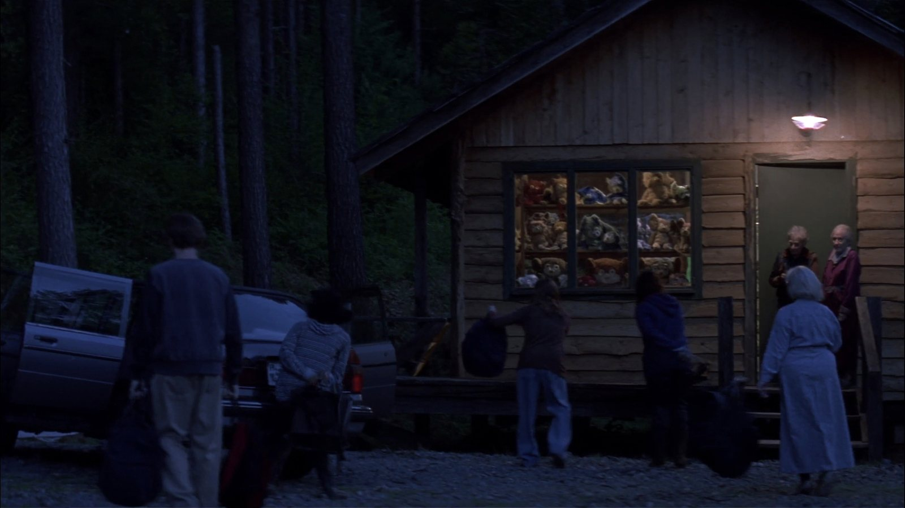

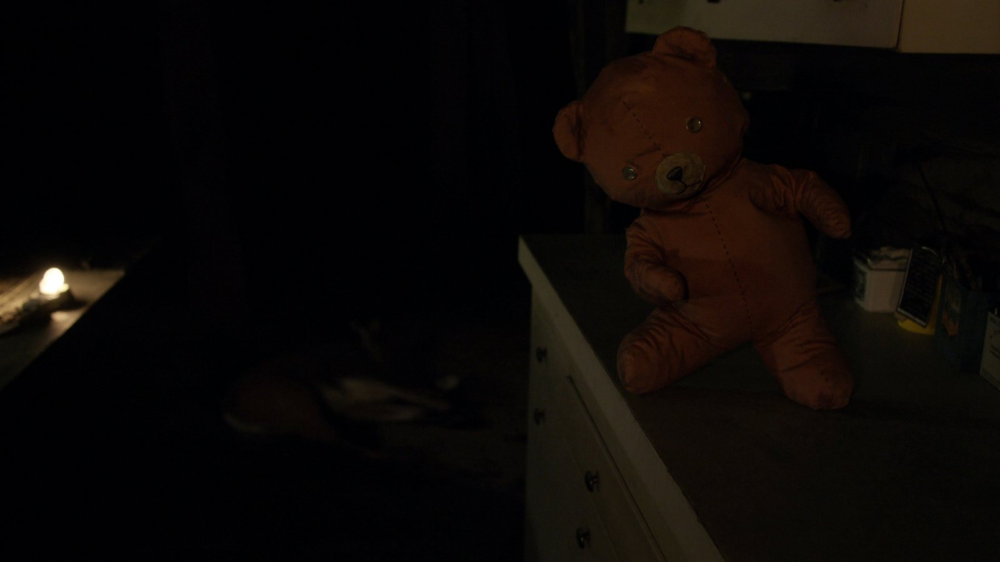

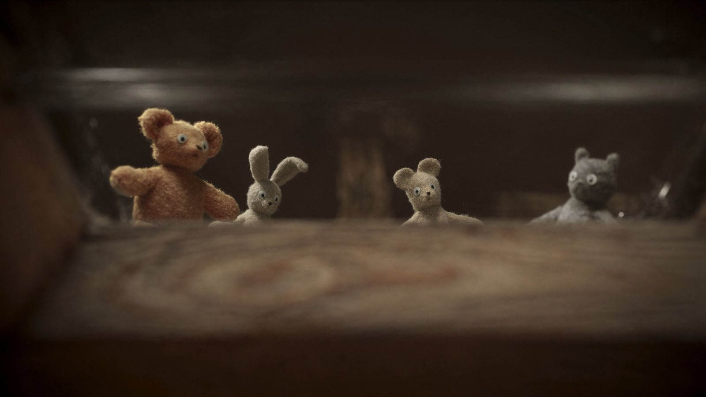

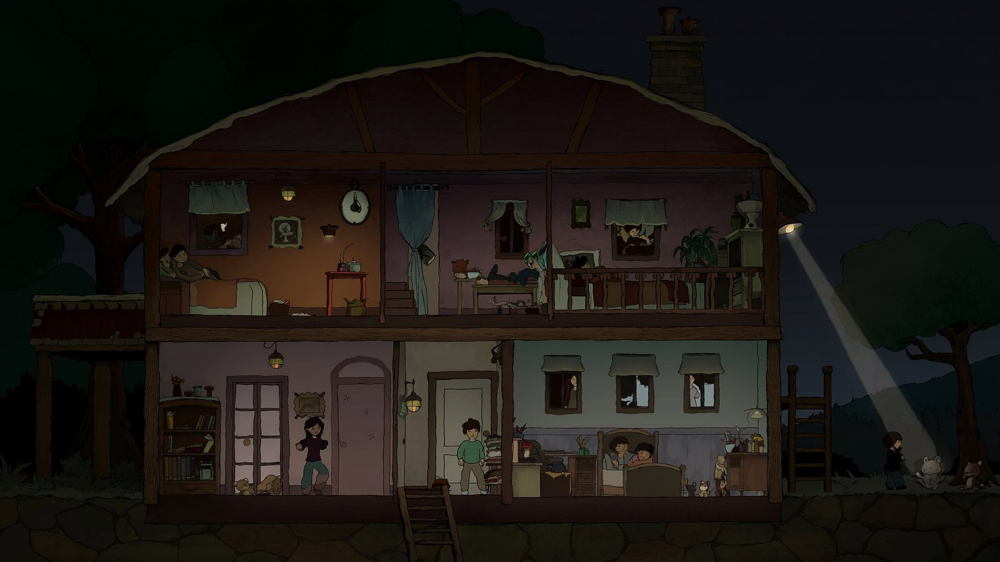

## 2. Behind the Peephole

Every night runs the same loop: the office, the shift at the six lenses and in the passage, then the Statement and the Mosaic. On night seven the knock comes at your own door. In 3D the camera pushes into a brass rose (the 2D eye) or into the desk, the card table or the cork board (the 1D pages), and pulls back out. The passage flattens side-on into the corridor race. A run with no special plan ends at dawn with the last lens.

| # | Layer | Scene | Shot | Beat | Into next | Still |
| --- | --- | --- | --- | --- | --- | --- |
| 1 | 3D | `n1_arrival` | The staff alley at 22:35 in rain and sodium light; the staff door; the service stair | Lew lets you in and leads you up one flight | Fade |  |
| 2 | 3D | `n1_passage` | The valet passage, 64 m long, six brass roses lit along one wall | Lew leaves; you walk west to 406's rose; the prompt "Look" | Push-in on 406's rose | [01-service-corridor](../games/behind-the-peephole/reference/01-service-corridor.jpg) |
| 3 | 2D | `n1_first_look` | The eye: empty 406, the river report on the TV, one paper boat on the sill | You learn to look; the bell rings four times as a test | Pull-out |  |
| 4 | 3D | `n1_office` | The old linen room: a green desk lamp, the bell board, six guest cards, a locked drawer | The phone at 22:58: Wren says "Log the returns. Only the returns." | Push-in on the desk drawer |  |
| 5 | 1D | `n1_drawer` | Lockwork: a three-pin tumbler, world paused | Pick it; inside, the logbook and the deck | Pull-out |  |
| 6 | 2D | `n1_shift_eye` | The eye at 402: a guest at her own door with her keycard | "A trembling hand holding a keycard": it drops twice; the chain goes on seven times | Pull-out | [02-eye-at-the-hole](../games/behind-the-peephole/reference/02-eye-at-the-hole.jpg) |
| 7 | 1D | `n2_patience` | Night Patience on the card table, the clock running at 10× | A card from another deck: "They see the dark." | Pull-out |  |
| 8 | 2D | `n2_shift_race` | The passage side-on: six doors, the light-well windows, the pipe run, Dora's trolley | Two bells at once (405, then 406); pass the maid unseen to make both doors | Push-in on the desk (the Statement) |  |
| 9 | 1D | `n6_mosaic` | The Mosaic: guest cards, pins and red thread on the cork board | Thread one payer to all six rooms, then Wren to you | Pull-out | [08-the-mosaic](../games/behind-the-peephole/reference/08-the-mosaic.jpg) |
| 10 | 1D | `n7_account` | The Account on the desk before the shift | Wren: "The file closes tonight." Write the Account before the shift; tonight you only confirm | Pull-out |  |
| 11 | 3D | `n7_your_door` | The office at 02:14: a brass rose in your own door, lit from outside | Three knocks; an eye at the lens; "A trap." You stay at the desk, and the log goes down the chute at 05:00 | Fade |  |
| 12 | 3D | `dawn_lobby` | The lobby at 06:00 from the mezzanine rail, grey river light | The guests leave in the order the file predicted | Fade |  |
| 13 | 2D | `end_next_watcher` | The eye at a lens in the passage, looking into your lit office | The Next Watcher: a figure at the desk writing the log lifts its head toward the rose, face still in the lamp's shadow | Fade (end) | [11-the-knock](../games/behind-the-peephole/reference/11-the-knock.jpg) |
| E | 3D | `end_under_door` | The passage at 05:00: six dark roses, every room empty, seven paper boats on 406's sill | Under the Door: the pages have gone under the doors; three knocks at the office door behind you | Fade (end) |  |
| E | 3D | `end_wrong_picture` | The lobby floor by the desk | The Wrong Picture: a guest who did not do what you wrote is led out and looks up at the fourth floor | Fade (end) |  |
| E | 3D | `end_open_door` | The river wall at dawn, beside Fenn | The Open Door: you count the fourth-floor windows, and one is dark | Fade (end) |  |
| 14 | 3D | `n2_seventh_bell` | The office from the door, looking back at the bell board: seven pulls, six numbered, one bare | Night two, leaving for the shift: the bare pull rings once, and no bulb lights | Push-in on 402's rose |  |
| 15 | 3D | `n3_tea` | The office at 01:00 on night three, from the chair, facing the door to the passage; Lew's tray on the desk | Lew talks; trolley wheels stop outside the door for a minute, then go on | Push-in on a rose |  |
| 16 | 2D | `n4_sitting` | The eye at 403, 03:40: tonight's picture pinned facing the rose, the valet door with the rose a black dot, pencil underneath | Mara looks straight in. Step back and she writes "gone"; hold, and the catch ring closes on her eye. Two taps: darken the rose twice for yes | Pull-out |  |
| 17 | 2D | `n5_linen_count` | The passage side-on in the blackout: six coins of light, a candle at the open lost-property cabinet, Dora counting | "Somebody has to count what they leave." Move on her count, be still when she listens; at 406 for the knock, turn round: a seventh coin, in your own door, and a figure crosses it | Cut |  |
| 18 | 2D | `n7_own_lens` | Your own rose from inside the office at 2:14: the passage bowed in the lens, six roses down its length, an eye pressed close on the far side | Offered once the seventh row is stamped. Hold still under the look until the catch ring closes; or step back; or open the door | Fade |  |
| E | 3D | `end_sitter` | The lobby floor by the reception desk at 06:00 | The Sitter: Mara sets the case, her watercolours and your carbons in front of two officers and holds out her wrists; five leave by the revolving door. Last image: her painting of your door, the rose lit | Fade (end) |  |
| 19 | 1D | `n7_lever_lock` | Lockwork, FIG. 5: the office door's lever lock from inside at 02:00, case cover off, the rose lit 20 cm above the keyhole | A key turns from the passage side: Fenn's, last season's. Hold both levers in their gates while the bolt goes across; when the rose goes dark he is looking in, so freeze | Pull-out |  |

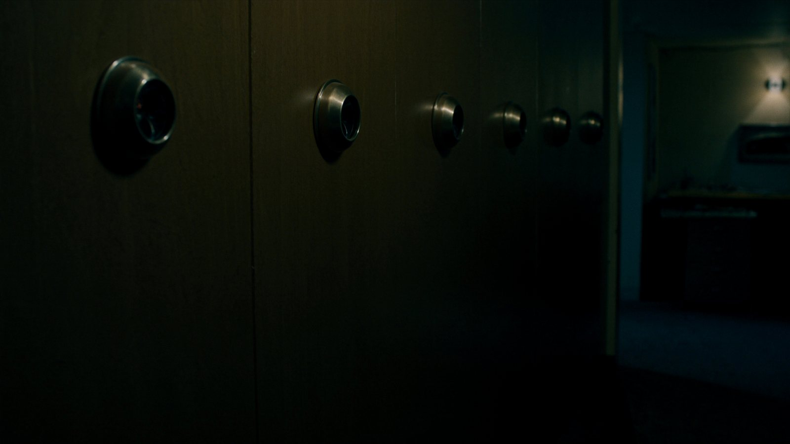

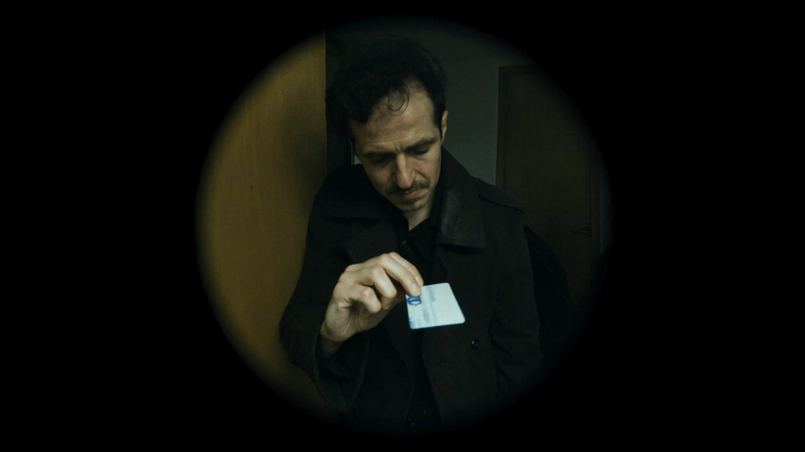

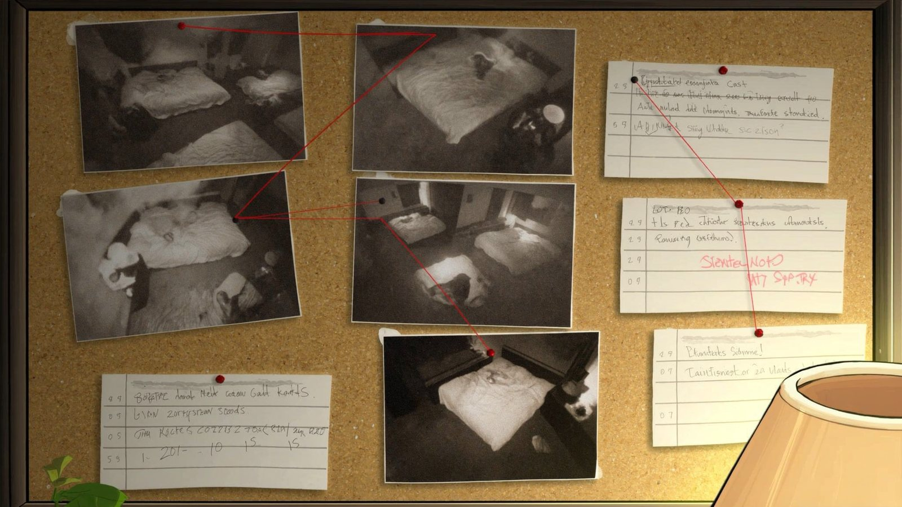

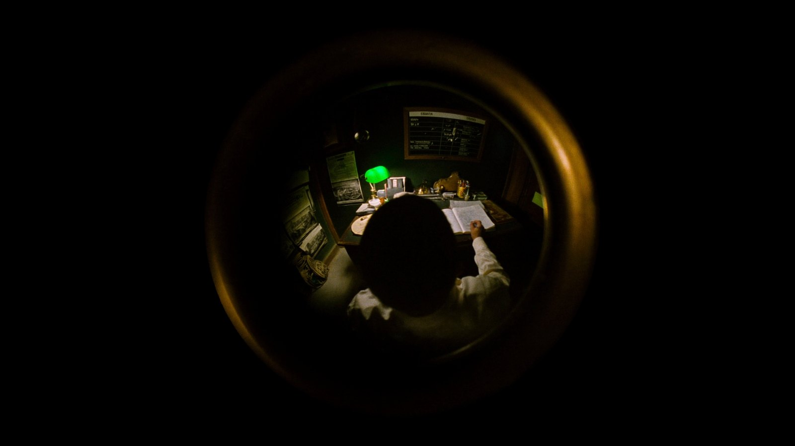

## 3. Missing Campsites

Three days in first-person 3D on a loop that loses sites between scenes; every record is checked on a 1D paper page (push-in from a table, a fire or the booth counter, pull-out back), and each night walk flattens to a top-down torchlit 2D loop. After the crossing the lost sites come back as tree glyphs in the 2D pattern walk, and the run ends in 3D at whatever the five sites held.

| # | Layer | Scene | Shot | Beat | Into next | Still |
| --- | --- | --- | --- | --- | --- | --- |
| 1 | 3D | `booth_day1` | 15:10, the van at the booth window; dust in the sun | Marisol hands over the paper map: "You're at the far end. Twenty through twenty-four." | Cut | [01-entrance](../games/missing-campsites/reference/01-entrance.jpg) |
| 2 | 3D | `loop_day1` | The loop road ahead of the idling van; the map lens raised | Posts 1–3 printed on the map, forest floor on the ground. "They just don’t exist." Photograph site 7 for Agnes | Cut |  |
| 3 | 1D | `reconcile_1` | The paper map and legend beside the notebook's Sites page | Three rows: Here, Gone, or Unknown, each written in Tam's hand; the first forecast | Pull-out |  |
| 4 | 2D | `torch_loop_1` | From above, a circle of torchlight on the road | Tick posts 19 to 4 down to the payphone; on the walk back 4, 5 and 6 are dark ground | Flatten | [03-torchlight-loop](../games/missing-campsites/reference/03-torchlight-loop.jpg) |
| 5 | 1D | `pack_list_1` | The fire ring from above, seats as cards | "I packed my bag." A blue kettle nobody added: catch it, or repeat it | Pull-out |  |
| 6 | 3D | `booth_day2` | Grey noon at the booth; the west leg ends at 12 | Marisol: "Numbering's always started at twelve." Write it down or accept | Push-in on the logbook |  |
| 7 | 1D | `rangers_book_1` | The logbook open across the page | Totals that do not add up; rebuild three missing rows | Pull-out |  |
| 8 | 3D | `dusk_choice` | Blue hour at the edge of site 20, the van | Rafe gives Tam the keys. No one is asked to stay; the Ashbys' lantern at 17 | Flatten | [08-five-sites](../games/missing-campsites/reference/08-five-sites.jpg) |
| 9 | 3D | `wrong_forest` | The five sites in even pearl light, trees beyond | "The sky is wrong." The phones show "no signal, no time, no date" | Push-in | [09-the-other-side](../games/missing-campsites/reference/09-the-other-side.jpg) |
| 10 | 1D | `foil_supper_3` | The camp table and cooler from above | Last breakfast from what came across, and things nobody packed | Pull-out |  |
| 11 | 2D | `pattern_walk_1` | From high above, sites 19 to 12 as glyphs of trees | Follow the path the trees spell by the Sites page; a wrong step whites out | Pull-out |  |
| 12 | 3D | `other_entrance` | An empty booth, a rack of maps showing 24 sites; headlights | Slipped Through: a car pulls in, and Tam says "You're at the far end. Twenty through twenty-four." | Fade |  |
| E | 3D | `other_entrance` | The guest at the booth window in the car's headlights | Brought Along: someone at home no longer knows to wait | Fade |  |
| E | 3D | `mothers_door` | Agnes's door in the evening | Held: Tam reads the site 21 line; Agnes: "That sounds like a lovely place." She does not know Tam | Fade |  |
| E | 3D | `drive_home` | The van on the highway; the notebook on the dash, shut | Nothing Missing: a seat with nobody in it; the radio gives the date | Fade |  |
| E | 3D | `recital` | A school hall, second row, a programme on the empty seat | The One Who Left: the notebook at Rafe's page: "Rafe. Four o'clock Monday. That's all I've got." | Fade |  |
| 13 | 3D | `channel_two` | Night 1, crouched at the crack of the split boulder at 21; torchlight, a green dial glow inside | June's walkie, on channel two, says the list half a second before she does, kettle included; the chain is on her forearm in biro. "It says the list before I do. I thought it was a kid." | Cut |  |
| 14 | 3D | `supper_for_two` | 17:30 at the booth window; the counter light on by itself, headlights from the lot | Ruth with a covered dish and a recipe tin: a list in Marisol's younger hand, five names. A grey car in the pull-in that belongs to no site, its door unlocked | Cut |  |
| 15 | 3D | `past_the_window` | The other entrance in pearl light, from behind the five on the road; the booth window lit amber from inside, nobody in it | Unlisted. The notebook went on the second fire, so nobody can say the line. The car's headlights pass the lit window, and the five walk on past it, together, up the road into a world that is not theirs, with no proof of anything | Fade |  |

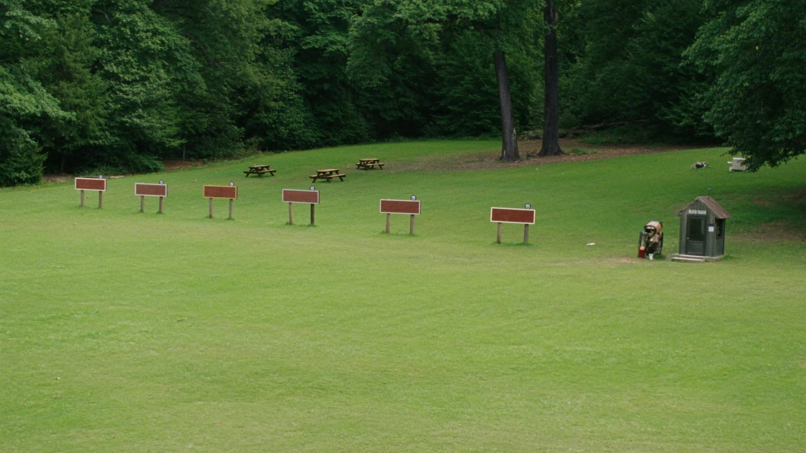

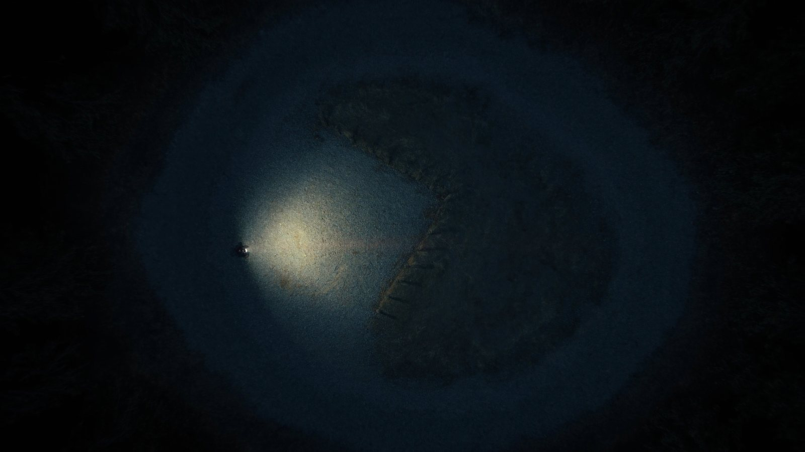

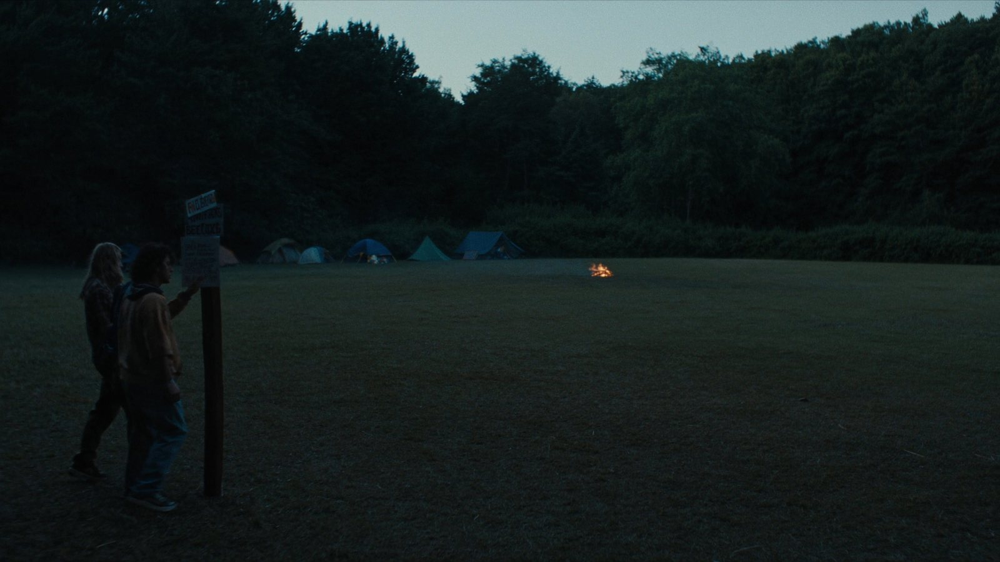

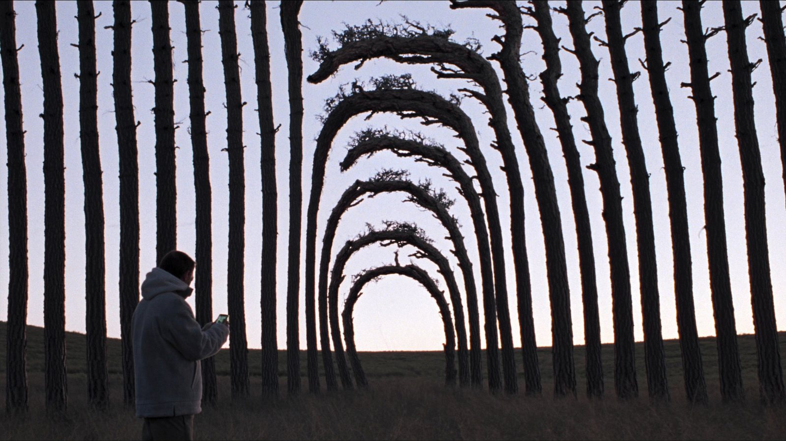

## 4. The Redacted Testament of Lira Calyx

A 3D cold open in the archivist's tunnel pushes into the journal, and each of Lira's four books then walks 3D places that push in to 1D journal pages and flatten into 2D cross-sections or the lens. After the choice on the Node Board, the playable epilogue hands the book to the archivist, and the run ends at one of four desks, the author's own last.

| # | Layer | Scene | Shot | Beat | Into next | Still |
| --- | --- | --- | --- | --- | --- | --- |
| 1 | 3D | `co-tunnel` | A lamp cone in fresh rubble under Peak 12; the journal lies open | Dust falls on a 7-second rhythm; the last line is torn: "the Peaks are—" | Push-in on page 1, which becomes the terrace | [14-the-torn-journal](../games/lira-calyx/reference/14-the-torn-journal.jpg) |
| 2 | 3D | `b1-terrace` | Hollin Terrace by day, three tiers over a rope bridge | Lira counts Ridgeback Striders with Pell and sets the flood-siren baseline; Joren shows the relay mast | Push-in on the specimen shelf | [01-terrace](../games/lira-calyx/reference/01-terrace.jpg) |
| 3 | 1D | `b1-key-1` | The Key: a specimen card and a branching key in Lira's hand | The juvenile Ember Wolf pelt breaks the key; Lira writes a new couplet | Pull-out |  |
| 4 | 3D | `b1-valley` | Night; Spore-Weaver webs pulse cyan across the valley | Pulsing "like a single organism": Pattern α, node N1. Page 47: "Phase offset miscalculated. Re‑sample at 0.5 s resolution." "Who wrote this?" | Flatten | [02-pattern-alpha](../games/lira-calyx/reference/02-pattern-alpha.jpg) |
| 5 | 2D | `b1-climb` | The mountain in cross-section, the altitude scale filling | Juvenile Ember Wolves at 2,600 m, too high; at the top, the Aether-Vine azimuth: node N2 | Fade |  |
| 6 | 2D | `b1-lens-1` | Under the lens: the fragment's micro-filaments scroll past | Steer the focus down to a lattice too regular to be natural | Pull-out |  |
| 7 | 1D | `b2-assay-2` | The Assay: a spectrum strip and a cuvette from a Lowland well | Isotope ratios that are not natural: "evidence of deep‑earth seeding", node N5 | Pull-out |  |
| 8 | 3D | `b2-lab` | The corporate lab after hours, guard lamp cones in blue-white halls | The scrap behind the console: "She’s close. Move the logs." | Push-in on the fragment under the lab pulse |  |
| 9 | 1D | `b3-cipher-2` | Storm-Song Cipher: Mara's song on a staff beside the peak map | The Peakborn "sing phase offsets that match AFU spikes"; the song decodes into nodes N7 and N8 | Pull-out |  |
| 10 | 3D | `b3-city` | The subterranean city in core glow; a hooded archivist in the record hall | A misfiled coordinate card in the margin hand; Joren leads the guards in; Lira runs with the Second Genesis logs | Flatten |  |
| 11 | 3D | `b4-core` | The crystal cavern under Peak 12, Veylor by the emitter array | "the old world was weak; a hard reset is a mercy." | Push-in on the board table | [12-the-core](../games/lira-calyx/reference/12-the-core.jpg) |
| 12 | 1D | `b4-board-core` | The Node Board: twelve nodes on a contour map, Veylor's seeds hidden | Place the emitters; at the end, Trigger the pulses | Pull-out |  |
| 13 | 3D | `b4-collapse` | Strobing core light down 200 m of shearing tunnel | Some nodes damp, others amplify; a partial fracture; Lira cornered at a sealed exit as her lamp goes out | Fade |  |
| 14 | 1D | `ep-audit-3` | Journal Audit as the archivist: eight spreads, twelve black bars | Restore the testament; decide which names stay black | Pull-out |  |
| 15 | 3D | `end-written` | The archivist's desk under a single lamp | "If you are reading this, you are a target." Close the book or keep going; a knock | Fade |  |
| E | 3D | `end-in-time` | A safe room in morning light | The archivist reached her at the north shaft; Lira writes her name on the cover; "You are one of us now." | Fade |  |
| E | 3D | `end-resilience` | A sterile Continuum catalogue hall | She stood down; the Peaks reset; Lira catalogues the new world under the seal | Fade |  |
| E | 3D | `end-fire` | Ash over the rubble of the Mid-Slope terraces | Kade's charges took the core; the archivist digs the books out beside silent water lifts | Fade |  |
| 16 | 1D | `b2-excision-desk` | Journal Audit from the other side: a steel desk seen from above under one cold lamp, hands only, her typed brief, a black pen, a rule, a seal press | The midpoint. You are the clerk. Cover every flagged station: cut only the word and the supervisor looks up, or rule the whole line to the length on the crib in the drawer | Cut |  |
| 17 | 1D | `b3-three-nights` | Journal Audit at the hideout table, one bulb; five lines from the last hour under the loupe | "I have not slept in three nights." The loupe reports an uncrossed seven on her own line; only the field card, the clock and physics still tell hands apart. "Or maybe it’s him. Or maybe it’s me." | Flatten |  |
| 18 | 2D | `b3-dream-slide` | Under the lens, a slide she never mounted: every cell seeded, ghost filaments flickering | Hold the cross-hair on "a 0.003 lux fluctuation at 12 Hz" for ten seconds; at ×1 600 the lattice is ruled lines and a maker's mark, a 9 | Fade |  |
| 19 | 1D | `b4-route` | Storm-Song Cipher on the bench before the descent: twelve strips of ruled bar laid under the red staff, the peak map below | The long puzzle's last step. Each surgical bar's line is a bearing and its length its rests; walked from the core, the twelve end at the north shaft. Whoever ruled them drew her a way out | Pull-out |  |
| E | 3D | `end-errata` | Hollin Terrace at violet storm dusk, shuttered and empty, lanterns climbing the far path | Errata: she did not fire. She pins the correction to her own model, unsigned, to the relay mast while the front takes the upper tier | Fade |  |

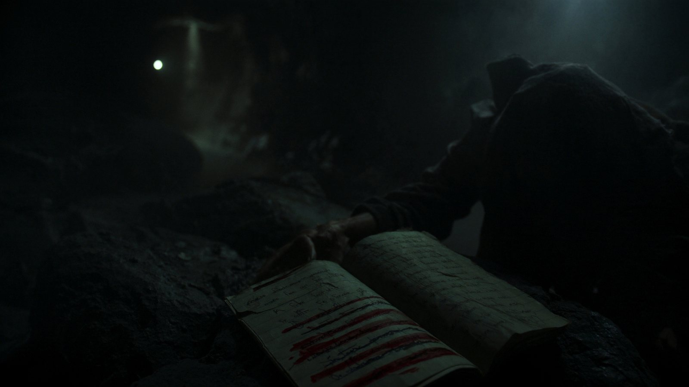

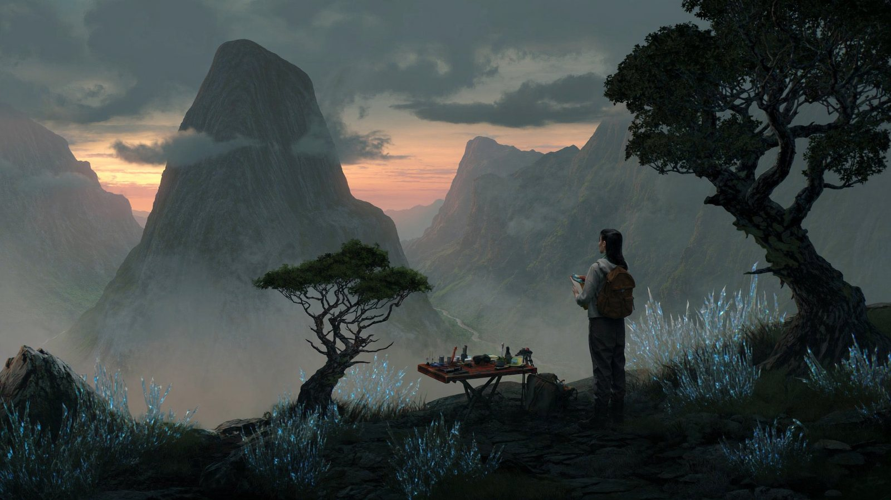

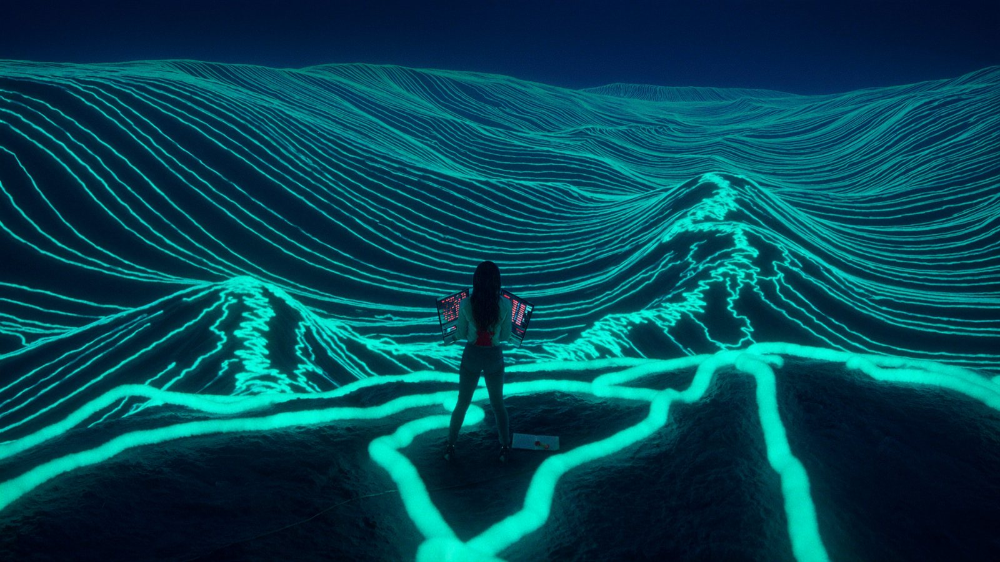

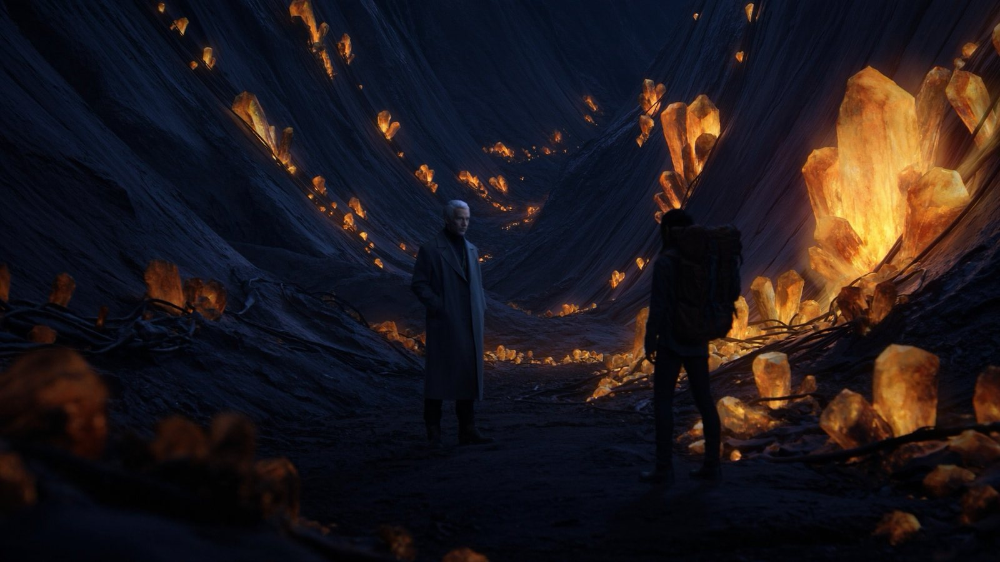

## 5. WrymWretch

Six one-pair prologues, each a 3D realm that pushes in to its own 1D game or flattens into a run or flight, then the party gathers at Wrymreach, and Act III (added) ends at the choice in the heart of the wound. None of the four endings is the author's; a first run that keeps watch ends in The Rememberer.

| # | Layer | Scene | Shot | Beat | Into next | Still |
| --- | --- | --- | --- | --- | --- | --- |
| 1 | 3D | `s_cedar_grove` | Thalen at a tree split from within, black ichor, moss greying | The moss falls to dust "that didn’t even remember how to be soil" (WW 33); "Western Groves" fades on the map | Flatten | [01-the-split-tree](../games/wrymwretch/reference/01-the-split-tree.jpg) |
| 2 | 1D | `s_conc_ward` | Cards of the fevered sky-elves' faces and names | Concentration I: match each face to its name before it blanks, as "Remember me." (WW 49) threads the wind | Pull-out |  |
| 3 | 1D | `s_heart_rekindle` | The dying Heartstone and a tuned shard | Heartstone I: Rhyla keeps one memory: the founding, the vision, or the Stonekeepers' song | Pull-out |  |
| 4 | 3D | `s_seabed` | The seabed in lantern light, a monolith in the silt | Lunessa swaps lantern-crystals to reach "a monolith carved with symbols her mind refused to hold" (WW 71) | Push-in on the monolith | [06-the-monolith](../games/wrymwretch/reference/06-the-monolith.jpg) |
| 5 | 1D | `s_glyph_monolith` | The monolith's face as a page of slipping glyphs | The Slipping Glyph I: three rows read by what stays; the fourth cannot be read | Flatten |  |
| 6 | 3D | `s_forbidden_chamber` | Candles flare over a pedestal of bone | Kael reads "When the last memory fades, the Astral Architect shall rise." (WW 77); THE NAME enters the Record | Cut |  |
| 7 | 1D | `s_chart_priory` | The Priory's star dome as a chart | Star Chart I: as the third constellation closes, the lines become "The Sigil of Izladar." (WW 87) | Pull-out |  |
| 8 | 2D | `s_flight_six_roads` | Side-on: six pairs over a fading painted map | Twin flight VII: each pair flies its own road, then all six in formation through gates that need the right dragon in front | Flatten |  |
| 9 | 3D | `s_rim` | The Rim of Wrymreach: astral winds, wyrm bones, the six landing | The six meet and name themselves; a shared dream scouts the ambush | Cut | [11-wrymreach](../games/wrymwretch/reference/11-wrymreach.jpg) |
| 10 | 1D | `s_realms_stonekeepers` | The hex board at a Moot elder's table | Six Realms II: one watch of the night spent winning a tribe's trust | Pull-out |  |
| 11 | 2D | `s_run_bone_bridge` | Side-on: a bridge of wyrm ribs erasing behind | Forgetting run III: escort Ilvarra across before the Remnants unwrite it | Push-in on Ilvarra's memories |  |
| 12 | 3D | `s_choice` | The heart of the wound, the King and Queen's statues | Three answers: keep watch, speak his whole name, give back the bond | Fade | [14-the-veil](../games/wrymwretch/reference/14-the-veil.jpg) |
| 13 | 3D | `s_end_rememberer` | The keeper pair alone with the statues, years after | The Rememberer: one pair stays to hold the name; the seal holds and the world slowly remembers | Fade |  |
| E | 3D | `s_end_whole` | The six realms in whole colour | Remembered Whole: the world remembers who he was; the voice finishes its sentence; the dead stay dead | Fade |  |
| E | 3D | `s_end_dormant` | Six realms, one shot each, no dragons | Dormant Again: the bonds are given back; Thalen tracks a silver-antlered stag, alone | Fade |  |
| E | 3D | `s_end_architect` | The sky above the realms, full of nameless stars | The Architect Rises: too much was forgotten, and the shape Rhyla saw steps through | Fade |  |
| 14 | 3D | `s_empty_saddle` | The Bone Choir with its door open; one rib paler and newer than the rest, a dragon-rider's saddle on the floor beside it with nothing in it, one ember-orange glow | The Empty Saddle: the rib is not ancient. If it was tuned the hall holds a seventh note. Ilvarra says whose it was: Tarn, and the name inside the Unwriter's mask, Dorrin Vael | Push-in on the door's seal |  |
| 15 | 3D | `s_last_witness` | The edge of the heart of the wound: the six pairs small under the veil, the Record open in the lead elf's hands, the statues still far off | The Last Witness Is the Prisoner: the voice says "I… remember…" and stops. The party Retells his name to him, as it did for forgetful elders | Fade |  |
| 16 | 3D | `s_end_saddle` | The heart of the wound at night: between the King's and the Queen's statues one small seated figure, back to us, faces the column of violet-white light; sun gold and moon silver meet on him, one ember glow where a saddle would be; an open book beside him | Ending, The Empty Saddle (phase 3): Dorrin Vael, reminded of his name and Tarn's, takes the watch. He has nobody to go home to. Last image: the Record's final page, headed "Who next?", empty | Fade (end) |  |

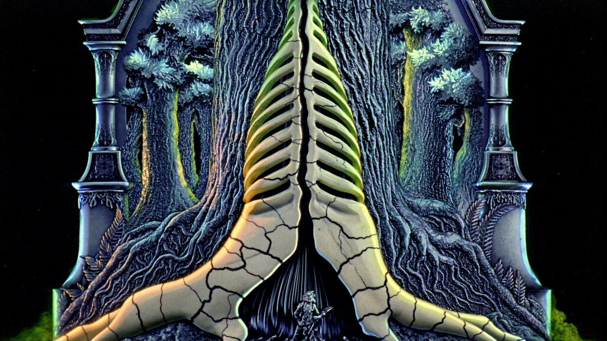

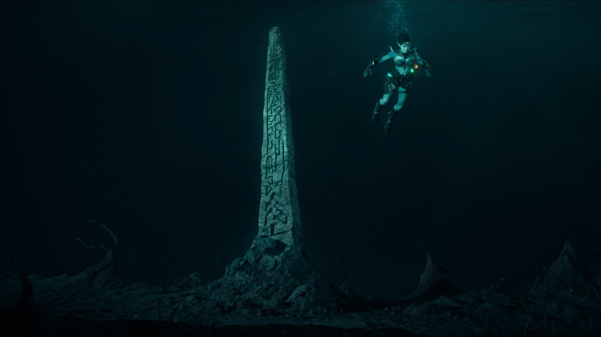

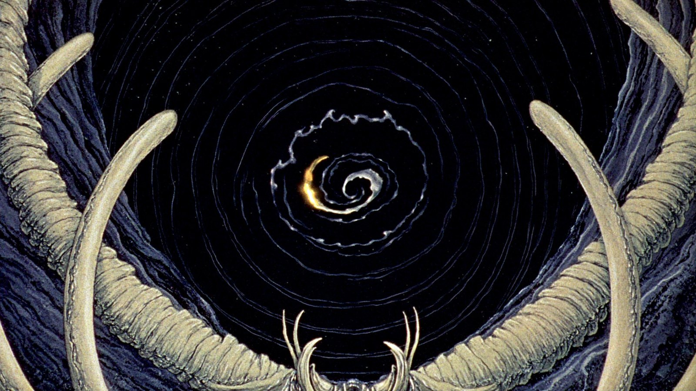

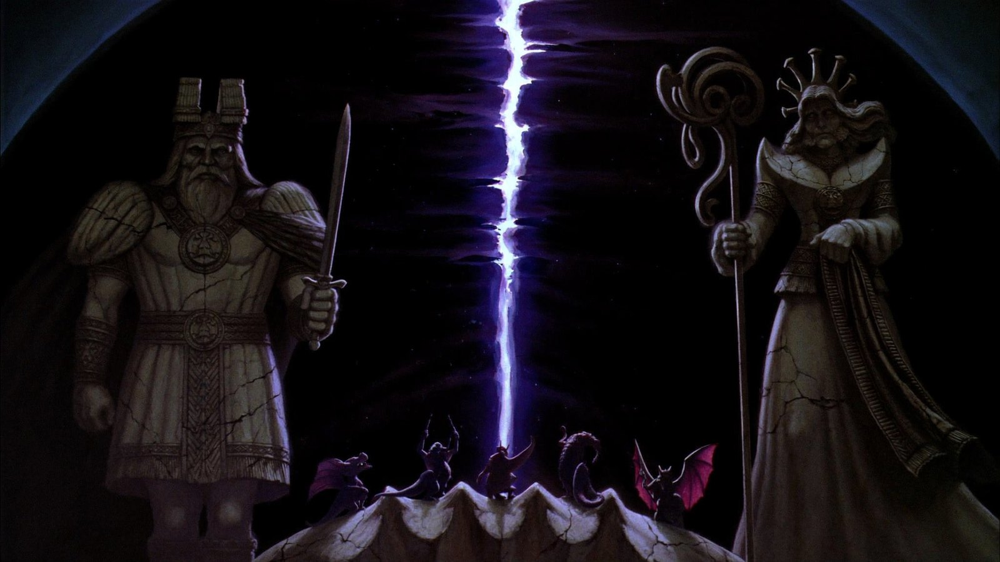

## 6. Project: Man Eater

Seven days on one clock, then one of four endings: each day the 3D base pushes in to a 1D page (the Chart, the Tray, Floor Plan, Short Rations) and pulls back out, and each night the bunk door flattens into a 2D run (Silhouette halls or Snow line) that fades to morning or pulls out into a 3D place. This first run eats what is served and follows the call with Jax on night 7 to The Zoo; the other three endings are the E rows.

| # | Layer | Scene | Shot | Beat | Into next | Still |
| --- | --- | --- | --- | --- | --- | --- |
| 1 | 3D | `c1_truck_gate` | From the truck bed: snow, the gate opening, armour plates bolted on its inside | "the facility is heavily armored but not to keep things out, but instead to keep them in." The list's first entry | Cut | [01-the-base](../games/man-eater/reference/01-the-base.jpg) |
| 2 | 3D | `c1_halls` | A hall at 1.66 m eye height, Sam ahead, claw marks high up, a lever at 2.4 m above a brass knob | "each about 4 feet wide but a whopping 15 feet high." | Cut | [02-tall-halls](../games/man-eater/reference/02-tall-halls.jpg) |
| 3 | 3D | `c1_bunk` | The bunk room; the rules card screwed to the door at the lever's height; the bunkmate already in his boots | Sam gives the three rules, word for word | Fade |  |
| 4 | 1D | `d1_tray` | The Tray: five pieces of pale meat, a timer, no orderly yet | "He didn't enjoy the taste, but he wanted more." Then the loaf: "They gave him a loaf of bread, which made him feel full" | Pull-out |  |
| 5 | 1D | `d1_rations` | Short Rations at a round table, six seats | Play for bread; the first bunkmate slides his to Fisk | Pull-out |  |
| 6 | 3D | `n1_bunk_call` | The bunk at night, the clock face at 10:00, breath in the air | "Low melodic groaning, almost flute-like". "Stop him" and "Say something" fade unpressed: "Fisk didn't even try to stop his bunkmate." | Fade |  |
| 7 | 2D | `n2_halls` | The tall halls side-on, black silhouettes against moonlit cream walls | Night two: past one guard to the latrine; a wet print 40 cm long freezes as Fisk watches | Fade | [06-silhouette-halls](../games/man-eater/reference/06-silhouette-halls.jpg) |
| 8 | 2D | `n3_snow` | The yard from above, the searchlight sweeping, Fisk's prints behind him | Snow line to the kennel shed: collars on hooks, the first bunkmate's boots, laces still tied | Fade |  |
| 9 | 1D | `d4_floorplan` | Floor Plan: the ground floor drawn from memory, its east side open | The halls do not close: 18 to 24 paces are missing | Pull-out |  |
| 10 | 1D | `d5_chart` | The Chart, the orderly's clipboard left on the scale | Fisk's numbers sit on a printed target curve, marked *on schedule* | Pull-out |  |
| 11 | 3D | `n7_windigo` | Night seven, round the last corner with Jax: a long pale shape backlit against frost, 6 m off | "Beware the Windigo, for I am he. Follow in my footsteps, and you will become me." A gust of mist; cloth, gas, black | Fade | [09-the-flute](../games/man-eater/reference/09-the-flute.jpg) |
| 12 | 3D | `e_cave` | Tied to a stalagmite, the camera fixed; Sam steps out of the dark at 4 m | Fisk: "We are not Windigos, nor will a single man in his right mind eat another human." Sam: "we won't make the same mistakes as we have with the rest." | Fade |  |
| 13 | 3D | `e_zoo_wake` | A white room; the camera cannot rise; Fisk's reflection in the door's small window, very tall, very thin | The Zoo (as written): "A tube ran through his arm." Caption: "He was like an animal in a zoo..." | Fade |  |
| E | 3D | `e_tree_line` | Dawn under the trees beyond the wire; Fisk's head among the low branches | Rule Three: his hands are not a man's; if Jax came, his prints stop in the snow behind. "Deep down, this would only spread." | Fade |  |
| E | 3D | `e_new_recruit` | The gate and the tall halls, a new recruit walking ahead; Sam at the hall's end | Call Me Sam: Fisk gives the three rules; the recruit answers "Sir yes Sir"; Sam nods | Fade |  |
| E | 3D | `e_transfer_truck` | From the truck bed, the gate closing, armour facing in | Transferred: too weak to be called, Fisk is driven out. If Jax is still on base, Sam in the hall: "your former bunkmate has been transferred, and he will no longer be stationed here." | Fade |  |
| 14 | 3D | `n3_glovebox` | Night three, from the snow at the open door of the truck parked under the north wall: the dark cab, one sodium lamp through frosted glass, the glovebox hanging open | The Glovebox: Duarte asked for his letter to go in the truck, not the sack. The glovebox is already full of letters, tied in bundles. Fisk lays Duarte's on top | Fade |  |
| 15 | 3D | `d6_next_week` | The cafeteria at breakfast on day six, 2.14 m eye height: an empty place on the bench, the hatch lit from inside, a tray pushed across the sill by a hand in a staff-grey sleeve | Next Week: Hollis's chair is empty in the morning, not at night. He is behind the hatch, and the gaze at the Tray is his | Push-in |  |
| 16 | 3D | `n7_set_down` | Night seven, from just inside the first trees, at 2.9 m eye height: one deep line of prints running back across the open snow to the wire and the searchlight | One Set of Prints: Fisk sets Jax down against a trunk with the list inside his coat, and turns back. The call pulling him home is heard, not seen (pending the consultant) | Cut |  |
| 17 | 2D | `n7_snow_back` | Snow line from above, Frame 112: the single line of deep prints, each one trodden a second time, toes turned for the base | He walks back in every print he made. The tower photographs one trail and types the caption: "No crossing." | Fade |  |
| E | 3D | `e_prints_bunk` | The bunk before dawn: Jax's bed flat and empty, snow melting off Fisk's boots by the door | One Set of Prints: he lies down; the door opens from outside; cloth, gas, black. Then the author's waking, unchanged | Fade |  |

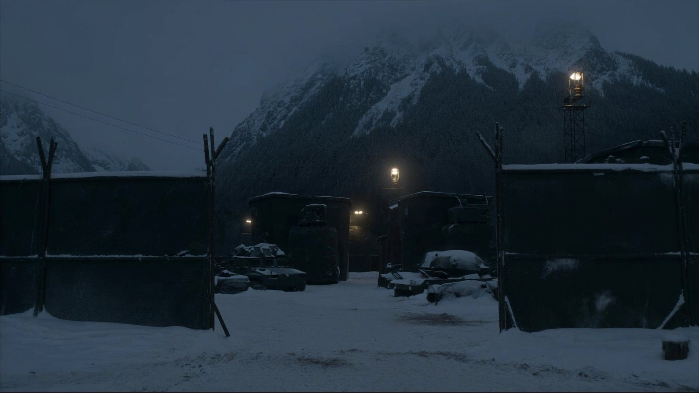

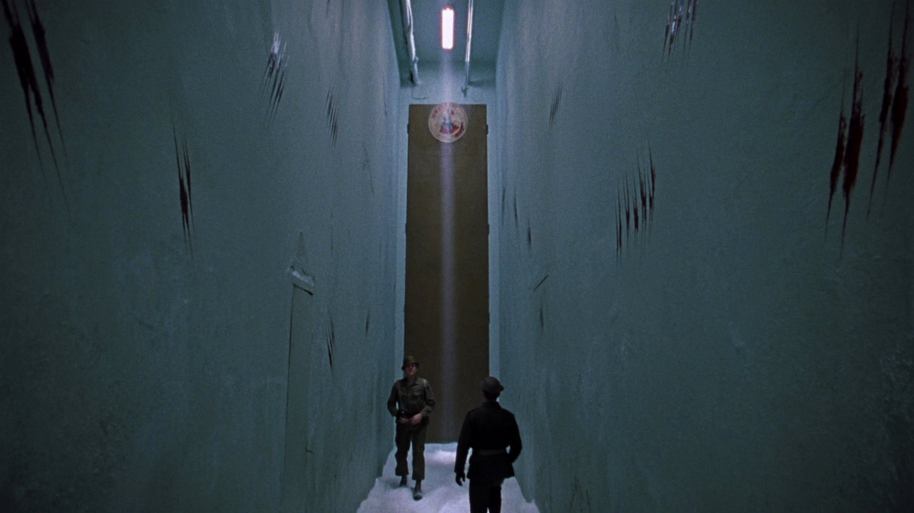

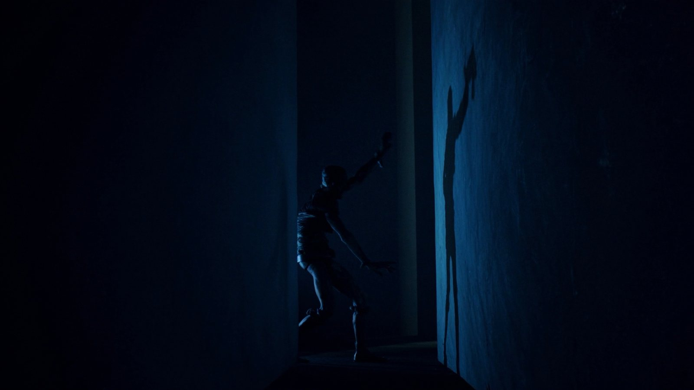

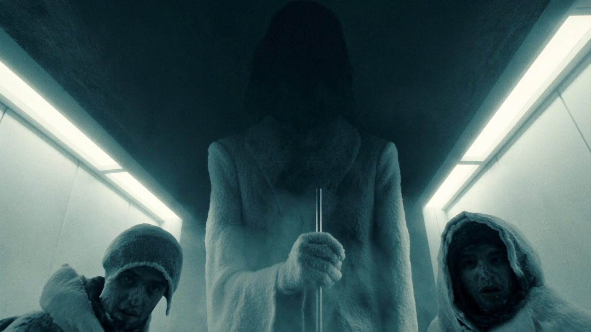

## 7. A Journey Into the Heartstream

One unbroken session on the heartbeat clock: the marrow chapters hand each 3D place to a 1D page by push-in and take it back by pull-out or cut, the climb and the river flatten into 2D, and the heart cuts each player to red and his own ending. Endings resolve per player as each client leaves the session, so one raft usually ends several ways at once.

| # | Layer | Scene | Shot | Beat | Into next | Still |
| --- | --- | --- | --- | --- | --- | --- |
| 1 | 3D | `s3_marrow` | Blue-lit marrow caverns breathing at 60 bpm; the hall of unfinished boards; the mark stone | The brothers wake, learn the pulse, choose a mark and a temperament | Push-in on the carving slab | [01-marrow-caverns](../games/heartstream/reference/01-marrow-caverns.jpg) |
| 2 | 3D | `s3_gallery` | The shedding gallery, chalky light, bone blanks on soft ledges | Find a good blank and your recipient's mark | Push-in on the blank |  |
| 3 | 1D | `s1_carve_gift` | A bone blank seen from above, grain lines, the chisel, notches for strokes | Too few strokes to make the tool perfect; cut his mark or not; then the exchange in the gallery | Pull-out |  |
| 4 | 1D | `s1_song_1` | A membrane of vertebra-like slots, each brother's phrases as beads | Compose verse one from the phrases hummed out of the singing hollow; everyone presses Sing | Cut |  |
| 5 | 1D | `s1_counters_2` | The bone board from above, your carved piece in your keep | Sow on the beat; mid-sowing, "The marrow lights dim."; one beat to pocket your piece or leave it | Fade |  |
| 6 | 3D | `s3_recognition` | The cavern of the elders dimming to 30%; arms reddening; the shaft opening; one empty seat on the bench | "The elders gather." Walk to the shaft and climb, or sit and stay; nothing prompts either | Push-in on the shaft mouth | [05-recognition](../games/heartstream/reference/05-recognition.jpg) |
| 7 | 2D | `s2_climb_2` | The shaft side-on, small figures, heat shimmer at the top edge, blue tint turning red | Holds firm only on the beat; brace and pull each other over the ledges | Flatten |  |
| 8 | 3D | `s3_river` | Crimson water between artery cliffs; the living raft at the bank | "It is not a tube. / It is a river." Board the raft, row and steer on the beat; one calm pool to talk | Flatten | [07-the-bloodstream](../games/heartstream/reference/07-the-bloodstream.jpg) |
| 9 | 2D | `s2_river_2` | The river in cross-section: raft above the surface line, glassy predators below, one beast's slow eye | The first patrol: row on the beat, lift from tendrils, hush when the eye opens | Flatten |  |
| 10 | 1D | `s1_chart_2` | Vellum membrane, vessels in red ink branching from the raft's glowing point | At the delta, three junctions, less time; each brother sets his piece on a branch; the raft keeps moving | Pull-out |  |
| 11 | 1D | `s1_song_2` | The membrane cut to four slots, the heart verse | Compose the verse that must end on height 1, home; its last note is the one to hold on | Flatten |  |
| 12 | 3D | `s3_heart` | The atrium: walls of muscle, beams of light, red turning gold | "The heart is not a chamber. / It is a cathedral." The song is sung back; grips drain and fail one per beat; voices are cut | Cut | [10-the-heart](../games/heartstream/reference/10-the-heart.jpg) |
| 13 | 3D | `s3_vessel` | A narrow vessel, one red glow; the player alone, holding the tool another carved for him | Carried Away (as written): the heart slows; "No one stays together." | Fade |  |
| E | 3D | `s3_vessel_two` | A shared chamber, two hands locked, two gifts, two glows | Two Together: they squeezed on the heart verse's last note; they hear each other and no one else | Fade |  |
| E | 3D | `s3_vessel` | The same narrow vessel, reached from inside the beast | Taken by the River: he watched the raft's glow draw away and rides on alone, still holding his gift | Fade |  |
| E | 3D | `s3_lamps` | The marrow lamps years on; a new group asleep in the alcoves; his group's unfinished board in the hall | The One Who Stayed: still blue, he dims the lamps; the child he taught may hold his counter and hum the song | Fade |  |
| 14 | 3D | `s3_stencil_gallery` | Above the last ledge: a long gallery, one tall wall of pale bone covered with hand stencils in rows of four, some rows with three; red-gold light from the far opening | The climbers walk the wall, pass a row with a gap, and stand together at the one bare row | Flatten |  |
| 15 | 2D | `s2_stencil_wall` | The wall flat-on in ochre and charcoal, four small figures at a bare row, the count of four over them | The Stencil Wall: all four press the bare row on one beat and the wall lights; the press sets the raft's sync. A group with a stayer leaves its own gap | Flatten |  |
| 16 | 2D | `s2_inspection` | The river in cross-section; the eye rises through the surface line, the only thing in the print that ever crosses it; four arms held out over the water | The Inspection: a raft that hushed perfectly is not passed over. Each brother holds his arm out, still, for four beats and is looked at, the bluest last. "It is not hungry. It is counting." | Flatten |  |
| 17 | 3D | `s3_backwater` | A still pool of flat grey-rose water under steady light, the living river's red through its mouth; an old grey raft moored at the wall, a board and four gifts on it, nobody | The Finished Board: every hollow empty, both keeps counted. Look at the keeps and the gifts; the raft rows back out to a fork three ways wide | Push-in on the chart |  |
| E | 3D | `s3_bank_years_on` | The bank of the Bloodstream in lower, steadier light; one raft at the landing, a pale patch on its flank with a mark healed into it | The One Who Stayed, the last image after the lamps: old, he climbs out of the shaft alone and lays a hand on his own mark; four small figures come out of the bone behind him | Fade |  |
| 18 | 3D | `s3_wall_at_night` | The small blue chamber of the pulse wall at night, lamps low; one old elder kneeling at the wall with a worn bone tool, tapping | The Wall at Night: the Lamp-Keeper taps for a raft that crossed long ago. Tap sixteen beats beside him and he turns his tool over: four signs over four beads, the last one home | Fade |  |
| E | 3D | `s3_vessel_open` | Looking along the narrow vessel, one red glow ahead; a red hand open, palm up, the gift lying in it; with the old phrase sung, a cold blue wall at the far end with an old mark in it | The Open Hand: he went first, by choice, and his grip passed to the brothers either side. With the old phrase sung he cuts his mark beside the old one | Fade |  |

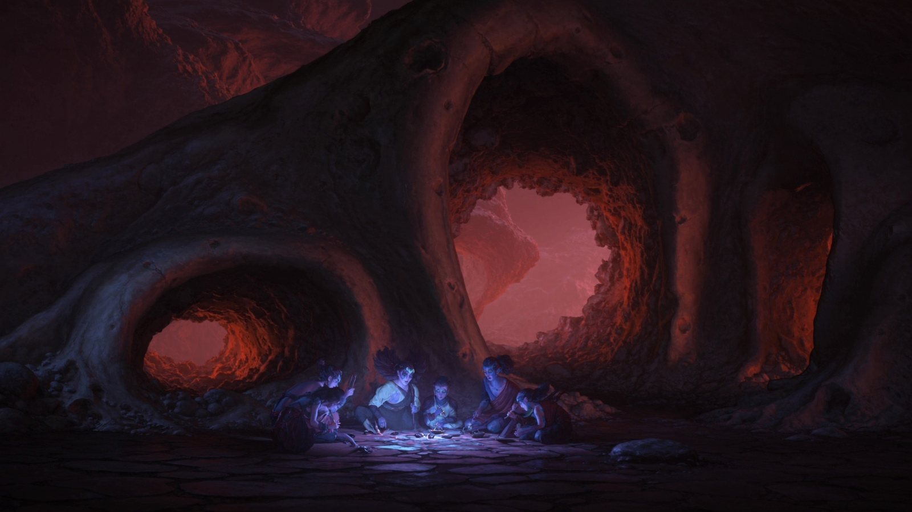

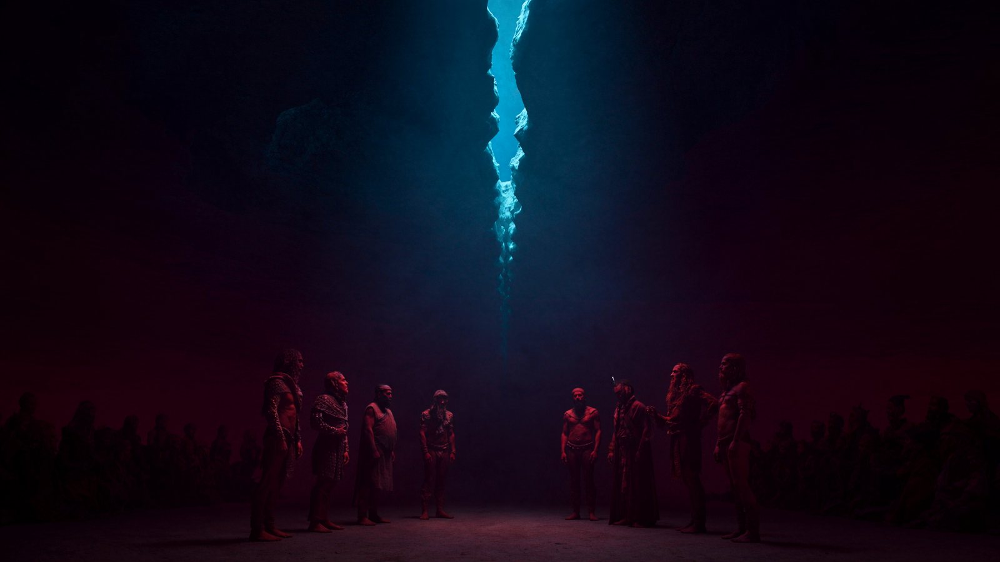

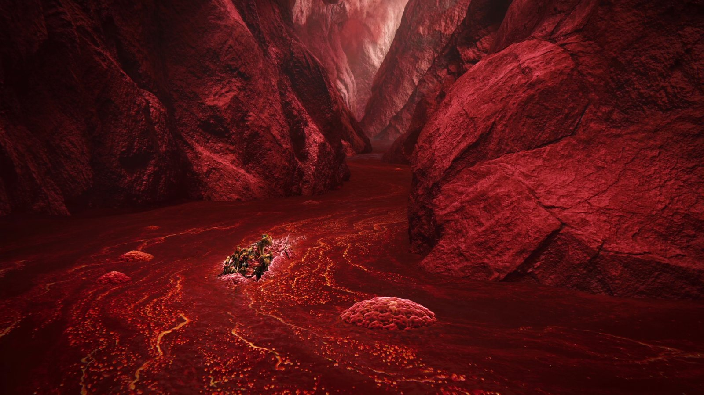

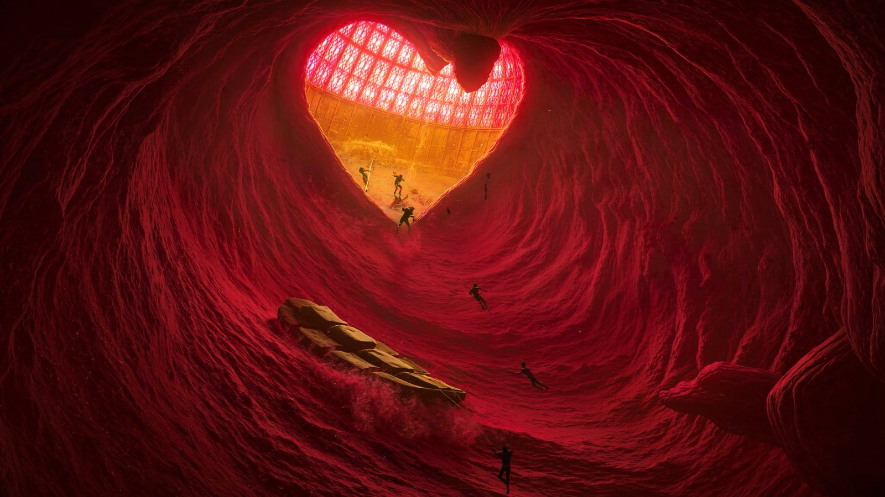

## 8. People of the Bark

One year on the bark, Tremor to Shadow, seen from the 3D god camera, which pulls back on Tab to show what really happened. Each event pushes in to a 1D bark-paper page and pulls back out, the cracks flatten into side-on 2D runs and defences, and the last pull-out rises to the backyard.

| # | Layer | Scene | Shot | Beat | Into next | Still |
| --- | --- | --- | --- | --- | --- | --- |
| 1 | 3D | `c1_city_dawn` | God camera on Highridge's grooves at dawn, glow-lichen lanterns | Wake the city, free Twig's kite, place the first sap tap; at 4:30 the Tremor, dust in sheets | Cut | [04-the-city](../games/people-of-the-bark/reference/04-the-city.jpg) |
| 2 | 3D | `c1_battlements` | Splinterwatch in dust-gold, shaking; then the camera rises to the trunk | Six warriors to the slots; first pull-back: "Meanwhile, the squirrel is just scratching an itch." | Push-in on Pell's spread | [01-the-tremor](../games/people-of-the-bark/reference/01-the-tremor.jpg) |
| 3 | 2D | `c2_run` | Side-on down the Long Crack to Lowridge | Mossa carries the year's reading; brace for the dawn tremor if the forecast was right | Flatten |  |
| 4 | 1D | `c2_kitchen` | Sap Kitchen: Old Resin's pot on bark-paper | Cook the spring sap into food; the Great Flake legend while it boils | Pull-out |  |
| 5 | 2D | `c3_beetle` | Crack defence, side-on: a beetle the size of a city in the crack | Read as monster, hold the lines; read as god, clear a lane and lay offerings | Flatten | [08-crack-defence](../games/people-of-the-bark/reference/08-crack-defence.jpg) |
| 6 | 1D | `c5_door` | The Ring Door: the Heartwood Door, five rings | Lay Pell in the heartwood and carve the living tree, or leave it sealed | Pull-out |  |
| 7 | 1D | `c5_tns` | Trunk and Shadow board at the winter festival | Twig adds a new piece, the Hand; winning rehearses the Shadow | Pull-out |  |
| 8 | 1D | `c6_scroll` | Tremor Scroll in late winter | A faint ripple at noon every seventh day, on all faces: forecast the next tread | Pull-out |  |
| 9 | 3D | `c6_shadow` | Zoom forced out; the dark crosses the bark west to east in 40 seconds | "It is enormous, stretching across their entire world." People to the knots; pull back: a hand, reaching | Flatten | [10-the-shadow](../games/people-of-the-bark/reference/10-the-shadow.jpg) |
| 10 | 1D | `c6_omen` | Omen Spread: the Reading of the Shadow | The heir lays one card of each sigil: a trial | Pull-out |  |
| 11 | 3D | `c6_stand` | Highridge and Splinterwatch in the dark, lit only by lanterns | The priests chant, the warriors stand ready, the scholars record | Cut |  |
| 12 | 3D | `c6_touch` | All the bark; the screen shakes on each tap | Three taps, a thumb pressed into a crack; it lifts away and light returns from the east | Pull-out |  |
| 13 | 3D | `c7_backyard` | The camera rises past the tree over an ordinary yard | A door closes; "Even the smallest world is a universe to the ones who live in it." | Fade |  |
| E | 2D | `c6_war` | Crack defence reversed: footholds up the knuckle | The War on the God: the warriors climb, Burr strikes the fingertip; the lost go on the Roll | Flatten |  |
| E | 3D | `c6_edge` | God camera following Fenn's party along the shadow's edge | The Edge of the World: twelve stakes trace the Shadow's outline; Fenn draws the first map with an edge | Cut |  |
| E | 3D | `c6_touch` | The over-tapped plate from the people's side | The Flake: the press breaks the plate and a district comes away; cut before the fall | Pull-out |  |
| 14 | 3D | `c2_sorrel_wall` | God camera close on the lowest street of Lowridge, at the pale stretch of wall by the last lantern | Sorrel puts Mossa's ear to the wall; something in it ticks; Mossa stops counting. "You Highridge lot hear the Trunk when it shouts. Down here it mutters." | Cut |  |
| 15 | 3D | `c3_thumb` | Highridge square at the summer festival, warm evening; the camera pushes in to Pell's table | Twig deals an ugly hand for him; Pell gathers it up, "clumsy me", and deals again; his thumb finds the notch | Push-in |  |
| 16 | 1D | `c4_omen_pulse` | Omen Spread at night: the Pulse event card with no suit, the Crown already laid by the leading house | Hold Tab: a dark yard, one lit window, nothing moving; the Backyard card turns over blank. "Then for once we are holding the same hand." | Pull-out |  |
| 17 | 3D | `c4_faceless` | One lit shutter on Highridge's second terrace, copper dusk | Fenn unrolls the scroll the Scroll House forbids, a row of marks with no face, and asks, "Is it me?" | Flatten |  |
| 18 | 3D | `c5_lowridge` | Wide and tilted up the Long Crack in frost; the lowest street gone dark, a city climbing with its doors on its backs | The street has settled into a gallery; if Sorrel was not backed the Roll gains names; Mossa takes Pell's lantern and goes down against the tide | Flatten |  |
| 19 | 3D | `c6_ring` | God camera straight onto the east face as the dark comes back once, then lifts; a level band of red light lies across the whole bark | The hand went and comes back. When the light returns a band of colour circles the world, and the people come out of the knots and lift their arms to it, as to a covenant | Pull-out |  |

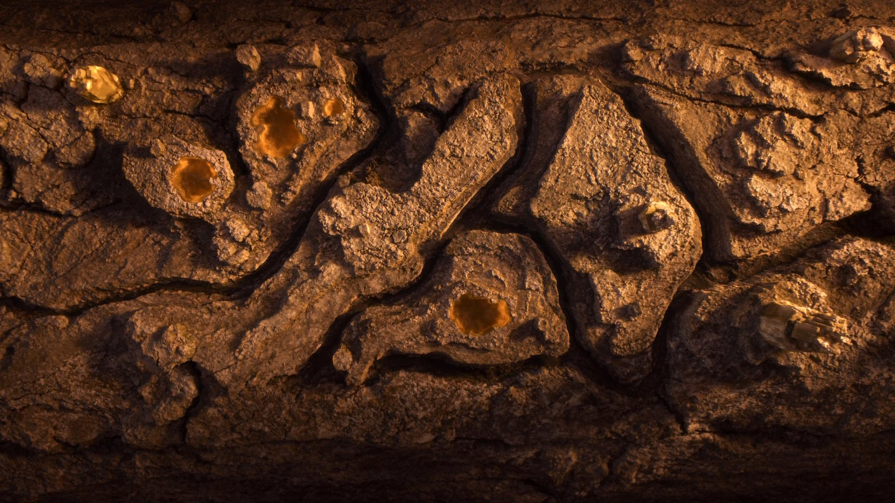

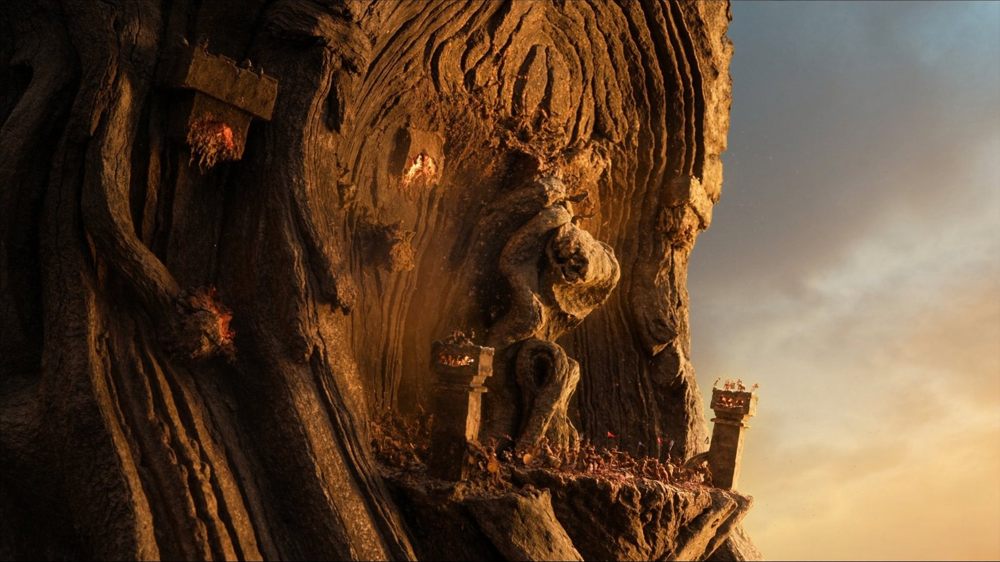

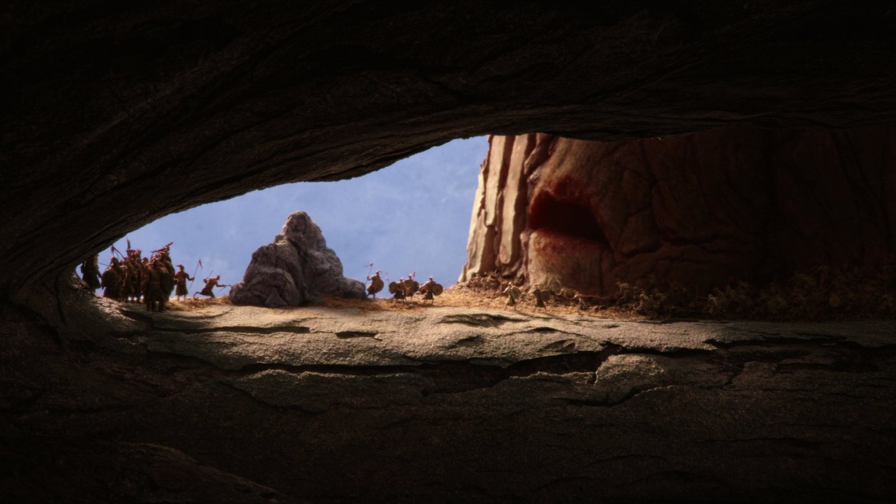

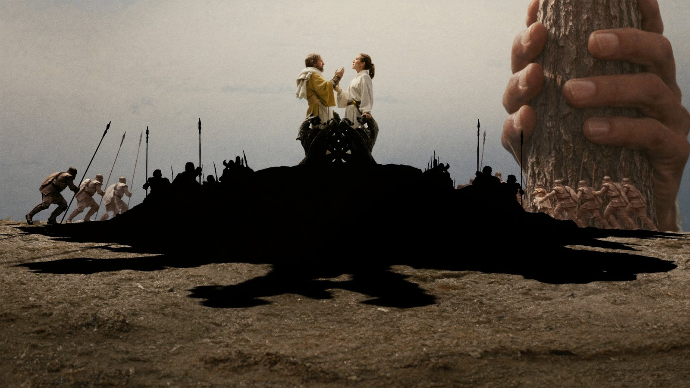

## 9. The Endless Temple

A temple hub in first-person 3D, where every brew is a 1D page that pushes into a book and every book is left by a pull-out back to the halls; inside the books, 3D flattens into the living illustration, and the hub's stacks flatten into 2D before pushing in on a clasp. The first playthrough ends on The Named Book; the other three endings branch at the herd and at the last cup.

| # | Layer | Scene | Shot | Beat | Into next | Still |
| --- | --- | --- | --- | --- | --- | --- |
| 1 | 3D | `s3_abyss_dream` | First person on a rock edge, blue-grey mist, near-black | "For in the great darkness, no light can be found…" A step past the edge | Fade |  |
| 2 | 3D | `s3_room_morning` | A sunbeam across the floor of a cluttered room, onto Elaris | Elaris wakes, an 8-foot elf in monk's attire | Cut | [01-elaris-wakes](../games/endless-temple/reference/01-elaris-wakes.jpg) |
| 3 | 1D | `g_tea_c1` | The pantry table from above: three jars, the cup, the kettle dial | The first cup for the nameless sand book: depth 3 or more | Push-in on the page |  |
| 4 | 3D | `s3_circle` | Firelit round hut, first person as Xandri among the children | "My hand shot up almost by instinct." The cane: "We do not ride on the backs of the gods." | Cut | [05-storyteller-circle](../games/endless-temple/reference/05-storyteller-circle.jpg) |
| 5 | 3D | `s3_moonlit_dunes` | Silver sand, purple vines, a wave of sand rising, seen in third person as the tea fades | "The sand washed forward like a crashing wave of water." The first mark | Pull-out to the halls | [07-the-sand-sea](../games/endless-temple/reference/07-the-sand-sea.jpg) |
| 6 | 2D | `s2_stacks_c3` | The stacks side-on, shelves without end, sand motes drifting | Follow the sand to the clasped shelf | Push-in on the clasp |  |
| 7 | 2D | `s2_li_c4a` | The book's drawn page: Xandri riding torrent waves on leaf shoes | Ride the leaves "that looked like the ears of the Zorlop" through the heat | Flatten | [08-living-illustration](../games/endless-temple/reference/08-living-illustration.jpg) |
| 8 | 1D | `g_tablet_c6` | The gods' rules tablet, eight rules, the Way tiles below | Leaves + follow the track + be named lost: the loophole, breaking no rule | Pull-out |  |
| 9 | 1D | `g_clasp_c8` | The black book's cover, frost on its straps, bolt and gears | Open the compound clasp: the Lantern Country (F6) | Pull-out |  |
| 10 | 2D | `s2_li_c9` | The herd's smooth track past the father's marker; the drawing runs off the right margin | Xandri follows the track past his father's mark | Push-in on the title page |  |
| 11 | 1D | `g_name_c9` | The sand book's title page, empty cartouche, sand in the gutter | Elaris reads it back "and find out what to call it": Inscribe | Pull-out |  |
| 12 | 3D | `s3_last_cup` | Seated at the reading chair, the cup in his hand | The tea thins: set the cup down | Fade |  |
| 13 | 3D | `e_named` | The shelf, the named spine beside yesterday's book | The sand stops; he shelves the book | End |  |
| E | 3D | `e_stayed` | The chair from across the room, the book open, the cup full | He drank with steep at 60 or more: nobody watching, a second book leaks | End |  |
| E | 3D | `e_rider` | The title page writing itself in a hand not Elaris's | Xandri climbed a Xandrix and rode into white; he does not come home | End |  |
| E | 3D | `e_returned` | The temple, the nameless book still sifting sand | Xandri turned back and became the storyteller; Elaris sweeps the sand | End |  |
| 14 | 3D | `s3_well_post` | Night in the village's open place, fixed from beside the carved well-post: the round shrine-store, its roof-gap dark, a full moon just clear of the post | Wordless. The watcher sees an arm go in at the roof-gap, and tilts up to the moon instead; afterwards a second leaf-cord hangs restrung at the store door | Cut |  |
| 15 | 3D | `s3_ledger_turned` | The pantry in late light through the jars, first person over the table, the kettle cold | Elaris turns the pantry ledger over: a count of days, "Day thirty-one…", stopping at forty. From here Look away is a standing verb inside books | Cut |  |
| 16 | 3D | `s3_ring_of_stones` | The father's ring of stones in the hour before dawn, the narration camera low and still beside the cold fire | Xandri lies down and does not get up. One prompt on the page: "One more page." It works: he rises without input and walks | Cut |  |
| 17 | 1D | `g_tablet_c8` | Straight on, close: a pale tablet cracked across one corner, one legible register and five worn nearly flat, the abyss's frost at its edges | The Keeper's Binding. "He was never to leave…": the binding says keep, and no rule says read. Look away, close, shelve | Pull-out |  |
| 18 | 3D | `e_unread` | Fixed, a few steps back from the reading table, the chair pushed back, nobody there; one sunbeam across the closed cover | The Unread Page: the sand book shut on a boy who is still walking, the empty Parting Cup beside it, and one woody leaf half out from between its pages | End |  |

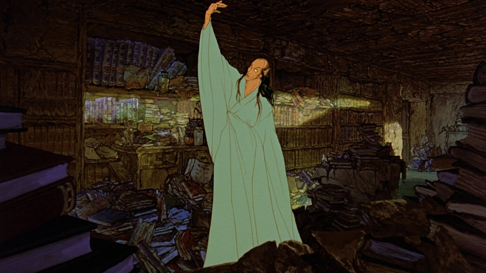

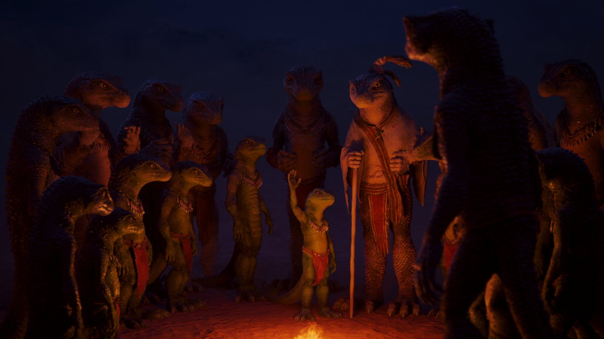

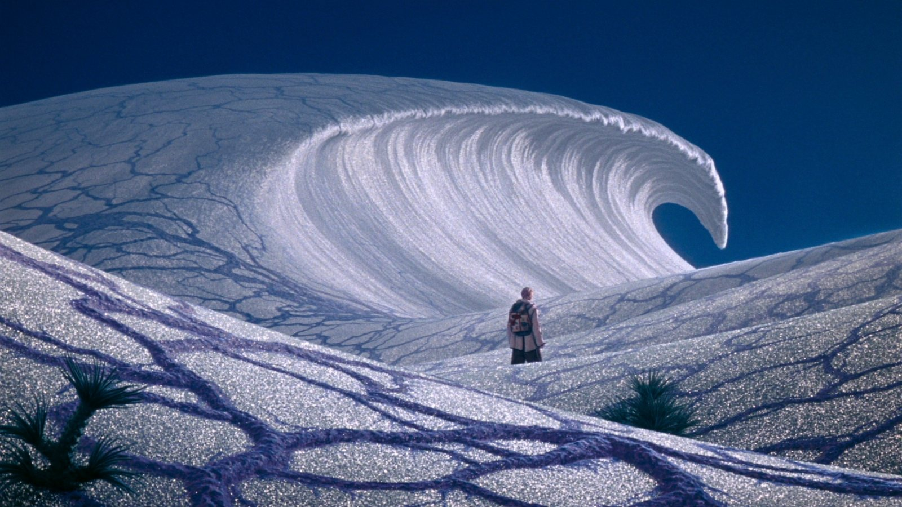

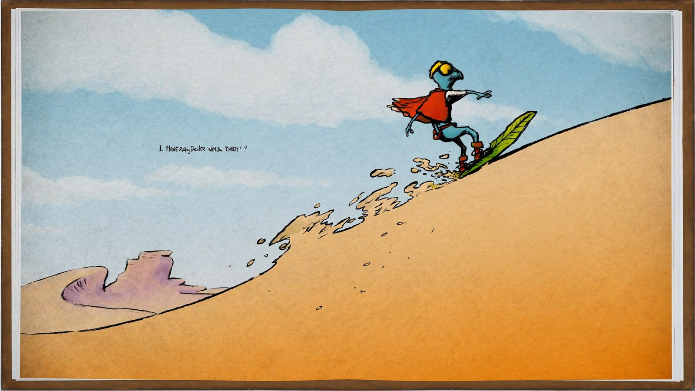

## 10. The Lord of the Sea

The two source chapters play in 3D, then the voyage moves between the layers: 3D pushes in on a deed, a dice table, a chart or a board to reach the 1D games, and flattens side-on for the Engraved Sea and the Deep. Everything turns on the tally at the chart table and the final Tea Board match, and the board ends back at the tideline it began at, where one choice after a win settles the ending.

| # | Layer | Scene | Shot | Beat | Into next | Still |
| --- | --- | --- | --- | --- | --- | --- |
| 1 | 3D | `s-cabin-dawn` | The cabin at sunrise, bottles rolling, the walls crowded with a life | The first stir: the bottles chime into a wrong little tune | Cut | [01-the-cabin](../games/lord-of-the-sea/reference/01-the-cabin.jpg) |
| 2 | 3D | `s-beach-tideline` | Low camera at the tideline, water spiralling round his ankles | The sea answers; "A man between worlds." | Cut (to the chapter card) |  |
| 3 | 3D | `s-beach-princess` | A sand-covered princess and a hungover man who has just run into her | “Alexi!”; the collision; “Tea has a lord.” / “Everything has a lord,” she said. | Push-in on the deed | [03-the-princess](../games/lord-of-the-sea/reference/03-the-princess.jpg) |
| 4 | 1D | `g-charter-deed` | The Charter: the sale deed of the halls | Tutorial: find the clause that reaches the sea, "and all waters adjoining" (added); nothing can be struck yet | Pull-out |  |
| 5 | 2D | `e-cutter-heave-to` | Engraved Sea: a revenue cutter, a convoy, his stir a ripple | No power to fight: hide in the convoy's lee | Push-in on the tavern table (Tidewater) |  |
| 6 | 1D | `g-liars-tidewater` | Liar's Tide with Wenna and two dockhands | Dice for news of crews that still sing | Cut |  |
| 7 | 1D | `g-reckon-unwritten` | Dead Reckoning: dividers and tide tables in fog | Plot a leg off the chart's edge to the Unwritten | Flatten |  |
| 8 | 2D | `e-first-squall` | Engraved Sea: a wave under the cutter, the Gullwife crew singing | Devotion is power: the first weather Alexi has made in a long time | Fade | [05-engraved-sea](../games/lord-of-the-sea/reference/05-engraved-sea.jpg) |
| 9 | 3D | `s-cabin-tally` | The cabin by night lamp, the walls full, the chart table | After the four regions and the halls: the tally counts the wild regions; the narrator's slot | Flatten |  |
| 10 | 2D | `d-under-pilings` | The Deep: under the counting-house wharf, through mooring chains | With four or more regions wild, he goes under and comes up between the pilings | Push-in on the board |  |
| 11 | 1D | `g-tea-final` | The Tea Board against the Lord of Tea | The final match; he wins | Fade |  |
| 12 | 3D | `s-tideline-final` | The same beach at dawn, Alexi standing in the water | Keep the sea, or give it up: he gives it up | Fade |  |
| 13 | 3D | `s-end-no-lord` | Dawn, plain light, the dinghy | No Lord (the default): an ordinary man rows in with blistered hands; the Gullwife crew sings the hymn and he does not look round | End |  |
| E | 3D | `s-end-charter` | Dawn on the bay, half glassy, half moving; the ferry crossing a lane | The Charter: terms signed at 4–4 with the princess; the toll read out as the reason for the lanes | End |  |
| E | 3D | `s-end-wild-sea` | Alexi on the bowsprit in a storm he made, moorings lifting on the coast | The Wild Sea: he keeps the sea; every crew sings, and the toll is sung by name | End | [11-the-open-sea](../games/lord-of-the-sea/reference/11-the-open-sea.jpg) |
| E | 3D | `s-end-lords-peace` | Flat noon on the beach, buoy bells, a bottle in his hand | The Lord's Peace: he stirs the water at his ankles and nothing happens; the narrator says nothing | End |  |
| 14 | 3D | `s-chandlery` | Mother Halse's chandlery on the Tidewater quay: shutters half down, a band of white harbour light across the counter, a slate lying face down | The Slate (added): he asks for a bottle; she turns the slate round, forty years of one account, every line ending "pays next tide" | Push-in on the tavern table (Tidewater) | [chandlery](../games/lord-of-the-sea/assets/locations/chandlery.jpg) |
| 15 | 1D | `g-reckon-backplot` | Dead Reckoning: a clean corner of the sheet, an empty skiff drawn where she was found, no circle | The back-plot (added): from where the skiff was found and the hours since, plot back to where she went over; every tide arrow is turned round | Flatten (to the rescue dive) |  |
| 16 | 1D | `g-charter-tab` | The Charter: the chart with eight regions and the chits found so far laid along its edge | The tab (added): each chit is pinned to the region whose order it bought; a drop of seawater raises a pledge the sea has had | Pull-out |  |
| 17 | 3D | `s-second-collision` | The mirror gallery at a run, eleven of him in the glass, and her coming round the last pier | The Second Collision (added): he cannot stop and hits her again; the writ falls out of her sleeve between them, and chit No. 7 lies on the glass, legible only in the mirror. She picks up the writ and goes | Push-in (the halls' deed) |  |
| 18 | 3D | `s-the-inventory` | The cabin in grey light, every object on the walls hung with a Company tag on a string | The Inventory (added, the darkest beat): the clerks have tagged the walls as the surety's security; he is ashore in his own cabin, dry and alone | Fade |  |
| 19 | 3D | `s-the-oars` | The empty throne room at evening, the king holding a pair of oars and a curling photograph | The Oars (added): the king gives back the one untagged thing, and the photograph of a young man at an oar beside Alexi; he does not say who it is | Fade (to the tally) |  |
| 20 | 3D | `s-the-cup` | Close on the porcelain board: two cups, one of tea and one of hot water, and a chit under a clerk's hand | The Cup (added): he pours the blend from the jar in Alexi's own cabinet and offers a salary, Harbourmaster-General; take it, or sit down to play | Push-in (the final board) |  |
| E | 3D | `s-end-paid-in-kind` | Dawn at the tideline stone, one finger turning in the shallows, eight blank slips in the foam | Paid in Kind (added): eight counter-clockwise stirs unsign the chits; one ripple answers, and nothing more | — |  |

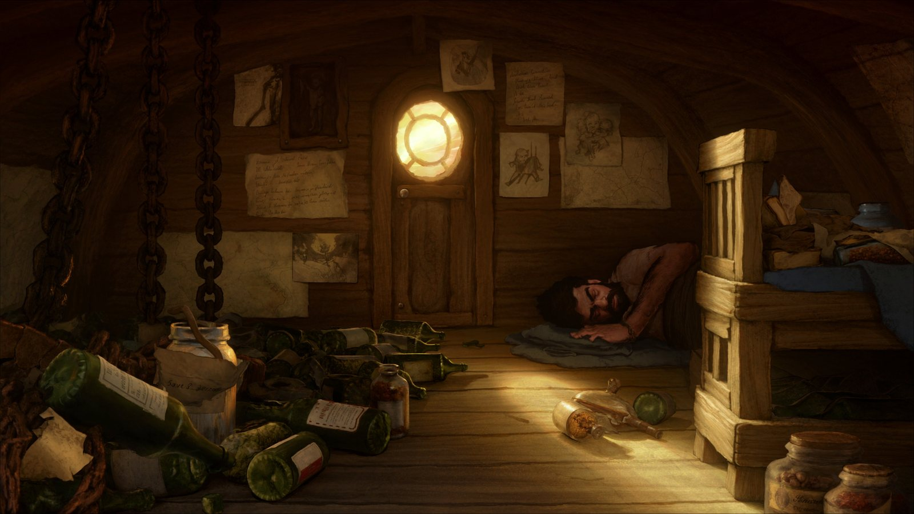

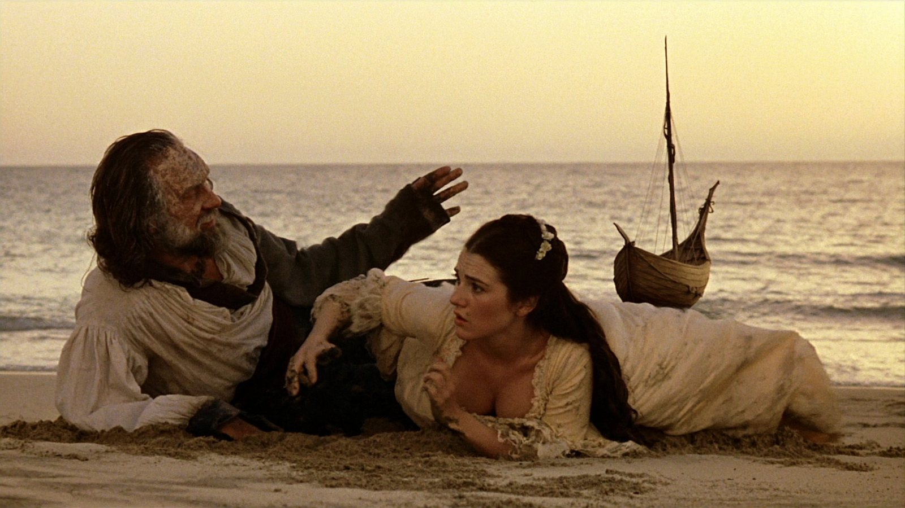

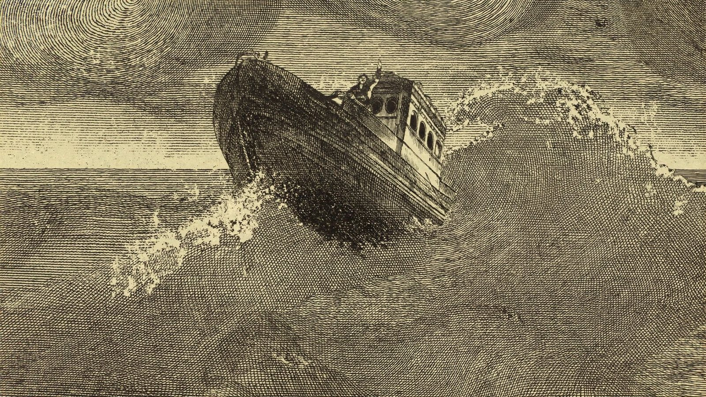

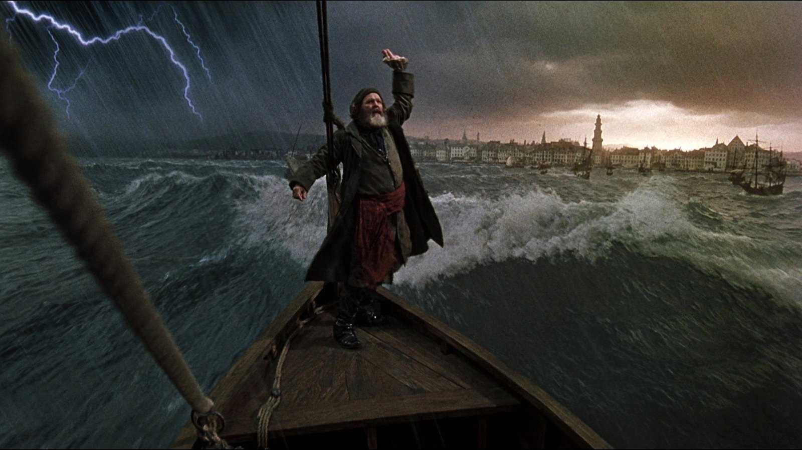

## 11. Dr. Tox: Rise

Episode 1 of four (`dr-tox-rise`), from the author's bible `dr-tox/source/Dr_Tox_Compiled_Bible_Obsidian.md`, not the vault. Two leads on two clocks, Alexander and Reese, alternating by chapter under dated captions. Each 3D room hands off to a page by push-in, every break-in and every escort flattens into the comic page it is drawn on, and the Toxin State is always a cut: the player sees the panel go green and then the evidence tents, never the act. The arena is played as the refusal and cut at the seam. The five stills are the author's own catalogued thumbnails (`dr-tox/art_catalogue.md`: `45e6b51e`, `7b7a67f7`, `20d976bc`, `a9a2b0c1`, `ce8c5a1a`), converted to JPEG at their 320-pixel size; the full-size originals are on Higgsfield, and new stills for the other panels are not generated yet.

| # | Layer | Scene | Shot | Beat | Into next | Still |
| --- | --- | --- | --- | --- | --- | --- |
| 1 | 3D | `s3_hospital_2217` | Flat fluorescent, locked off at 85 mm: a breath fogging a plastic tent; past it, a bench built from IV poles; caption 2217 | Fifteen, alone, lethal to share a room with: walk the four metres the tubing allows, lift the tent, go to the bench | Push-in on the bench |  |
| 2 | 1D | `s1_cage_1` | The Cage: a dropper over a flask in flat colourist's fills, an indicator front of green against an amber band | Titrate the first batch to its endpoint; stop the drip where the flask holds amber against the green | Pull-out |  |
| 3 | 3D | `s3_injection_first` | The bench at 85 mm; a scarred young arm; the lead sleeve with its slot of amber | The first dose: he drives it himself, and the monitor line turns from green to amber. "It is a cage, and he built it himself" | Cut to a painted sky |  |
| 4 | 3D | `s3_skyroom_small` | A low child's camera in a concrete room painted with a blue sky and green fields; twenty small bunks | Reese at four meets Cally, Carmy and Rolan at the play mat; Rolan gets them in trouble; find the string in the crate | Push-in on the string |  |
| 5 | 1D | `s1_cradle_1` | Chalk string between two pairs of small hands on painted sky | Two hands, Reese and Cally: learn the pinch, lift and drop; finish the first figure together | Pull-out |  |
| 6 | 3D | `s3_skyroom_evening` | The same room in corridor blue through wired glass; four older children at the painted wall | After training, ages eight to ten: the four are top of the floor and close as anyone in the trial; Carmy and Cally since this room; Rolan the oddball | Push-in on eight hands |  |
| 7 | 1D | `s1_cradle_2` | Four pairs of hands in chalk, one figure passing between them | Four hands: each crossing must go to the right child's fingers or the figure falls; bonds rise with each figure finished | Cut |  |
| 8 | 3D | `s3_river_town` | A child's height on a bleached main street; sheeting stapled over doors; two small bikes on the asphalt | Alexander at five, before. Play beside Dale, June, the Ostrowski twins and Hollis, and notice one thing about each | Cut | [08-main-street](../games/dr-tox-rise/reference/08-main-street.jpg) |
| 9 | 3D | `s3_river_night` | Night on the bank: the outflow pipe pouring pale sludge, one red flare, dead fish on the mud | "The town dies around them." Porch lights go out behind him one by one; nothing else is shown | Fade | [09-the-outflow](../games/dr-tox-rise/reference/09-the-outflow.jpg) |
| 10 | 3D | `s3_hospital_walkout` | The sealed room in morning light, the tent folded; the door open for the first time | 2226: 24, a doctorate in forensic medical sciences, and a hunch not yet formed; he walks out the year the world falls | Push-in on the bench |  |
| 11 | 1D | `s1_cage_2` | The Cage with a second flask and a moving indicator | A batch to carry outside: a larger flask, a faster front; the vials go in his pocket | Cut |  |
| 12 | 1D | `s1_cradle_3` | Eight chalk hands; one pair stops | The night before: mid-figure Cally tells them the final protocol; the string drops; three are horrified and Rolan is not | Cut |  |
| 13 | 3D | `s3_arena` | A concrete pit under hard floods, a steel seam across the floor; four children; dark glass above | "Only two of you can remain." The only input is Drop. Rolan's embrace is cut behind Reese's back; the leap is cut at the seam; the shot from above is never shown | Cut |  |
| 14 | 3D | `s3_arena_after` | The floods off, one red light, two blades on two halves of the floor | "Now, now — you broke the rules. You should have killed your pair. Now you have no one." Then cryo, two doors down from a gurney he never sees | Fade |  |
| 15 | 1D | `s1_window_1` | The Window: a posed photo of a guardhouse, a typed rota pinned in the margin | 2226, months 6 to 12: find the gap in two guards' rounds and lay his route into it | Flatten |  |
| 16 | 2D | `s2_panel_1` | Panel run: a research floor through scratched glass in spotted black ink; white gutters | The first break-in. Pick the next panel; the gutter skips the guard's turn; find the plate that reads RCC | Fade | [16-the-research-floor](../games/dr-tox-rise/reference/16-the-research-floor.jpg) |
| 17 | 3D | `s3_spire_mirror` | Amber, gold-edged light; a tall mirror; a woman's voice warm on purpose | "Welcome back, Aegis." "You look like you're supposed to." The flinch at "terrible" | Push-in on the reflection |  |
| 18 | 1D | `s1_cradle_leash` | Cat's Cradle with three pairs of hands blank | The leash: the figure needs four children and three are white chalk ghosts; HOPE plays the flashback and calls it gratitude | Pull-out |  |
| 19 | 3D | `s3_spire_ceremony` | A platform above a hundred thousand faces; his face forty metres tall on every screen | "Citizens of the Spire — I give you Aegis." The insignia goes on before he has decided how it feels | Cut |  |
| 20 | 1D | `s1_window_2` | The Window: two rotas, a dog handler's photo, a clock that runs | 2227: three rounds and a dog; the window is narrower; the slack he finds is his starting Pulse | Flatten |  |
| 21 | 2D | `s2_panel_2` | Panel run: a cold-storage depot in ink; the last panel's border turns green | A guard and a dog and nowhere left to hide: Pulse hits 100 and the State takes the page; cut | Cut |  |
| 22 | 1D | `s1_aftermath_1` | Aftermath: a guard post in dot-tone grey, numbered evidence tents | He reads the room like evidence of a crime he did not witness: order the traces; the guard's name is on his locker | Fade | [22-aftermath](../games/dr-tox-rise/reference/22-aftermath.jpg) |
| 23 | 3D | `s3_lower_ring` | Smoke on a ramp under a concrete deck; a woman already fighting, unhurried | "They finally sent the amber-lit one down from the Spire. I wondered when." Learn Load on the first canister cloud | Flatten |  |
| 24 | 2D | `s2_barrier_1` | Barrier escort in clear line: a transport, hard-light walls as clean bars, people behind them | Draw walls to bring the transport through; every wall pens someone in, and their names show on it | Flatten |  |
| 25 | 3D | `s3_lower_ring_after` | Behind his own walls; a plate stamped RCC on the emitter | Hear each penned person's want; Nell Okafor: "RCC sent you." Say "HOPE sent me", "RCC sent me", or nothing; the first "RCC" is recorded | Flatten |  |
| 26 | 2D | `s2_barrier_2` | The same page going out | Drop pen walls on the way out, at the transport's cost, or keep them | Cut |  |
| 27 | 3D | `s3_archive_fall` | Rubble under a breach, blue emergency light, rows of grey cabinets | 2228, two years and one week: through the ground into Snakehead; follow the hum to the reader | Push-in on the reader |  |
| 28 | 1D | `s1_fiche_1` | Fiche: a hooded screen in scratchboard white, an index of a thousand frames | Find SUBJECT CMXCIX, his own file; find the river children by the one detail you kept; read names until the reader is needed elsewhere | Pull-out |  |
| 29 | 3D | `s3_printer_room` | Soft blue, a black column veined with conduit, a CRT terminal, vapour on the floor | PROJECT CATALYST; BOND INTEGRITY 94.6%; leave it on the screen or tear the printout. The column splits; the girl from Sky Room opens her eyes as Cycle 41: "Cold." | Cut |  |
| 30 | 3D | `s3_archive_alarm` | Red strobe through the cabinets; four glass cells; a tank where someone becomes visible | Security on the stair. The Observers open their inner door: go through with them, or take the stair alone and seal it | Flatten |  |
| 31 | 2D | `s2_panel_3` | Panel run through the bunker, the Observers' shapes in the gutters | The escape: the Split leaps a gutter, the Cauldron sprays a doorway, the Twins crack a wall; draw as few darts as you can | Fade |  |
| 32 | 3D | `s3_archive_claimed` | One amber work lamp, hard falloff into black | The return: light the lamp; the cells open on the family that kept him alive | Push-in on the locker |  |
| 33 | 1D | `s1_cage_3` | The Cage on a steel bench under the work lamp | The first batch in his own lab: the supply that will have to last into the Fall | Pull-out |  |
| 34 | 3D | `s3_bunker_injection` | The bunker medical bay at 50 mm; shirtless, scarred arm, lead-shielded syringe, jaw clenched, eyes shut | Fully Dr. Tox (as written): "armored, armed, based in Snakehead." The last image is the first signature image | Fade | [34-the-injection](../games/dr-tox-rise/reference/34-the-injection.jpg) |
| E | 1D | `s1_aftermath_2` | Aftermath: the archive in dot tone, more tents than he can count | Green in the Archive: Pulse reached 100 in the escape; the tents are where the Observers set them for him | Fade |  |
| E | 3D | `s3_archive_green` | Dim red emergency light, a wide empty frame, the subject small in it | Green in the Archive: he wakes among what the State did; the Observers keep their distance; Self starts the Fall lower | Push-in on the locker |  |
| E | 3D | `s3_archive_empty` | The amber lamp over four open cells and a dry tank | The Cage Alone: he sealed the door behind him and they were taken; he claims an empty fortress | Push-in on the locker |  |
| E | 3D | `s3_printer_room_after` | The column gone to its bolts; one still on the terminal | The Spec Sheet: he kept the printout and knows "Aegis"; the terminal shows his own face, logged | Push-in on the bench |  |

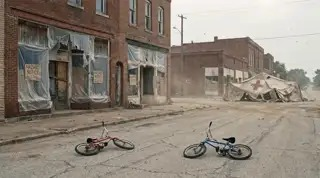

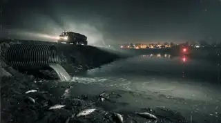

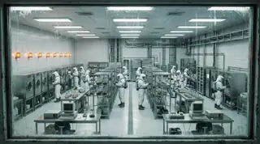

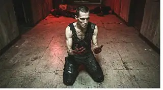

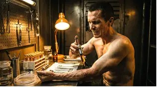

## 12. Dr. Tox: Fall

Episode 2 of four (`dr-tox-fall`), from the author's bible `dr-tox/source/Dr_Tox_Compiled_Bible_Obsidian.md`, not the vault; the bible's Fall is a stub, so most of this board is added (`games/dr-tox-fall/DESIGN.md` section 21). Three leads on one clock, 2228 to 2236, under dated captions: Dr. Tox, Reese as Aegis, and Cally at Cycle 41. Each 3D room hands off to a page by push-in; the relief hall and the gala flatten into the crowd they are drawn as, and the Spire's glass flattens into Cally's reflection. The Toxin State is always a cut, and what follows it is other people telling him what they saw. This board follows the default first run, which ends in The Following; the other three endings are the E rows. The five stills are the author's own catalogued thumbnails (`dr-tox/art_catalogue.md`: `f9398896`, `6f93c88c`, `c378345b`, `ee8b72ec`, `554be284`), converted to JPEG at their 320-pixel size; the full-size originals are on Higgsfield, and new stills for the other panels are not generated yet.

| # | Layer | Scene | Shot | Beat | Into next | Still |
| --- | --- | --- | --- | --- | --- | --- |
| 1 | 3D | `s3_fortress_lamp` | One amber lamp, hard falloff into black; caption 2228; four cells, a clear tank | Snakehead, as Rise left it. The Ghost points up; a knock comes down the cavern; take the shroud off its stand and see the ring on the floor | Push-in on the breach |  |
| 2 | 1D | `s1_triage_1` | Triage: two marker-sketched cards and a tray of amber marks | Wren Halloran and her brother Teo, carried down on a door. Two marks would ease him; a third would make him stop asking | Pull-out |  |
| 3 | 3D | `s3_fortress_bench` | The bench at 50 mm under the lamp; flasks, lead bricks, vials | Give the batch its hours, or keep them for the cots. "They will tell someone." | Cut |  |
| 4 | 3D | `s3_relief_queue` | A bare concrete relief hall under flat tubes; a queue of the plague-marked; dispensers stamped RCC | 2229. Empty hoppers; at noon the shutter comes down on RELIEF SUSPENDED; the failure of institutions as a room | Flatten | [04-the-relief-hall](../games/dr-tox-fall/reference/04-the-relief-hall.jpg) |
| 5 | 2D | `s2_crowd_1` | Crowd thread: the queue in comix crosshatch, his breath radius a ring of bare paper | Down the queue to the back of the hall; whoever steps into the ring coughs once and becomes a card | Push-in on the back table |  |
| 6 | 1D | `s1_triage_2` | Triage behind the shutter: six cards, two cots, a tray full of marks | The night clinic: more need than cots; a mark past the need settles a card at once | Cut |  |
| 7 | 3D | `s3_bloom_morning` | A rooftop view at pale dawn; haze from the stacks settling on market streets; a drone already up | Reese as Aegis sets down; the first cloud teaches Load; a stall's screen shows Rostova's portrait beside the word CATALYST | Push-in on the street grid | [07-the-haze](../games/dr-tox-fall/reference/07-the-haze.jpg) |
| 8 | 1D | `s1_bloom_1` | Bloom: the district in Ben-Day dots, the spread in rust | Absorb cells and raise panes, street by street; the names in the cells the spores take are marked | Pull-out |  |
| 9 | 3D | `s3_bloom_after` | The haze settled rust and ochre; a closed stall; the drone's lens | The marked were all on the side the cameras were not filming. The woman's voice, the sentence, a flinch | Fade |  |
| 10 | 3D | `s3_fortress_workshop` | The workshop under the amber lamp; a gauntlet in a vise; a board of index cards | 2230. The names of the 999 he read; the bench; seat the gauntlet over the shunt | Push-in on the vise | [10-the-gauntlet](../games/dr-tox-fall/reference/10-the-gauntlet.jpg) |
| 11 | 1D | `s1_manifold_1` | The Manifold: the gauntlet as a back-page comic advert, six valves, four barrels | Route the shunt's flow; every bead of back-pressure is Pulse on every dart. At the end, the first cots in the cavern hall | Cut |  |
| 12 | 3D | `s3_settlement_day` | Freeway ruins at dusk; drums, laundry, tube lights on a generator; warm towers far off | 2231. The hall's people followed him and built a settlement; the hour before he comes; a bulletin on the monitors | Push-in on the clinic shelter | [12-under-the-freeway](../games/dr-tox-fall/reference/12-under-the-freeway.jpg) |
| 13 | 1D | `s1_triage_3` | Triage under the freeway: eight cards, the set-aside returning, corners stamped "came back early" | People ask for more by name; Wren asks for a third mark for Teo | Pull-out |  |
| 14 | 3D | `s3_settlement_raid` | Hard white floodlights from a grey truck; muzzle flash; handheld 28 mm | The State answers the clinic with a raid; sustained fire; Pulse reaches the trigger line; the suit fails; cut before any act | Cut |  |
| 15 | 1D | `s1_composite_1` | Composite: a light box, acetate strips, six witness cards | Build what he was from what they saw: plating across the shoulders. Yusuf saw a light; pin it, and the settlement has its icon | Fade |  |
| 16 | 3D | `s3_gala_annex` | A white calibration annex; a mirror; a portrait beside SUBJECT DESIGNATION: CALLY (ARCHIVED) | 2232. Cally, seventy-two hours; Aegis's file; a note that his compliance has shown variance | Push-in on the file |  |
| 17 | 1D | `s1_persona_1` | Persona: a romance-comic heart panel around his profile; thought balloons; a hand of cards | Build a person to fit him from a painted sky, a string and three friends; the deck deals itself a dropped blade | Flatten |  |
| 18 | 2D | `s2_reflect_1` | Reflection run: silkscreen repeats of a glass hall, Cally above and her reflection below | Steer both through the glass to a meeting arranged as chance; at a plate stamped RCC the reflection turns its back | Fade |  |
| 19 | 3D | `s3_relief_standoff` | The hall at night, half the tubes off, one amber lamp at the back table; a shrouded figure | 2233. Aegis walks into the breath radius and nothing happens: the two who can share a room. "That plate says who runs this hall." The Word; wall the door or stand down | Push-in on the table |  |
| 20 | 1D | `s1_triage_4` | Triage from the other side: the CANNOT column, cards stamped in the corner | As Aegis, carry the cards the doctor set aside to cots, and read what a mark past the need looks like | Pull-out |  |
| 21 | 3D | `s3_relief_dawn` | Dawn through the shutter going up on the same empty dispensers | The queue faces the back door now; he files a report; the channel answers with the sentence | Cut |  |
| 22 | 3D | `s3_settlement_haze` | A pale haze across the dust plain turning rust as it lands; a horn passed hand to hand | 2234. Rostova's second release drifts east toward the freeway; call the crews | Push-in on the plain |  |
| 23 | 1D | `s1_bloom_2` | Bloom: the plain and the settlement in Ben-Day dots, crews at the cordons, the east edge in red | At tick 6 the wind turns east; the east front needs five cordons at once; with fewer crews the settlement is taken | Pull-out |  |
| 24 | 3D | `s3_bloom_rooftop` | The source rooftop at rust dawn: an aerosol rig, a filming drone, a woman at the rail in silhouette | Rostova: "You're the one they didn't plan. I'm the one they did." The rig's plate reads RCC BIOSYNTH DIVISION; its screen shows her photograph and CATALYST | Fade |  |
| 25 | 3D | `s3_fortress_rite` | The cavern hall in lantern light; rows of people gone still; a shaft of grey day | 2235. A rite he did not make; Mercy asks for what's in the blades | Push-in on the vise |  |
| 26 | 1D | `s1_manifold_2` | The Manifold again: a fifth outlet at the end of the spine, capped | Route the resin line for them, at a cost on every dart, or keep it capped | Cut |  |
| 27 | 3D | `s3_gala_floor` | A glass gala hall in clean air; white tables; a lectern; tall columns of pale vapour | 2236. Aegis honoured beside the Biosynth director for the Bloom containment; Cally at his table | Push-in on the table |  |
| 28 | 1D | `s1_persona_2` | Persona at the gala table: three exchanges, the match meter's mark at 94.6 | The last hand; his flinches show the weights; burn the dealt cards or keep them | Flatten |  |
| 29 | 2D | `s2_reflect_2` | Reflection run: glass halls to the balcony, guests in both worlds | Three doors the reflection will not pass: a plate stamped RCC, a painted sky, a loop of string. Force it, or stop with it | Cut |  |
| 30 | 2D | `s2_crowd_2` | Crowd thread: a dim service corridor, two guards slumped, then the gala floor in crosshatch | Ama Owusu and Lev Brandt open the service door; darts in the corridor; the shroud among people who paid for their air | Cut | [30-the-service-corridor](../games/dr-tox-fall/reference/30-the-service-corridor.jpg) |
| 31 | 3D | `s3_gala_balcony` | The balcony at dusk, amber behind, a cold city below; a hard-light wall; her hand at his wrist | Dr. Tox at the rail with a dart drawn; Aegis's wall closes; "Who built you?" Reese's one word: HOPE, RCC, or nothing | Fade |  |
| 32 | 3D | `s3_fortress_following` | The cavern hall full, lanterns and the lamp; blades laid on a cloth | The Following: he doses himself under the lamp and turns to them; the cut comes first. "His followers become chemically dependent on him" | Fade |  |
| E | 1D | `s1_composite_2` | Composite at the gala: five regions, four witnesses who will not testify | Only if the State fired at the gala: reach, everything longer than it should be; leave the horns out | Cut |  |
| E | 3D | `s3_gala_leash` | Muzzle flash on the balcony; the wall going out | First Word: he said "RCC"; the leash fires mid-fight; Dr. Tox over the rail; Ama and Lev taken; Reese recalled | Fade |  |
| E | 3D | `s3_gala_bond` | The amber wash; two figures going in off the balcony past the plate | Bond Held: her hand at his wrist; the doubt closes; CALIBRATION COMPLETE | Fade |  |
| E | 3D | `s3_settlement_lost` | The freeway ruins months later, spore rust on the drums, the shelters empty | The Clinic: without a following there were not crews enough for the east front | Cut |  |
| E | 3D | `s3_fortress_clinic` | The cavern hall at night, one cot lamp, a cot being made up | The Clinic: patients come down the cavern and go home; nobody stays | Fade |  |

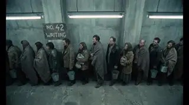

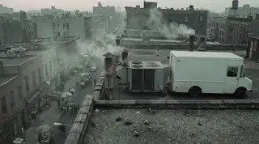

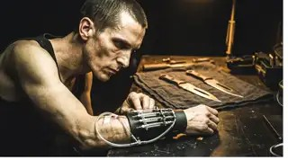

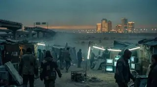

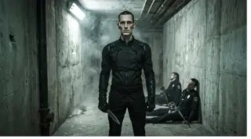
