# Storyboards

How each game's scenes join, panel by panel, through the three layers. The camera moves the player between layers inside the world, so a 3D scene becomes a 2D or 1D page without a menu.

| Transition | What the camera does |
| --- | --- |
| Push-in | The 3D camera moves into a surface (a page, a lens, a table) and it becomes the full-page 1D game |
| Pull-out | The reverse |
| Flatten | The 3D camera swings side-on or overhead and goes orthographic; the scene becomes 2D |
| Fade, cut | Time passes, or the place changes |

Reference stills were made with Higgsfield (Soul Cinema) and live in each game's `reference/` folder. They are mood references, not final art. Each game's DESIGN.md is the authority on scene ids; these boards are the flow between them.

## 1. The Stuffed Ones

The board turns over once: the first half looks out from human height, the second from a shelf.

| # | Layer | Shot | Beat | Into next | Still |
| --- | --- | --- | --- | --- | --- |
| 1 | 3D | Dusk, gravel drive. The cabin on Ridgeway Road, porch light on, stuffed animals behind the window | Five friends arrive. Mabel and Ruth: "They like company." | Cut | [01-arrival](../games/stuffed-ones/reference/01-arrival.jpg) |
| 2 | 3D | Bright kitchen, morning, the five round the table | Three days of trips and meals; the player learns who Jamie, Lila, Marcus and Dani are | Fade |  |
| 3 | 3D | 2:30 a.m., the hallway, a rabbit at the top of the stairs | The first squeak and drag; each wrong thing breaks the last explanation | Cut |  |
| 4 | 3D | Night three, the kitchen. A bear upright on the counter beside an emptied deer | The bear turns its head | Cut | [04-the-bear-turns](../games/stuffed-ones/reference/04-the-bear-turns.jpg) |
| 5 | 3D | The basement labyrinth: wallpaper, broken toys, warm air | Herded and lost; doors loop back | Push-in on the hand-sewn book |  |
| 6 | 1D | The Hand-Sewn Book | How much you read decides which endings stay open | Fade to black |  |
| 7 | 3D | Shelf height, seen through plastic; four button-eyed friends opposite | The awakening | Push-in on your own seams | [07-awakening](../games/stuffed-ones/reference/07-awakening.jpg) |
| 8 | 1D | Stuffing: memories laid out beside open seams | Choose what to keep | Pull-out, then flatten |  |
| 9 | 2D | Dollhouse cutaway at night, the guests' sight cones sweeping | Move only when no one is looking | Push-in on the parlour table | [09-dollhouse-cutaway](../games/stuffed-ones/reference/09-dollhouse-cutaway.jpg) |
| 10 | 1D | Parlour: the guests' board game from above | Move their pieces while they look away | Pull-out |  |
| 11 | 1D | Stitchwork: Jamie's split seam | Mend him after he falls | Flatten |  |
| 12 | 2D | The labyrinth from above, guests running | The Chase | Cut |  |
| 13 | 3D | The shelf again; headlights outside | The ending your choices earned | End |  |

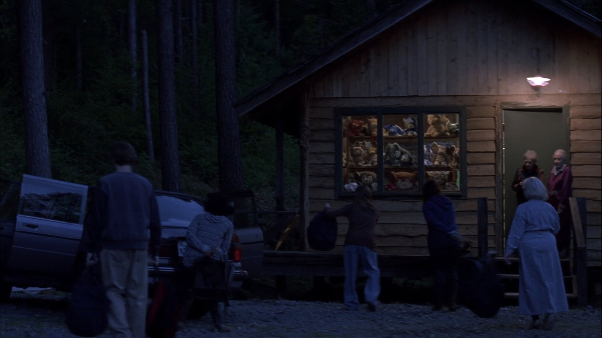

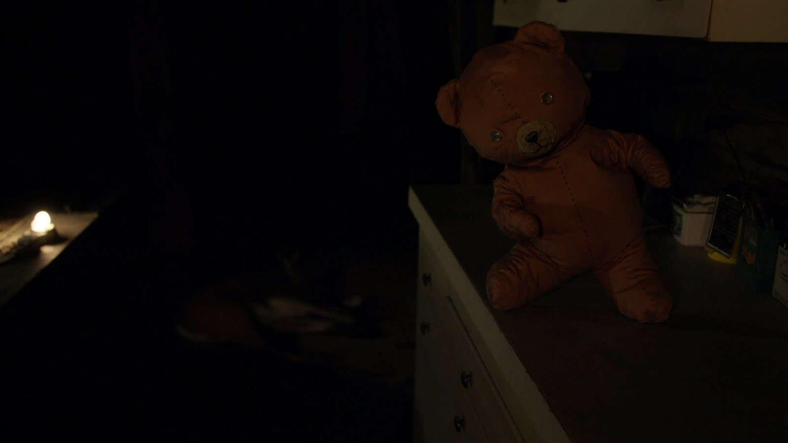

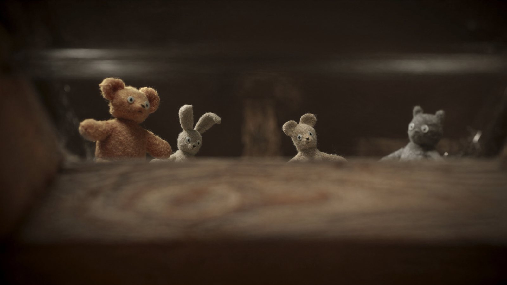

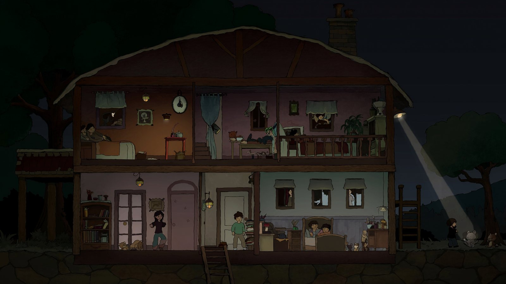

## 2. Behind the Peephole

Every night repeats one loop: corridor, lens, run, lens, desk.

| # | Layer | Shot | Beat | Into next | Still |
| --- | --- | --- | --- | --- | --- |
| 1 | 3D | The service corridor at 11 p.m., six small lenses along one wall | The shift starts | Push-in on lens 3 | [01-service-corridor](../games/behind-the-peephole/reference/01-service-corridor.jpg) |
| 2 | 2D | The eye at the hole: a circle of fisheye light over a dark room | Tilt to follow a guest; dirt on a collar | Pull-out | [02-eye-at-the-hole](../games/behind-the-peephole/reference/02-eye-at-the-hole.jpg) |
| 3 | 2D | The corridor side-on, a maid's trolley, a lit window | Race to lens 5 before the thief reaches her door | Push-in on lens 5 |  |
| 4 | 2D | Lens 5: a suitcase "that wasn't there yesterday" | Watch too long and the guest looks at you | Pull-out |  |
| 5 | 3D | Your desk in the quiet hour, a lamp, a deck of cards | A pause in the night | Push-in on the cards |  |
| 6 | 1D | Night Patience; one card not from this deck | A message from someone | Pull-out |  |
| 7 | 3D | 2:14 a.m., a stranger at a door down the hall | The knock | Fade to dawn |  |
| 8 | 1D | The Mosaic: photos, pins, red thread | Link the guests whose stories rhyme | Turn the page | [08-the-mosaic](../games/behind-the-peephole/reference/08-the-mosaic.jpg) |
| 9 | 1D | The Statement: the morning log | Lock in who did what | Fade |  |
| 10 | 1D | Night six, Lockwork on the desk drawer | The booking ledger inside | Pull-out |  |
| 11 | 3D | Night seven, your office seen through a lens in your own door | The knock at 2:14 is for you | Cut | [11-the-knock](../games/behind-the-peephole/reference/11-the-knock.jpg) |
| 12 | 3D | The lobby at dawn | The ending your log and choice earned | End |  |

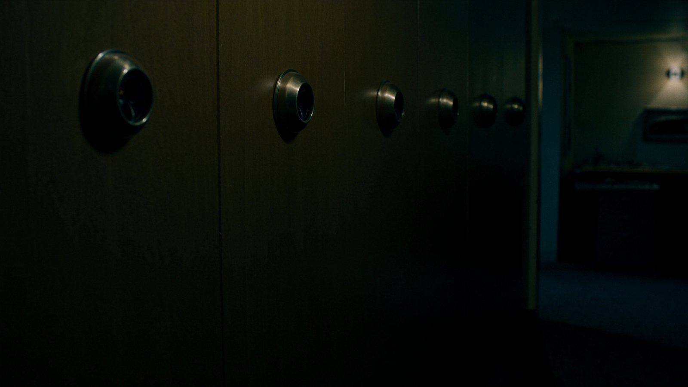

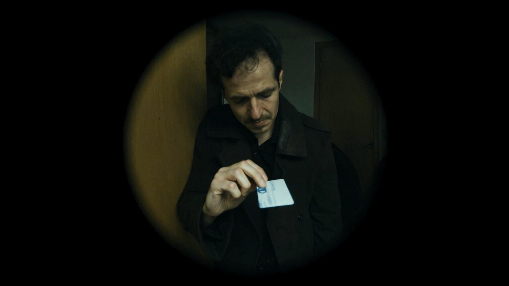

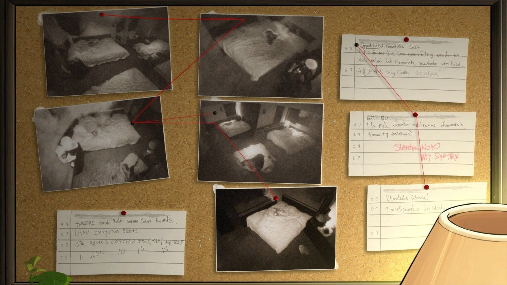

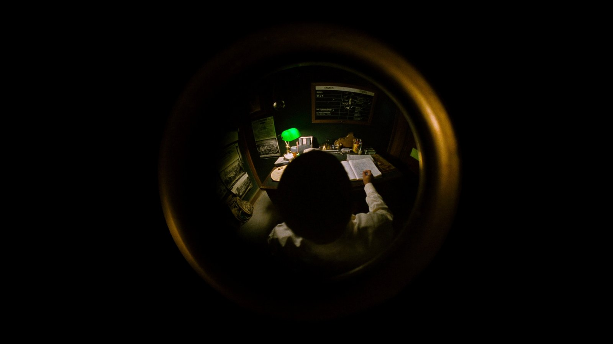

## 3. Missing Campsites

Each day the board gets shorter; the booth, the loop road and the fire recur with less in them.

| # | Layer | Shot | Beat | Into next | Still |
| --- | --- | --- | --- | --- | --- |
| 1 | 3D | Noon, the entrance. Site posts in clean empty ground | "They just don't exist." The ranger smiles | Push-in on your map | [01-entrance](../games/missing-campsites/reference/01-entrance.jpg) |
| 2 | 1D | Reconcile: the map beside your field notes | Mark what is there and what is not | Pull-out |  |
| 3 | 2D | Night one, the loop road from above in torchlight | Count the posts; the gaps are dark ground | Fade | [03-torchlight-loop](../games/missing-campsites/reference/03-torchlight-loop.jpg) |
| 4 | 1D | Foil Supper at the fire | An ingredient you packed is gone | Cut |  |
| 5 | 1D | Pack List, the campfire game | The chain includes an item nobody said | Fade to morning |  |
| 6 | 3D | Day two, the ranger booth; a family with a board game | Fewer sites; fewer squares | Push-in on the ranger's logbook |  |
| 7 | 1D | The Ranger's Book | Check-ins that no longer add up | Pull-out |  |
| 8 | 3D | Dusk, your five sites alone at the end of the loop | Choose what and whom to carry inside | Fade | [08-five-sites](../games/missing-campsites/reference/08-five-sites.jpg) |
| 9 | 3D | The final morning: the sky wrong, trees in impossible rows | You slipped through | Flatten | [09-the-other-side](../games/missing-campsites/reference/09-the-other-side.jpg) |
| 10 | 2D | The other side from above, a path spelled by the trees | The pattern walk | Cut |  |
| 11 | 3D | Wherever your carrying led you | The ending | End |  |

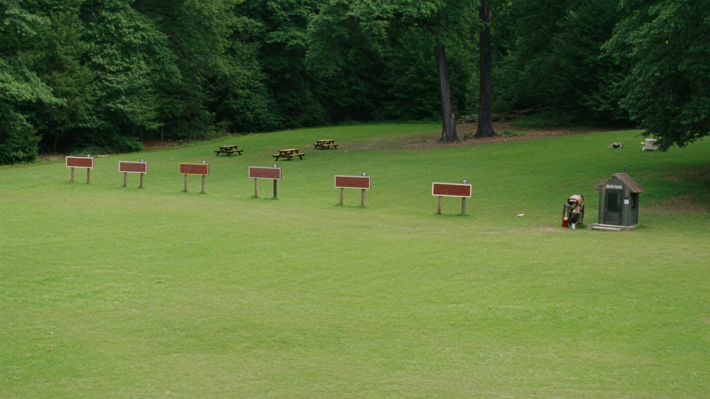

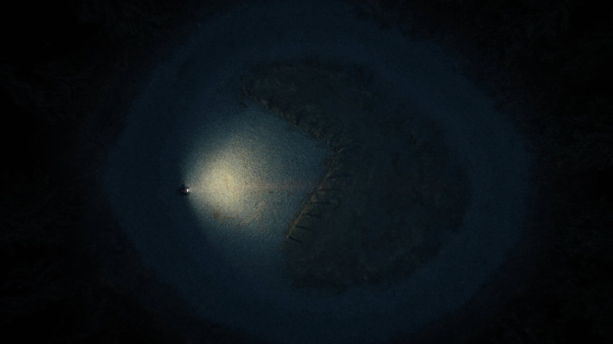

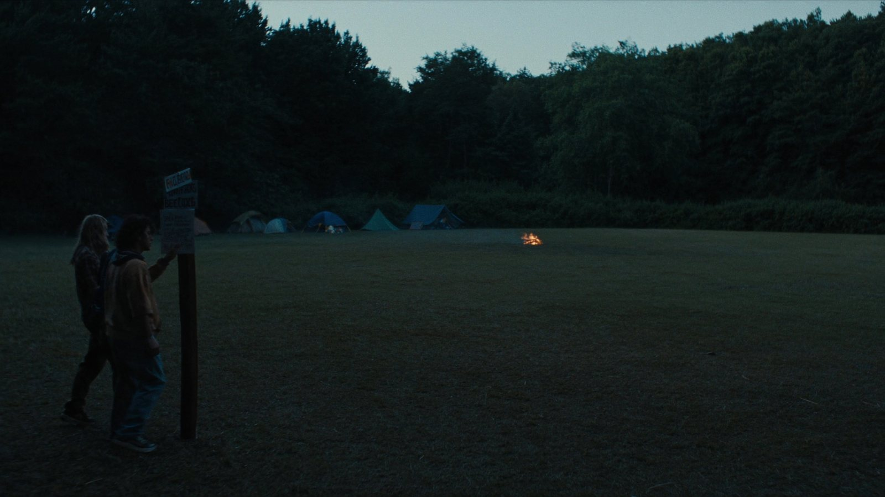

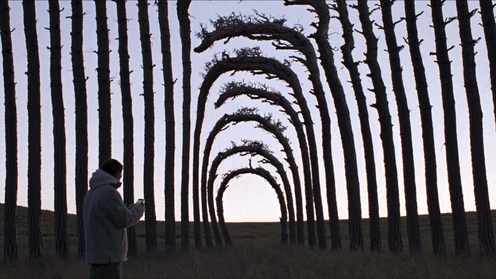

## 4. The Redacted Testament of Lira Calyx

The journal is the hinge of every scene, and each act it is a little less trustworthy.

| # | Layer | Shot | Beat | Into next | Still |
| --- | --- | --- | --- | --- | --- |
| 1 | 3D | A Mid-Slope terrace at dawn | Lira sets her baselines | Cut | [01-terrace](../games/lira-calyx/reference/01-terrace.jpg) |
| 2 | 3D | Night, a valley of Spore-Weaver webs pulsing as one | Pattern α | Push-in on the journal | [02-pattern-alpha](../games/lira-calyx/reference/02-pattern-alpha.jpg) |
| 3 | 1D | The journal, page 47, a correction in another hand | "Who wrote this?" | Turn the page |  |
| 4 | 1D | The Key: a juvenile Ember Wolf | It does not fit; the key breaks | Pull-out, flatten |  |
| 5 | 2D | The mountain in cross-section, Lira climbing | Air thins; a storm forms inside the rock | Cut |  |
| 6 | 2D | Under the lens: the fragment's micro-filaments | Steer to the seeding lattice | Push-in on the bench |  |
| 7 | 1D | The Assay | Isotope ratios that are not natural | Pull-out |  |
| 8 | 3D | A corporate lab at night | "She's close. Move the logs." | Cut |  |
| 9 | 3D | A Peakborn circle singing under a storm | Mara's storm-song | Push-in on the notation |  |
| 10 | 1D | Storm-Song Cipher | The song is a map of nodes | Turn the page |  |
| 11 | 1D | Journal Audit | One entry you did not write | Cut |  |
| 12 | 3D | The core beneath Peak 12, Veylor waiting | "A hard reset is a mercy" | Push-in on the node map | [12-the-core](../games/lira-calyx/reference/12-the-core.jpg) |
| 13 | 1D | The Node Board against Veylor's hidden pieces | Fire the pulses | Fade |  |
| 14 | 3D | Collapsed tunnels; a torn journal | The epilogue as the archivist | End | [14-the-torn-journal](../games/lira-calyx/reference/14-the-torn-journal.jpg) |

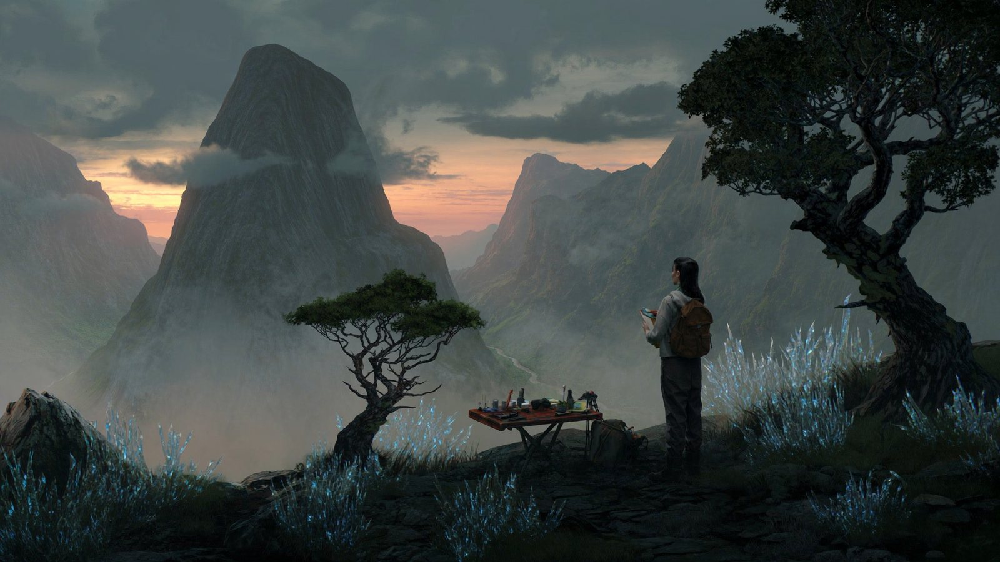

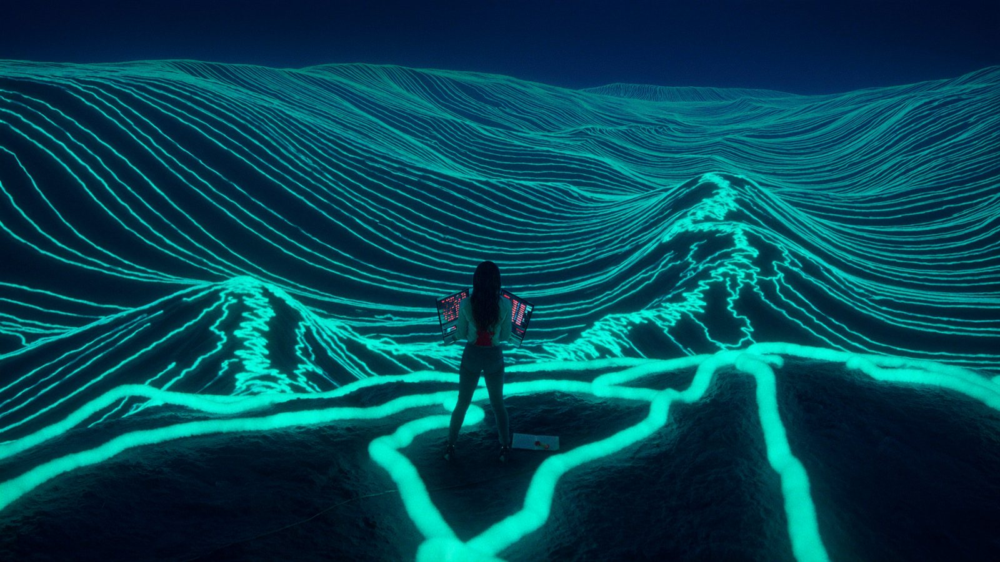

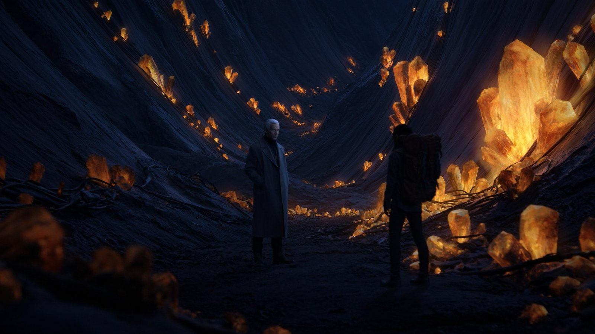

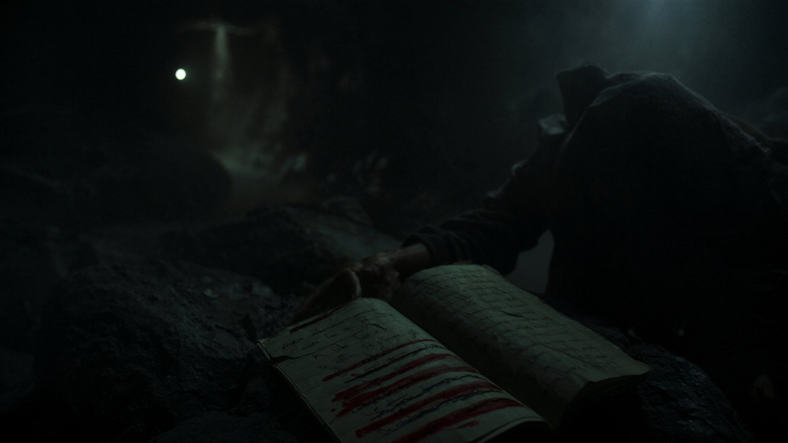

## 5. WrymWretch

Six short boards that each end with a pair taking off toward the chasm, then one for the convergence.

| # | Layer | Shot | Beat | Into next | Still |
| --- | --- | --- | --- | --- | --- |
| 1 | 3D | Cedarheart: a tree split from within, black ichor | Thalen: "The forest is… forgetting." | Cut | [01-the-split-tree](../games/wrymwretch/reference/01-the-split-tree.jpg) |
| 2 | 2D | Side-on flight, Sylvan weaving through the canopy | The first twin flight | Cut |  |
| 3 | 3D | A sky-city balcony, Sky Elves shivering | Aeris hears "Remember me." | Flatten |  |
| 4 | 2D | Aetherius riding thermals | Flight, the second way | Cut |  |
| 5 | 1D | The Heartstone | Rhyla tunes a memory back in | Pull-out |  |
| 6 | 3D | The seabed in lantern light, a monolith in silt | Lunessa cannot hold its symbols | Push-in on the face | [06-the-monolith](../games/wrymwretch/reference/06-the-monolith.jpg) |
| 7 | 1D | The Slipping Glyph | Solve it by what stays when you look away | Cut |  |
| 8 | 3D | A forbidden chamber, a prophecy on bone | Kael reads of the Astral Architect | Cut |  |
| 9 | 1D | Star Chart: the Sigil of Izladar | Seraphyne redraws the stars | Pull-out |  |
| 10 | 2D | The forgetting run | Reach the remembered place before it goes | Cut |  |
| 11 | 3D | Wrymreach: astral wind, wyrm bones, six dragons arriving | "I… remember… me…" | Cut | [11-wrymreach](../games/wrymwretch/reference/11-wrymreach.jpg) |
| 12 | 3D | A battle on the chasm's rim | The party's first fight | Push-in on the tribal board |  |
| 13 | 1D | Six Realms against a tribe's elder | Win their trust | Pull-out |  |
| 14 | 3D | Before the Astral Expanse | The pair you choose decides the ending | End | [14-the-veil](../games/wrymwretch/reference/14-the-veil.jpg) |

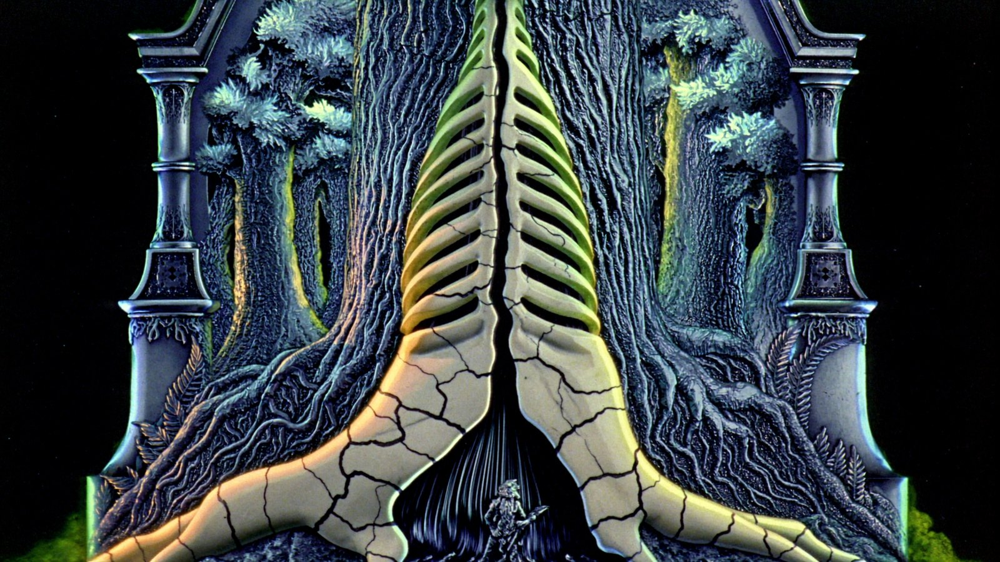

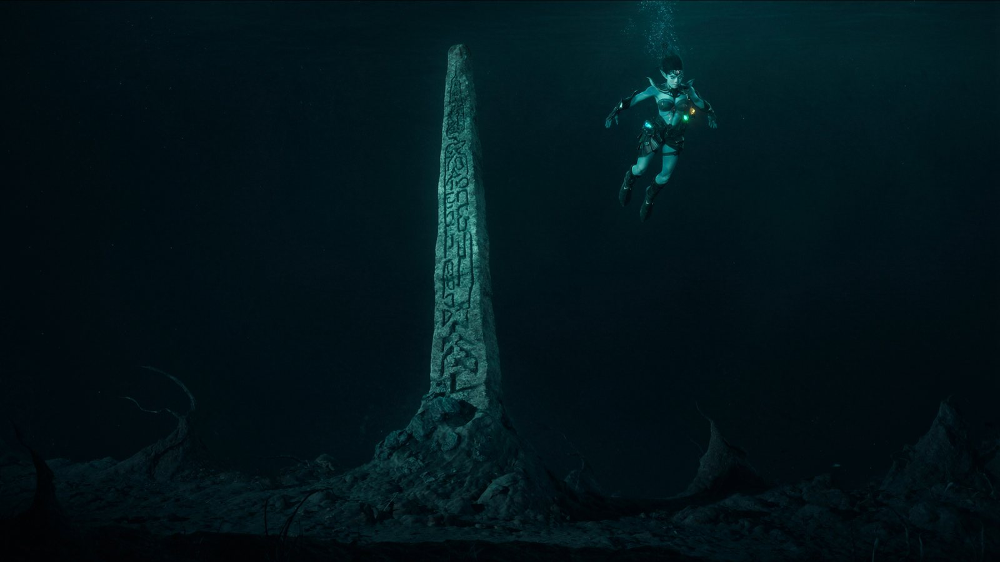

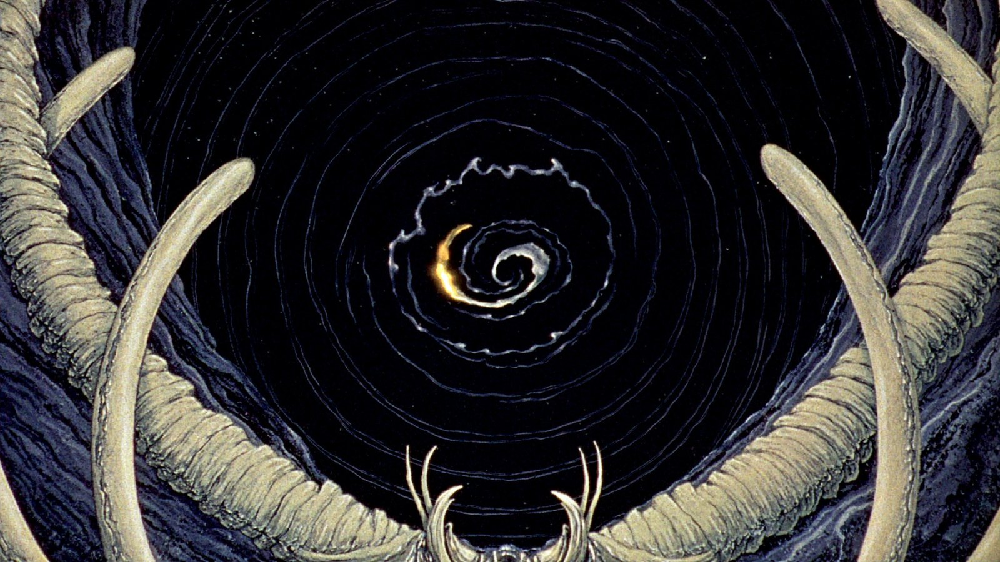

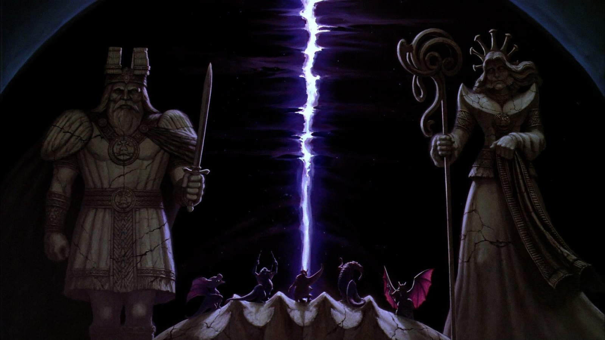

## 6. Project: Man Eater

A day board and a night board, alternating seven times; the doorways shrink to Fisk's size as he changes.

| # | Layer | Shot | Beat | Into next | Still |
| --- | --- | --- | --- | --- | --- |
| 1 | 3D | Snow, mountains, a base whose armour faces inward | "Not to keep things out, but instead to keep them in." | Cut | [01-the-base](../games/man-eater/reference/01-the-base.jpg) |
| 2 | 3D | A hall four feet wide and fifteen feet high, Sam ahead | The three rules | Cut | [02-tall-halls](../games/man-eater/reference/02-tall-halls.jpg) |
| 3 | 1D | The Tray | How much to eat | Pull-out |  |
| 4 | 1D | Short Rations at the barracks table, one chair empty | Play for bread | Fade |  |
| 5 | 3D | The bunk at 10:00, breath in the air | The flute; the bunkmate gets up | Flatten |  |
| 6 | 2D | The tall halls side-on in silhouette | Follow the sound unseen | Cut | [06-silhouette-halls](../games/man-eater/reference/06-silhouette-halls.jpg) |
| 7 | 1D | The Chart | Work out what is being done to you | Turn the page |  |
| 8 | 1D | Floor Plan | The halls never measure what they should | Fade |  |
| 9 | 3D | Round the last corner: the figure with the flute | "Beware the Windigo, for I am he." | Cut to black | [09-the-flute](../games/man-eater/reference/09-the-flute.jpg) |
| 10 | 2D | The perimeter from above, footprints in snow | Break rule three | Cut |  |
| 11 | 3D | The cave, the lab, or the snow | The ending your ledger earned | End |  |

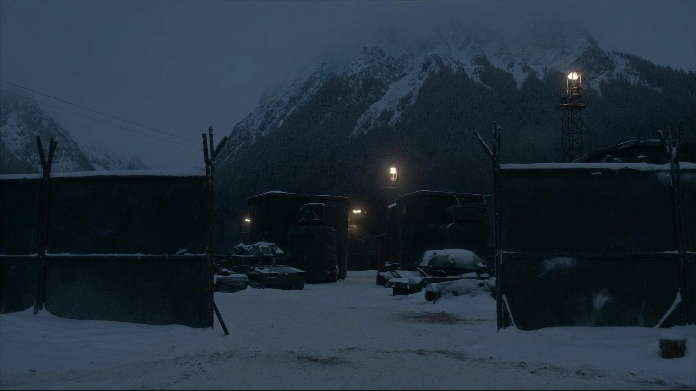

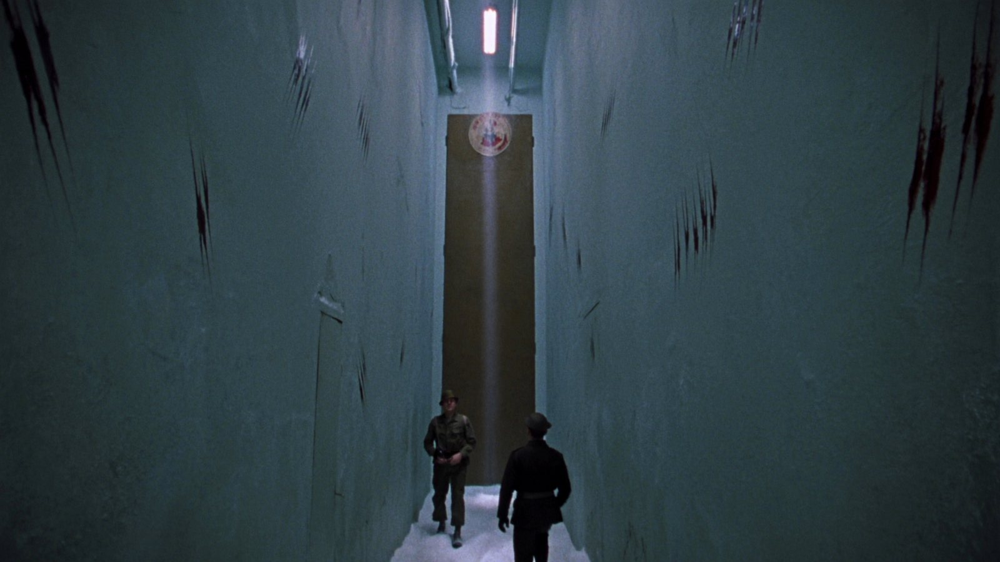

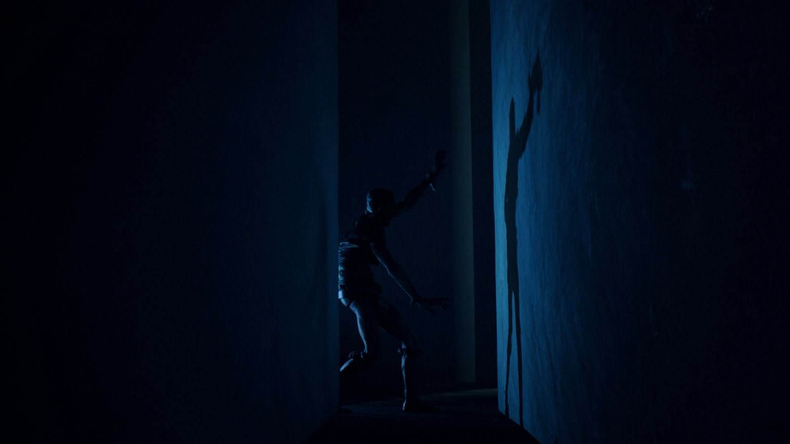

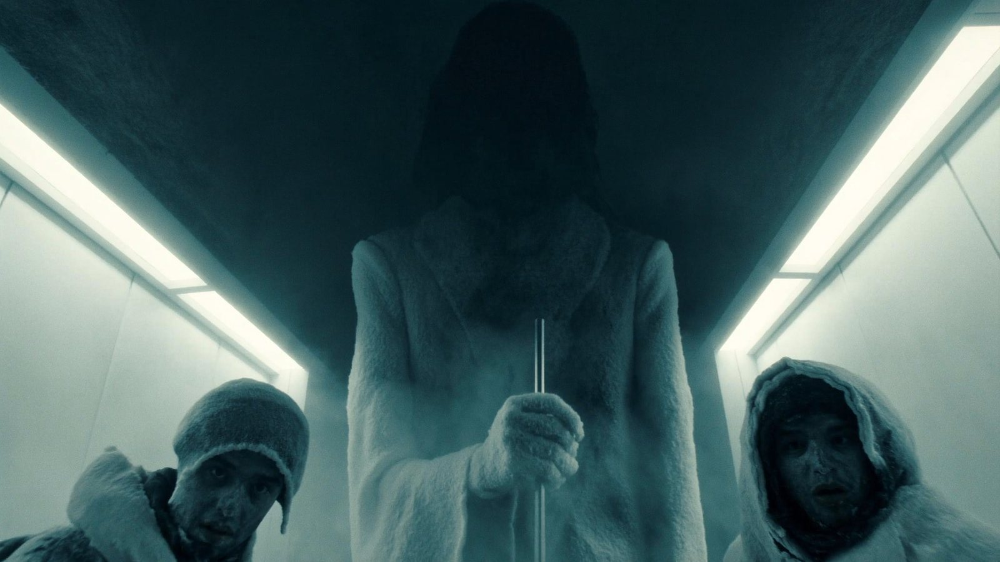

## 7. A Journey Into the Heartstream

One unbroken board; colour carries it, blue in the marrow, red in the river.

| # | Layer | Shot | Beat | Into next | Still |
| --- | --- | --- | --- | --- | --- |
| 1 | 3D | The marrow caverns, blue-skinned youths | The players meet | Push-in on the carving bench | [01-marrow-caverns](../games/heartstream/reference/01-marrow-caverns.jpg) |
| 2 | 1D | The Carving | Make a tool for another player | Pull-out |  |
| 3 | 1D | Bone Counters | A game you start and never finish | Pull-out |  |
| 4 | 1D | Marrow-Song | Compose the group's song | Fade |  |
| 5 | 3D | The Recognition: blue turning red | The shaft opens | Flatten | [05-recognition](../games/heartstream/reference/05-recognition.jpg) |
| 6 | 2D | The shaft through the bone, side-on | The climb | Cut |  |
| 7 | 3D | Emerging into the Bloodstream; the living raft | "It is not a tube. It is a river." | Flatten | [07-the-bloodstream](../games/heartstream/reference/07-the-bloodstream.jpg) |
| 8 | 2D | The river in cross-section, beasts below | Row on the beat; hide | Push-in on the chart |  |
| 9 | 1D | The Branch Chart at a delta | Vote on a route | Pull-out |  |
| 10 | 3D | The heart: a cathedral of muscle and light | Hold on. Grips fail | Cut | [10-the-heart](../games/heartstream/reference/10-the-heart.jpg) |
| 11 | 3D | A narrow vessel, one player alone, holding a carved tool | The ending | End |  |

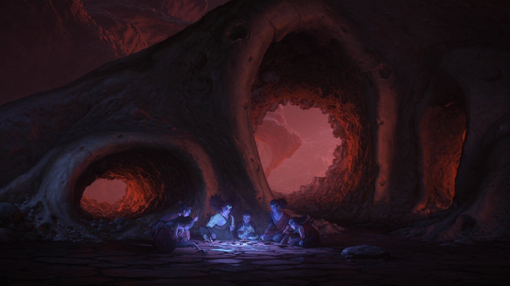

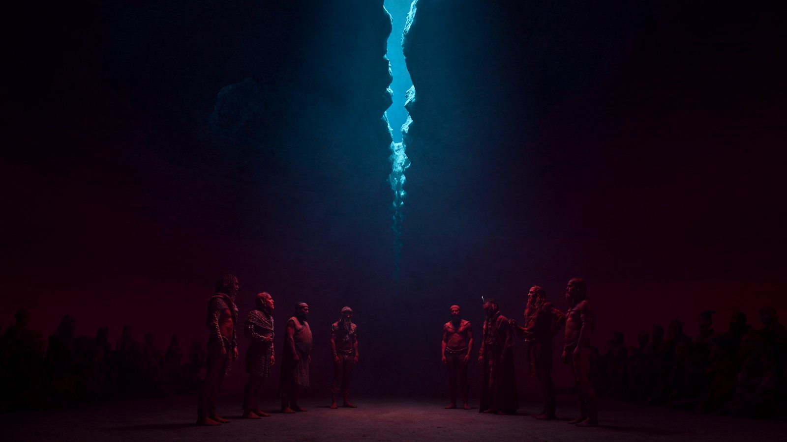

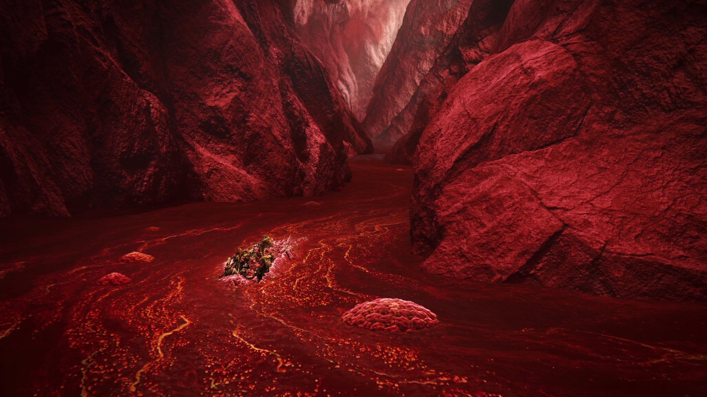

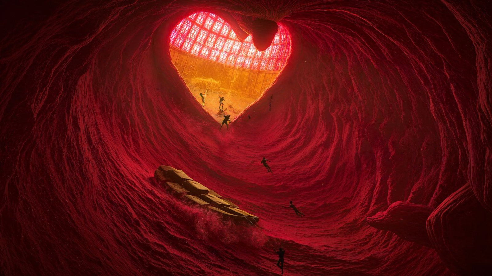

## 8. People of the Bark

Every season opens and closes on a pull-back: the epic, then the backyard.

| # | Layer | Shot | Beat | Into next | Still |
| --- | --- | --- | --- | --- | --- |
| 1 | 3D | Dawn on a bark city, dust raining from the ridges | The Tremor | Pull-out to the backyard: a squirrel | [01-the-tremor](../games/people-of-the-bark/reference/01-the-tremor.jpg) |
| 2 | 1D | Tremor Scroll | The scholars record its pattern | Turn the page |  |
| 3 | 1D | Omen Spread before the elders | Decide what it meant | Pull-out |  |
| 4 | 3D | The city from above, building along the cracks | Spring | Flatten | [04-the-city](../games/people-of-the-bark/reference/04-the-city.jpg) |
| 5 | 2D | The crack runner, side-on | Carry the omen before the next tremor | Cut |  |
| 6 | 1D | Sap Kitchen | Food, sealant or offering | Fade to summer |  |
| 7 | 1D | The Ring Door | Turn the rings into line | Pull-out |  |
| 8 | 2D | Crack defence against a fortress-sized insect | Hold the barricades | Fade to autumn | [08-crack-defence](../games/people-of-the-bark/reference/08-crack-defence.jpg) |
| 9 | 1D | Trunk and Shadow | Its rules have changed with their beliefs | Fade to winter |  |
| 10 | 3D | A shadow across the whole world | The Coming of the Shadow | Pull-out: a hand checking for termites | [10-the-shadow](../games/people-of-the-bark/reference/10-the-shadow.jpg) |

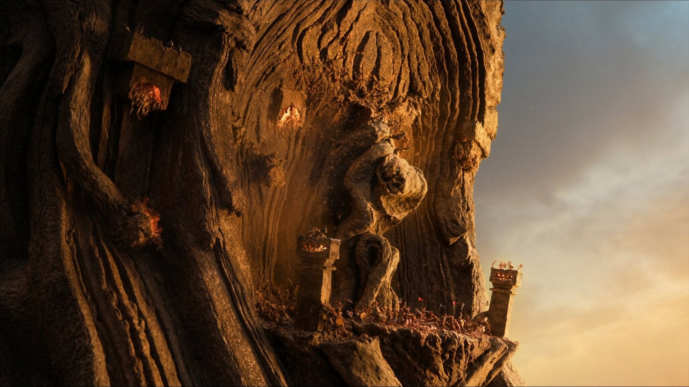

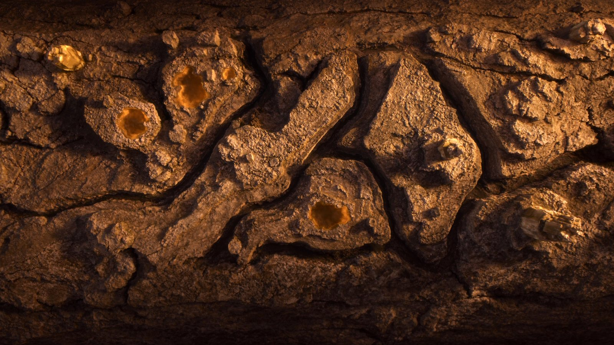

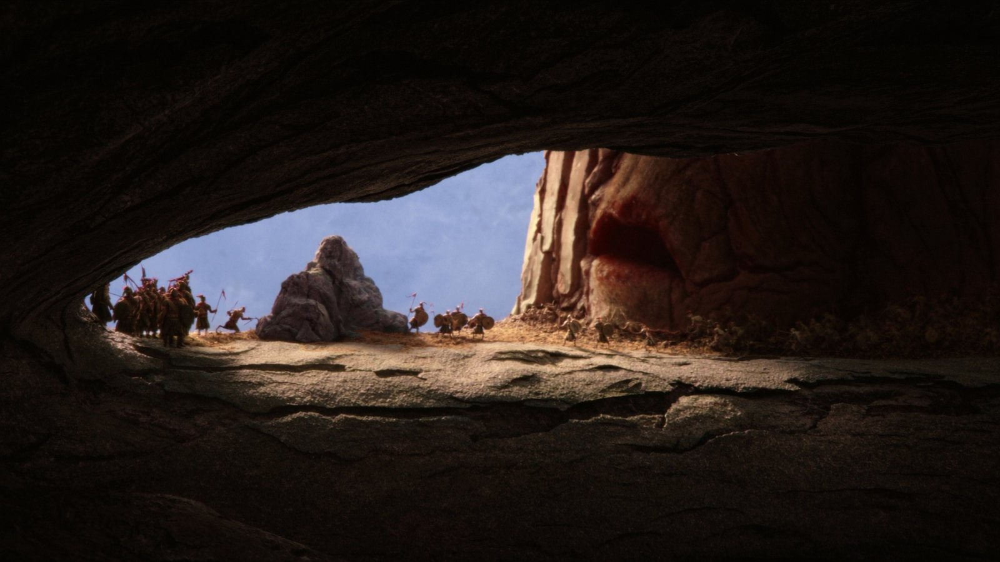

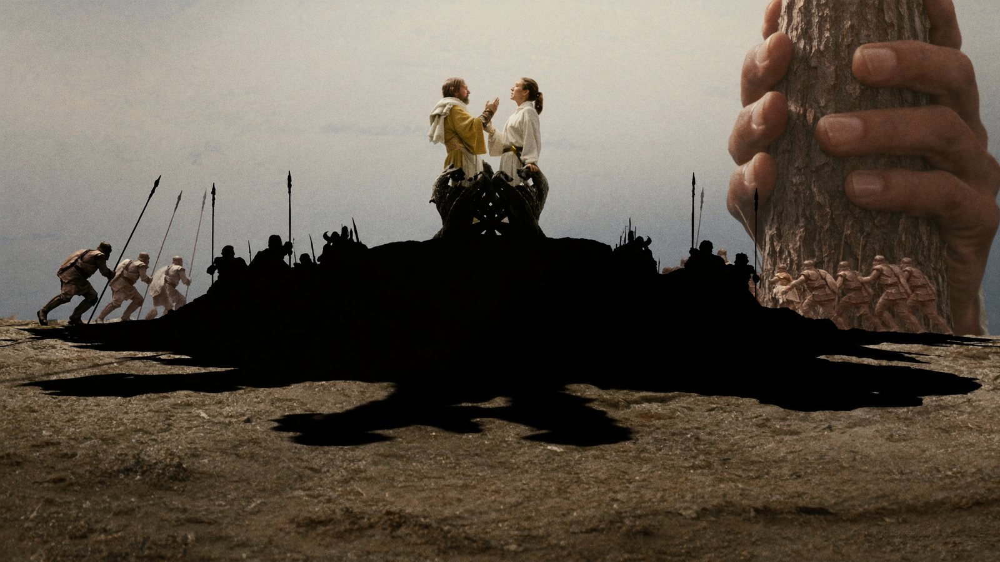

## 9. The Endless Temple

A book is entered by a push-in on its page and left by a pull-out to the reading chair.

| # | Layer | Shot | Beat | Into next | Still |
| --- | --- | --- | --- | --- | --- |
| 1 | 3D | A cluttered cell of books, a sunbeam on Elaris | Elaris wakes | Cut | [01-elaris-wakes](../games/endless-temple/reference/01-elaris-wakes.jpg) |
| 2 | 2D | The stacks side-on, shelves without end | Follow a book that leaks sand | Push-in on its clasp |  |
| 3 | 1D | The Clasps | Open the nameless book | Cut |  |
| 4 | 1D | Tea Blending | How deep to go | Push-in on the page |  |
| 5 | 3D | The storyteller circle, first person as Xandri | "We do not ride on the backs of the gods." | Cut | [05-storyteller-circle](../games/endless-temple/reference/05-storyteller-circle.jpg) |
| 6 | 1D | The Rule Tablet | Find what the shamans do not forbid | Cut |  |
| 7 | 3D | Night, silver dunes, a wave of sand rising | Xandri walks out | Flatten | [07-the-sand-sea](../games/endless-temple/reference/07-the-sand-sea.jpg) |
| 8 | 2D | The book's illustration: riding sand waves on leaf shoes | Third person as the tea fades | Pull-out to the chair | [08-living-illustration](../games/endless-temple/reference/08-living-illustration.jpg) |
| 9 | 3D | The temple again, something changed on a shelf | A piece of Elaris's past | Push-in on the title page |  |
| 10 | 1D | The Naming | Give the book its name | End of the book |  |

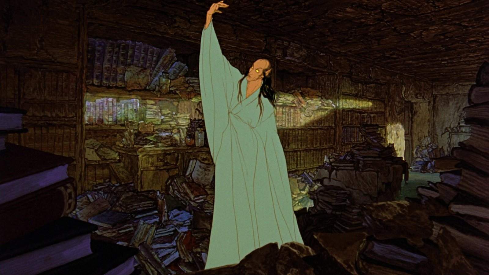

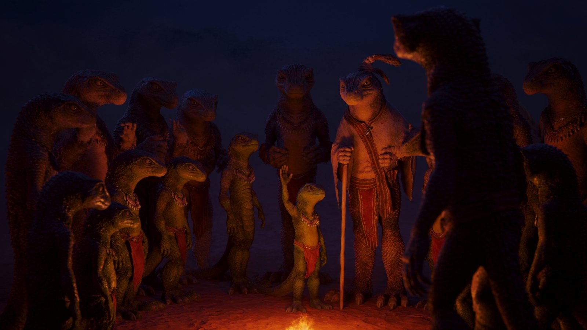

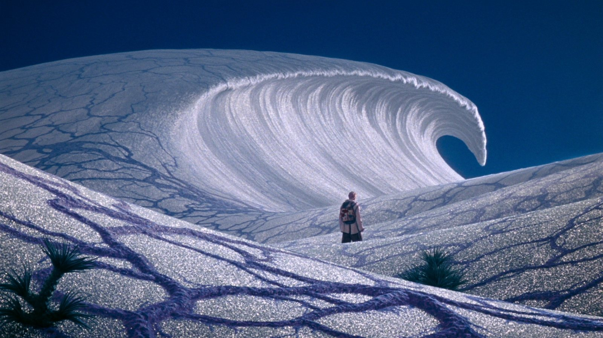

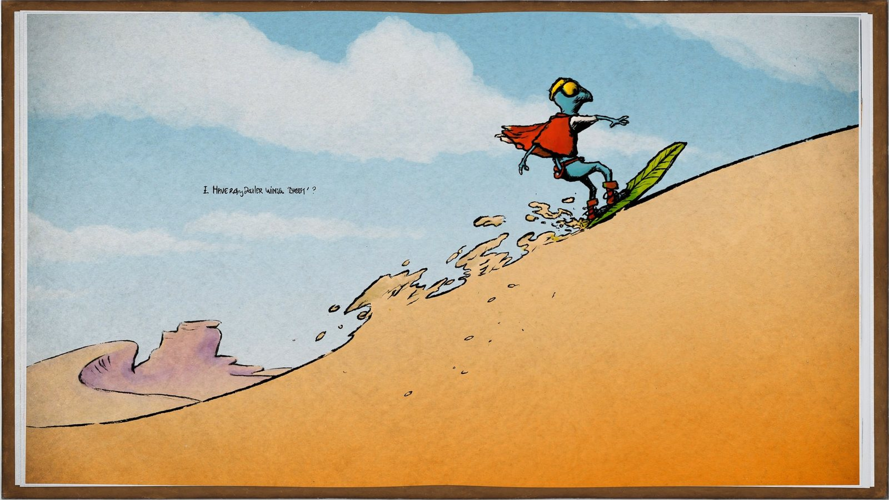

## 10. The Lord of the Sea

The chart is the hub: every voyage starts and ends on it.

| # | Layer | Shot | Beat | Into next | Still |
| --- | --- | --- | --- | --- | --- |
| 1 | 3D | An old boat's cabin at sunrise, bottles rolling | Alexi wakes | Cut | [01-the-cabin](../games/lord-of-the-sea/reference/01-the-cabin.jpg) |
| 2 | 3D | A dinghy on pale sand; a man at the tideline | "A man between worlds." | Cut |  |
| 3 | 3D | A hungover sailor and a sand-covered princess | "Alexi, I bring a warning." | Push-in on the chart | [03-the-princess](../games/lord-of-the-sea/reference/03-the-princess.jpg) |
| 4 | 1D | Dead Reckoning | Plot the first course | Pull-out, flatten |  |
| 5 | 2D | The engraved sea, a storm half-answering him | Stir the water | Cut | [05-engraved-sea](../games/lord-of-the-sea/reference/05-engraved-sea.jpg) |
| 6 | 3D | A Company port, one flag on every mast | The order is real | Push-in on the tavern table |  |
| 7 | 1D | Liar's Tide | Win a crew and the news | Cut |  |
| 8 | 1D | The Charter | Find the clause that binds this port | Flatten |  |
| 9 | 2D | The deep, side-on | What the sea still holds of him | Cut |  |
| 10 | 1D | The Tea Board against the Lord of Tea | The final match | Pull-out |  |
| 11 | 3D | The open sea at the end | The ending the chart earned | End | [11-the-open-sea](../games/lord-of-the-sea/reference/11-the-open-sea.jpg) |

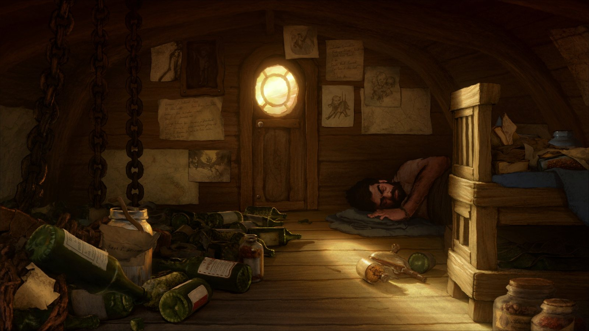

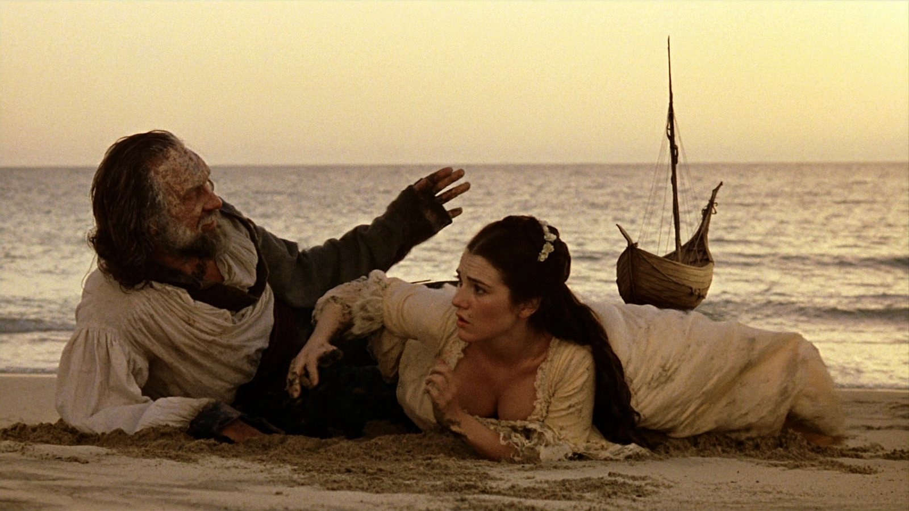

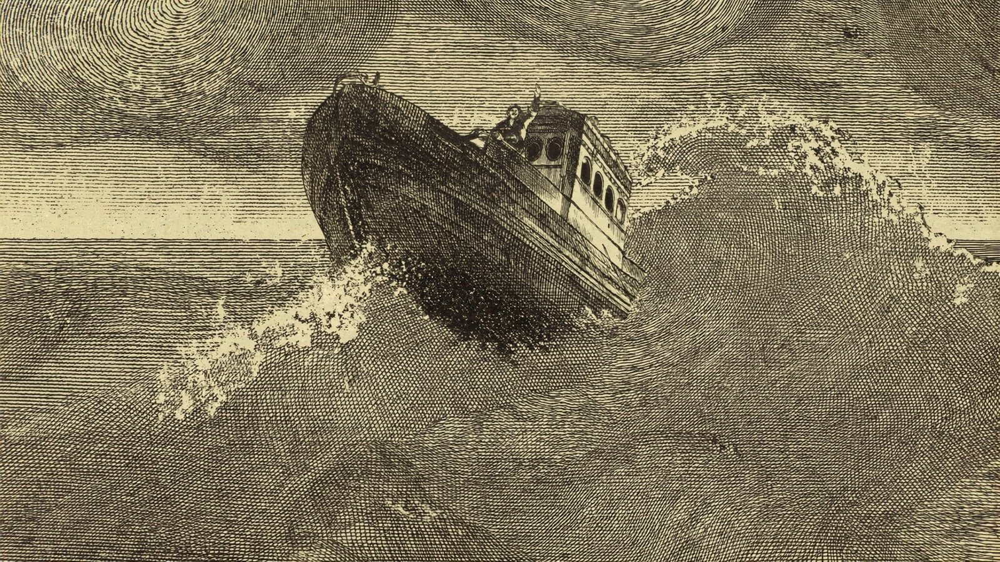

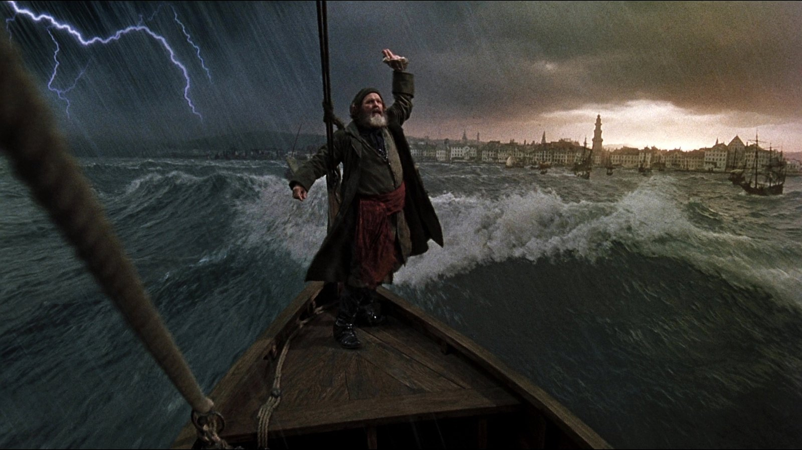
