# Behind the Peephole: art drawn by code

177 assets, generated by `python tools/art/build.py behind-the-peephole` from `art/src/`. Do not edit the
SVGs by hand; change the code and rebuild.

## title (1)

## figures (3)

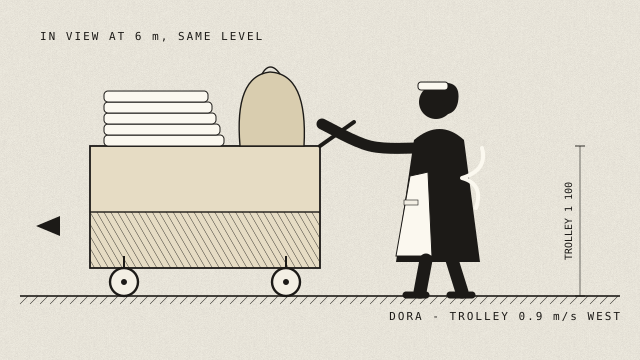
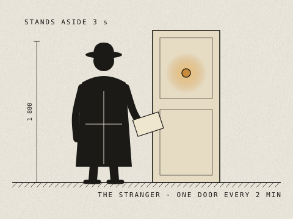
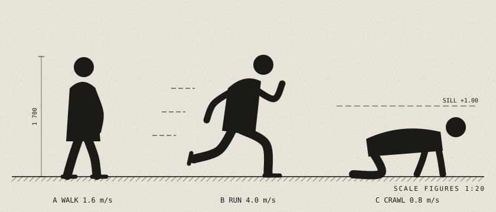

## backdrops (25)

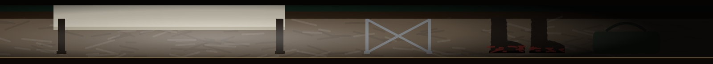
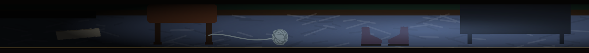
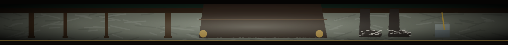
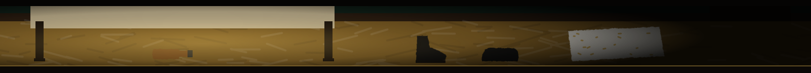
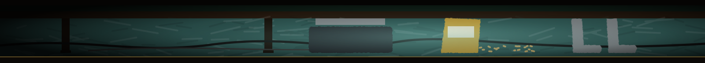
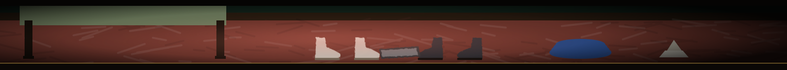
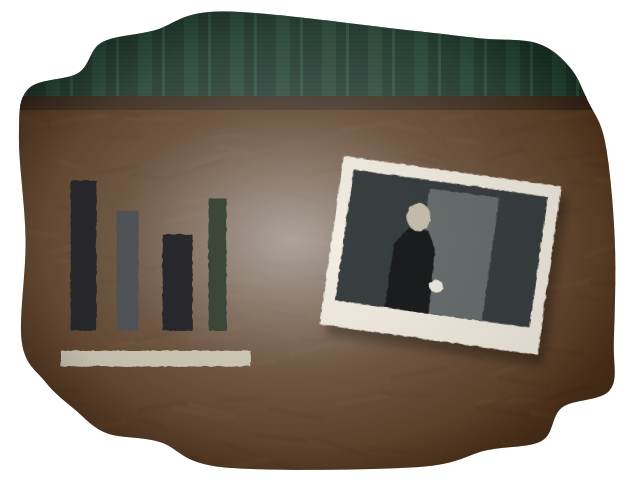
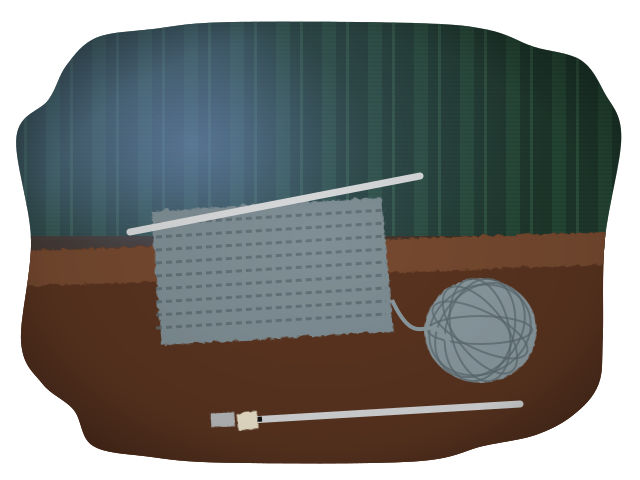
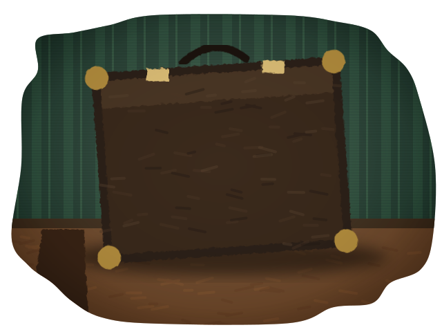
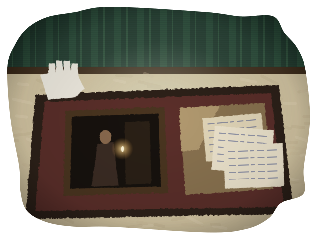
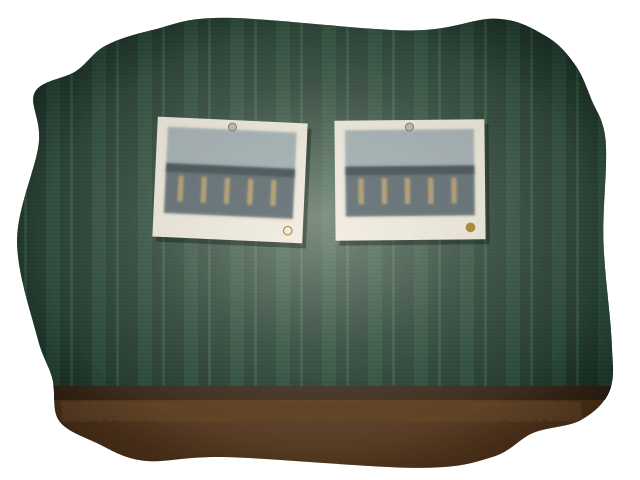
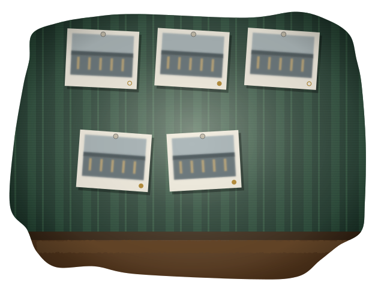
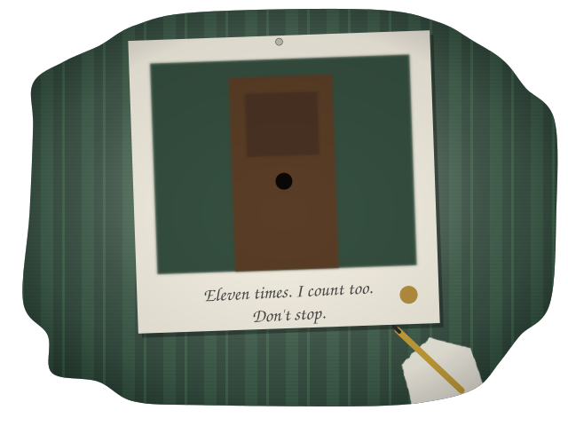
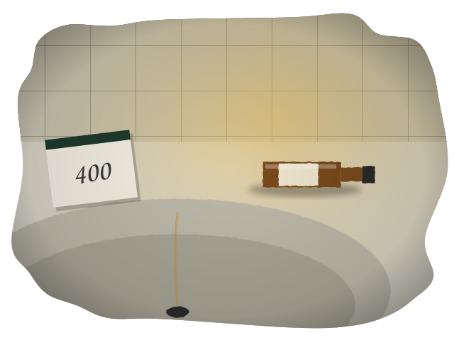
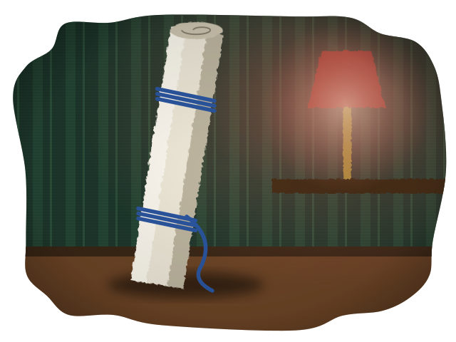
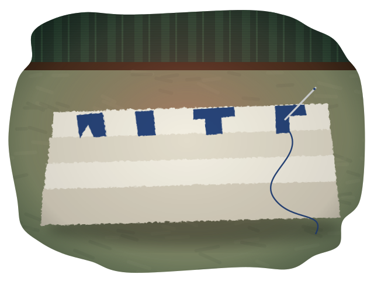
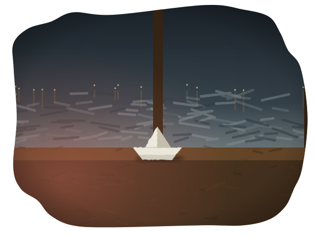
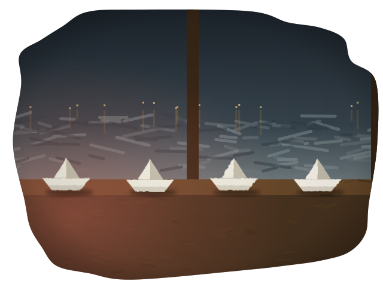
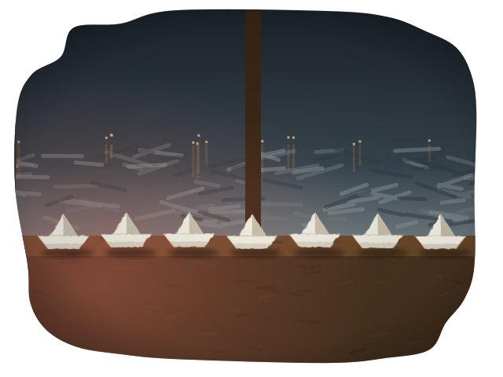
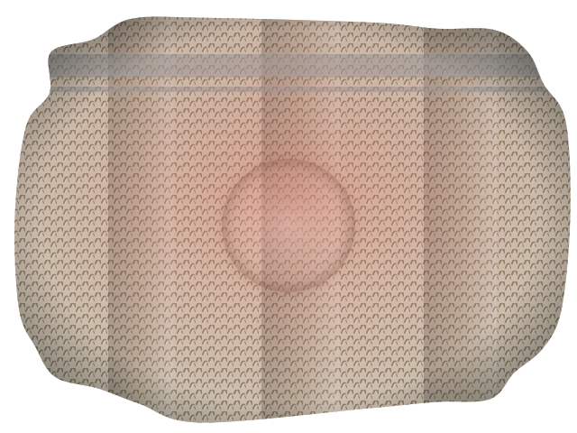
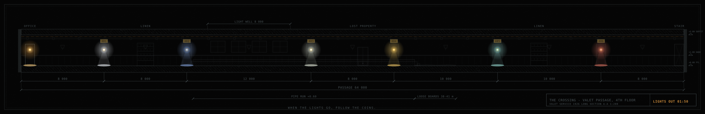
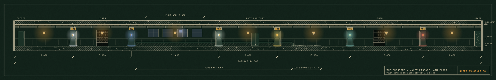
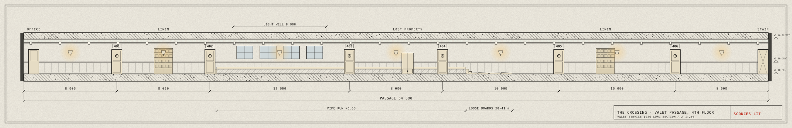
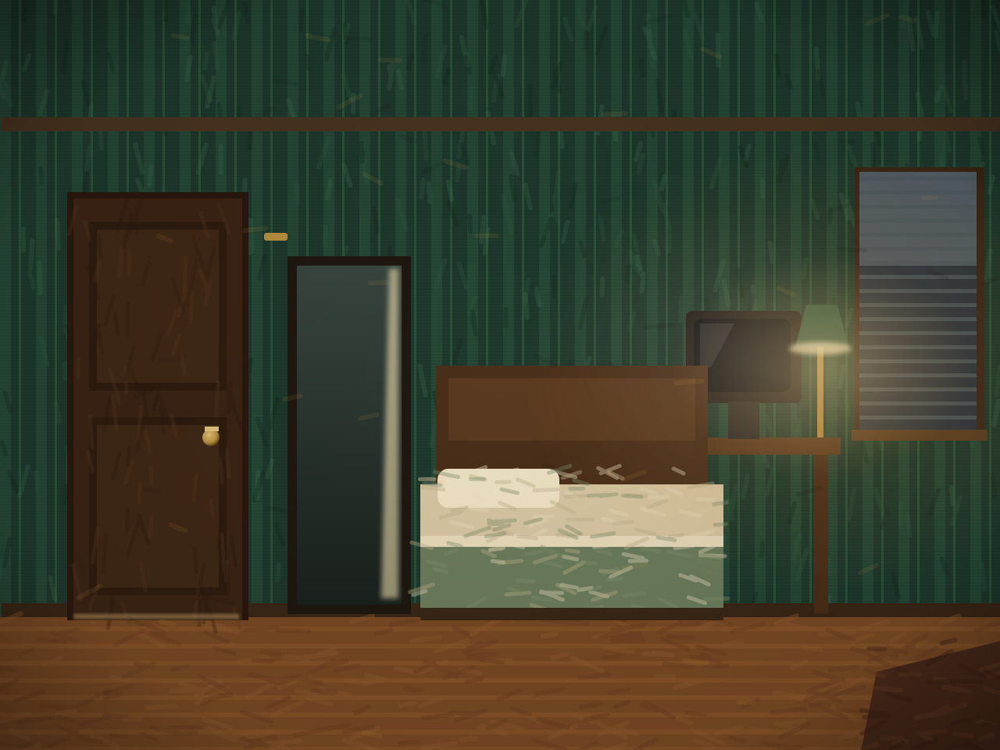
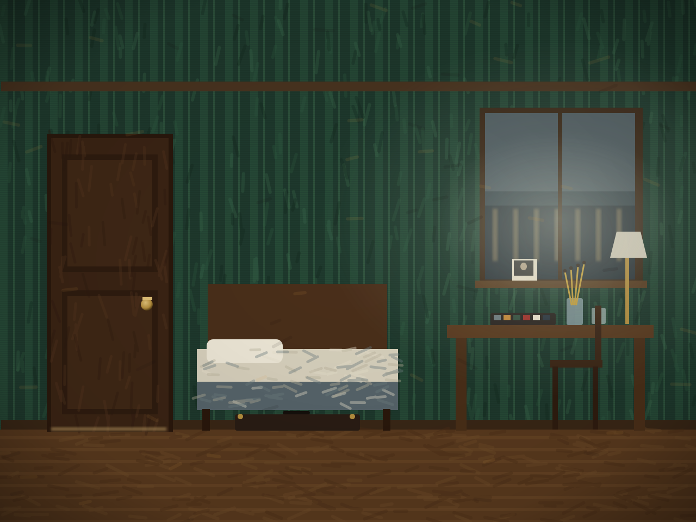

## cards (73)

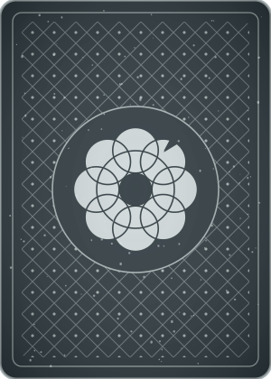
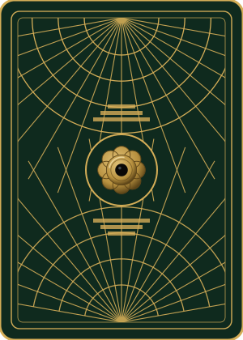
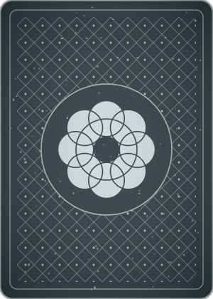
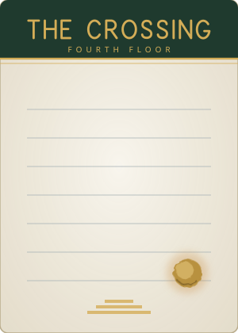
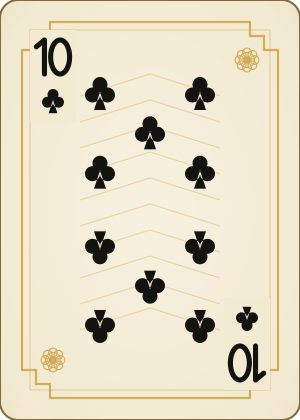
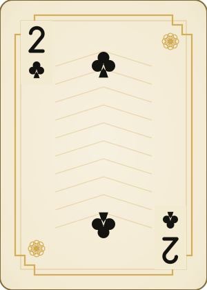
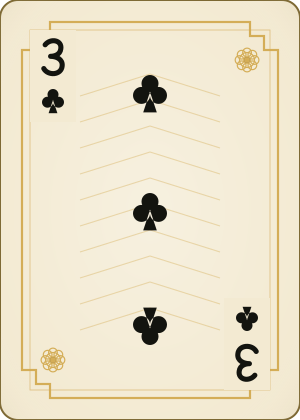
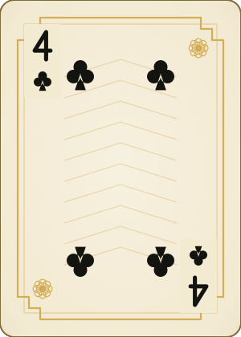
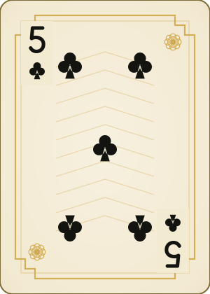
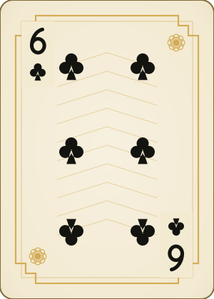
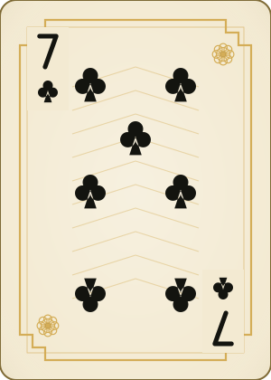
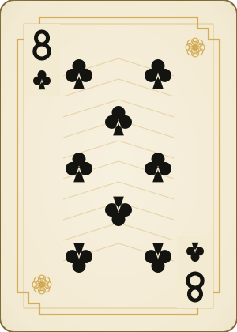
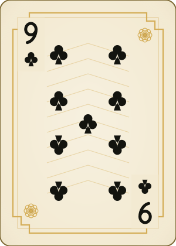
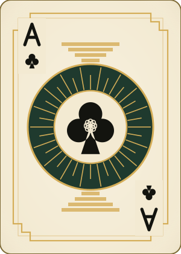
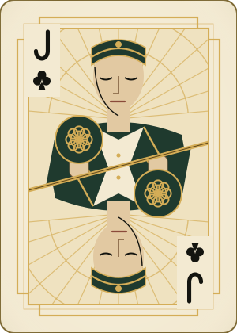
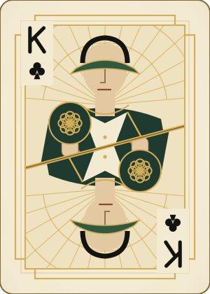
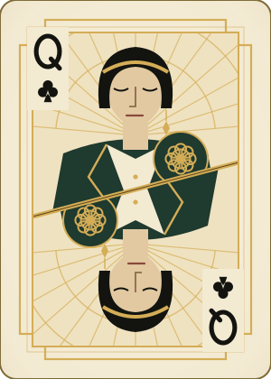
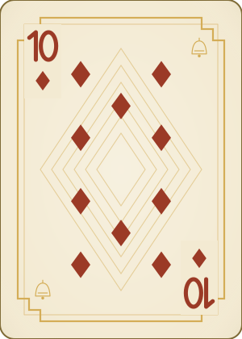
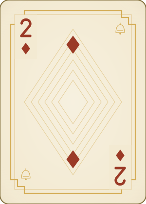
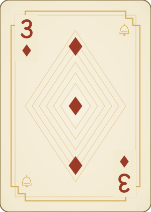
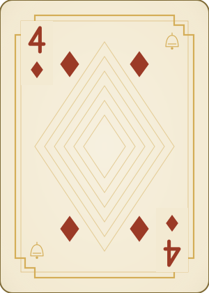
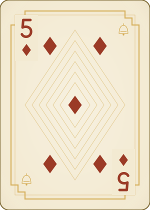

## pieces (32)

## chapters (8)

## ui (14)

## documents (14)

## maps (5)

## thread (2)

