# Dr. Tox: Fall: art drawn by code

184 assets, generated by `python tools/art/build.py dr-tox-fall` from `art/src/`. Do not edit the
SVGs by hand; change the code and rebuild.

## title (2)

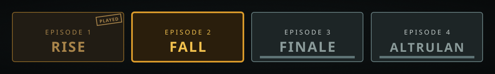
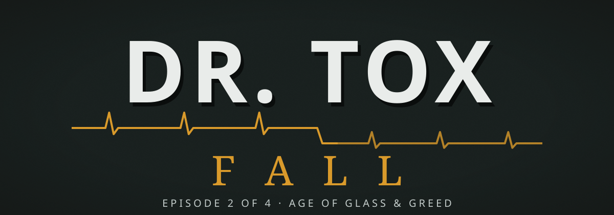

## figures (19)

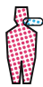

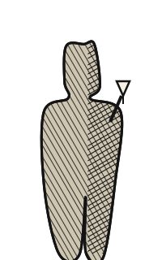
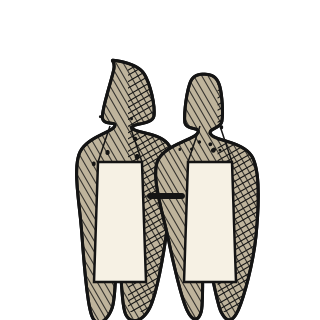
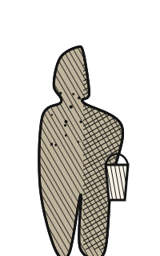
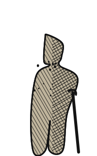
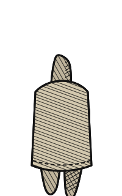
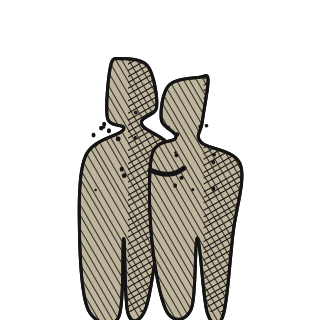
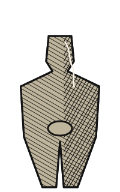
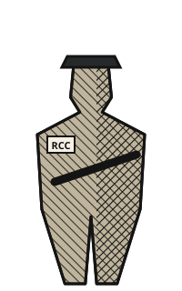
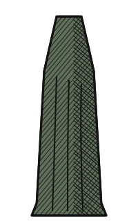
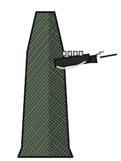
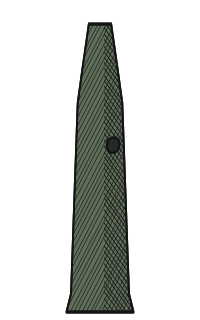
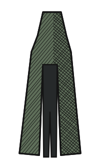
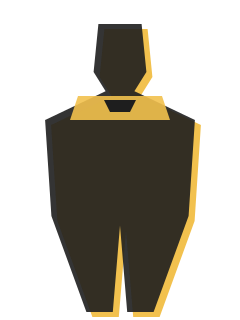
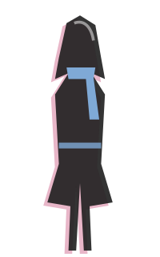
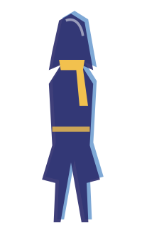
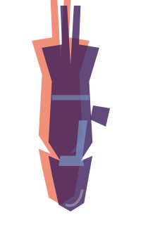
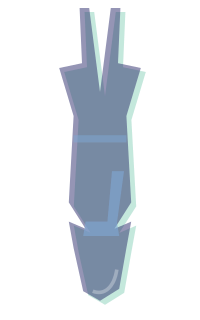

## backdrops (14)

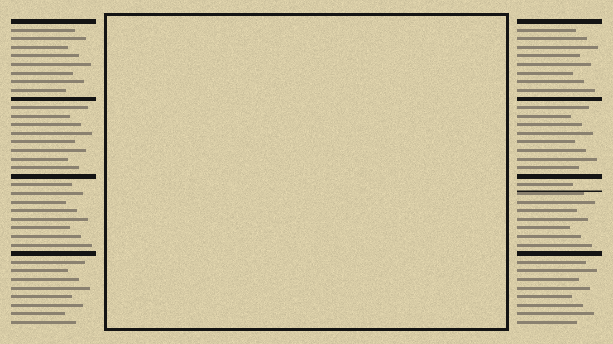
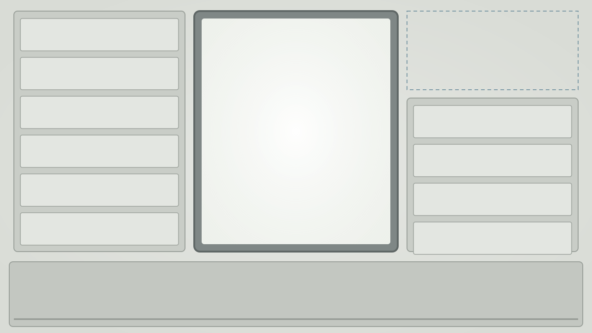
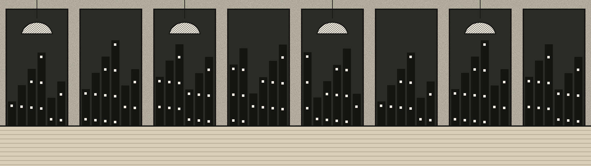
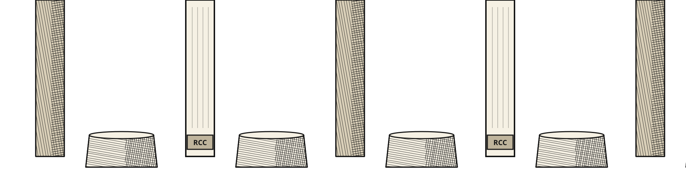
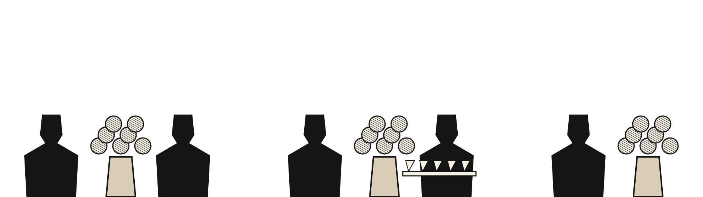
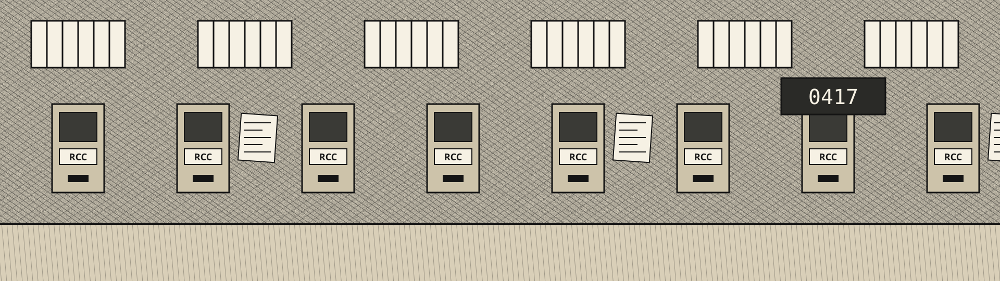
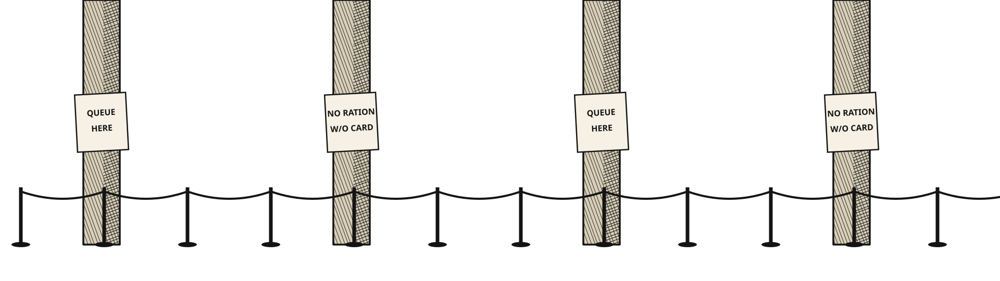
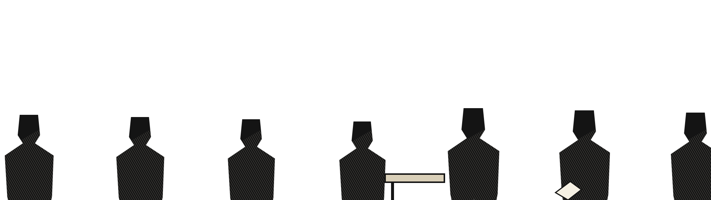
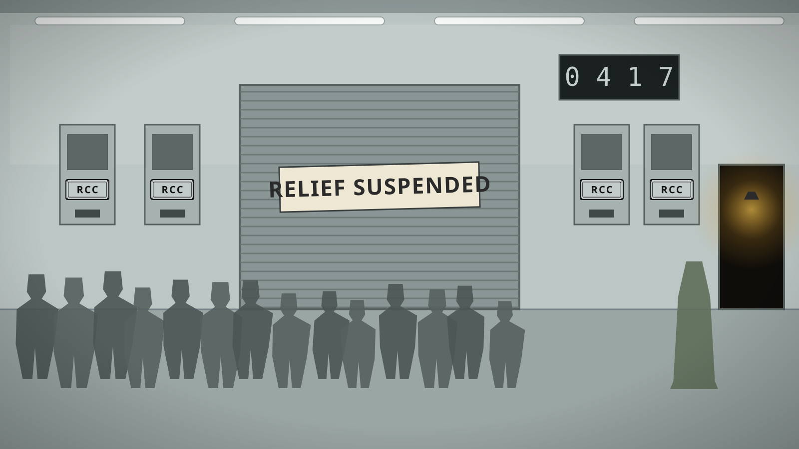
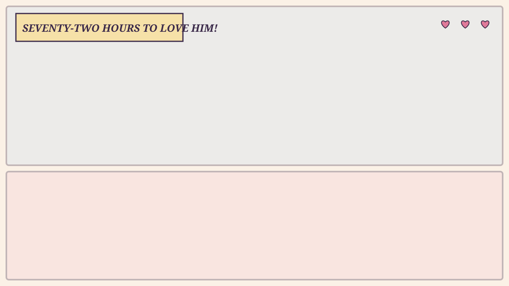
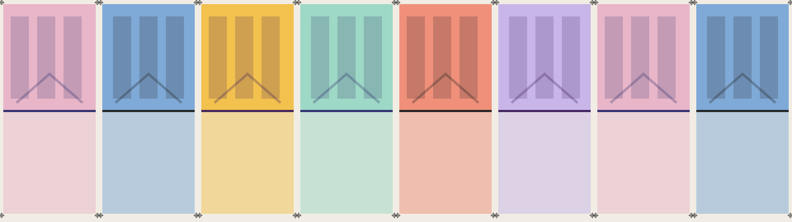
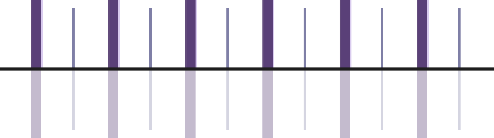
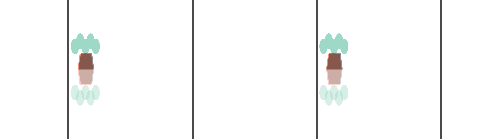
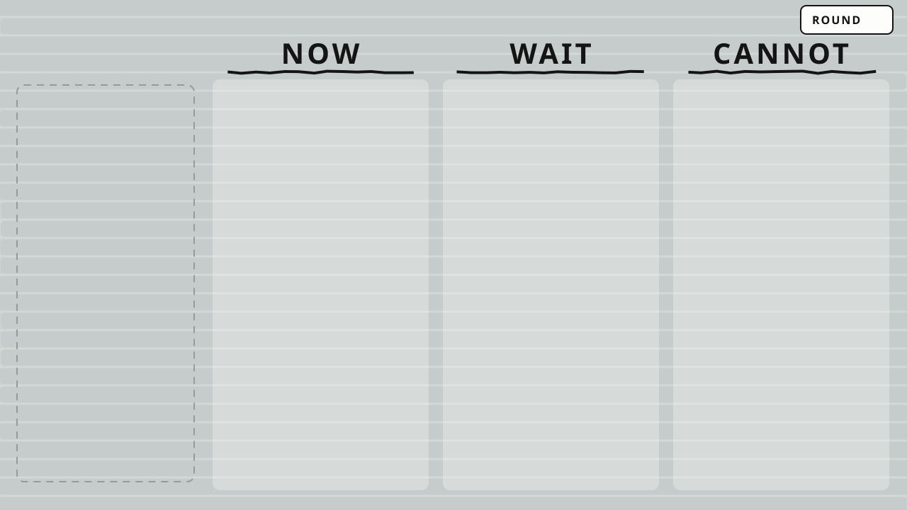

## cards (36)

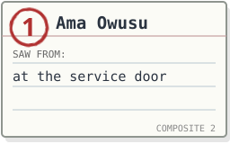
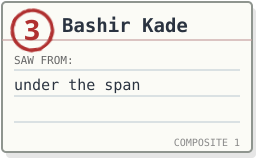
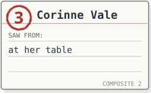
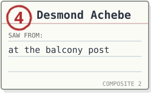
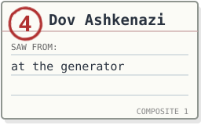
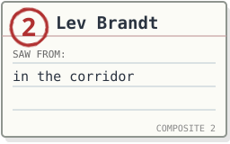
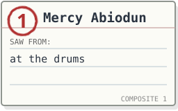
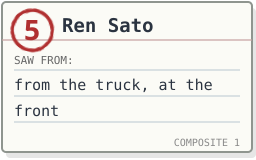
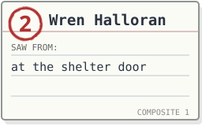
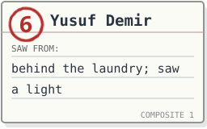
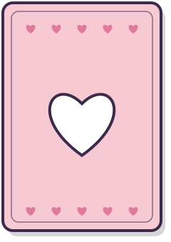
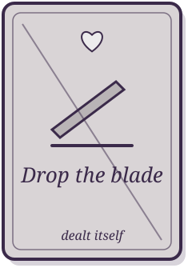
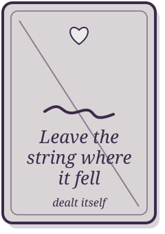
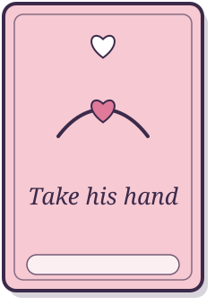
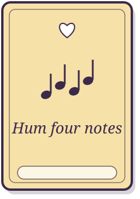
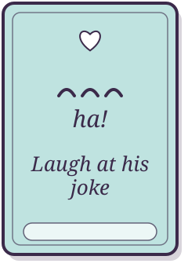

## pieces (70)

## endings (4)

## chapters (11)

## ui (19)

## documents (7)

## maps (2)

