# The Endless Temple: art drawn by code

134 assets, generated by `python tools/art/build.py endless-temple` from `art/src/`. Do not edit the
SVGs by hand; change the code and rebuild.

## title (10)

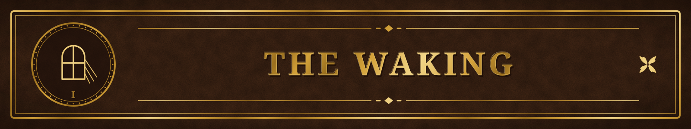
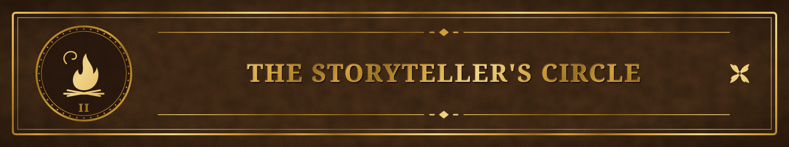
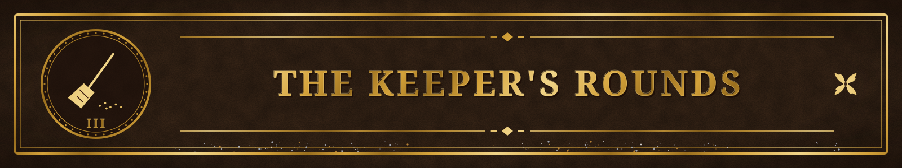
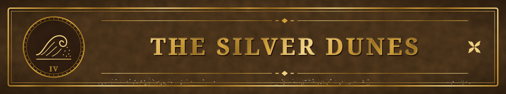
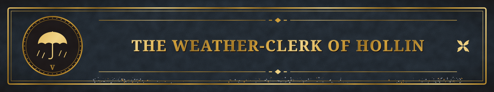
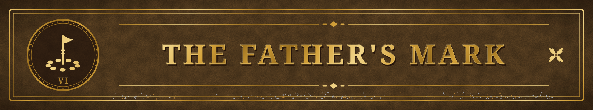
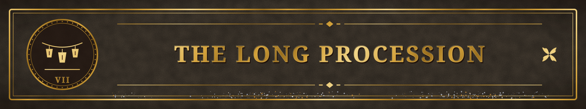
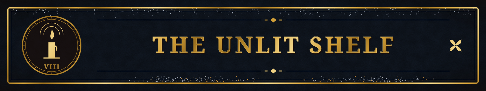
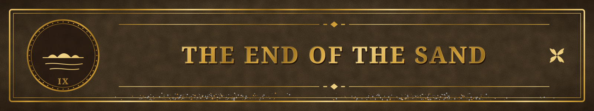
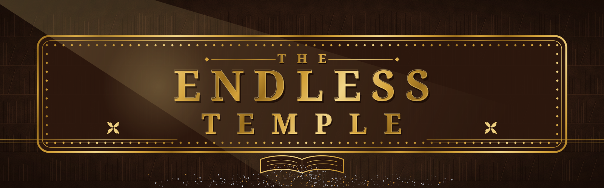

## figures (8)

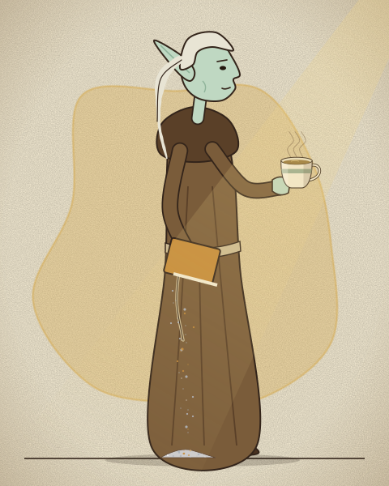
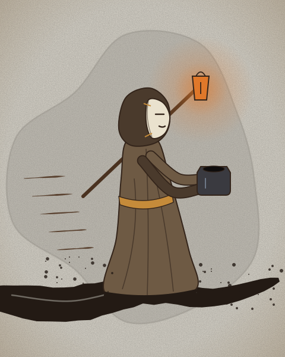
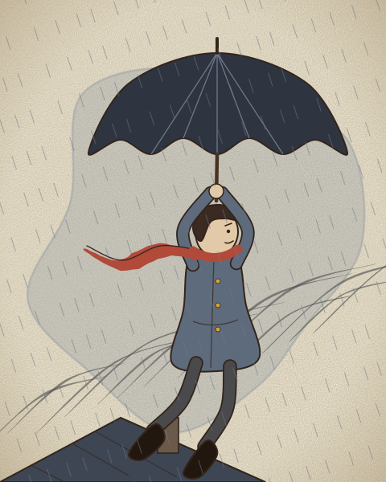
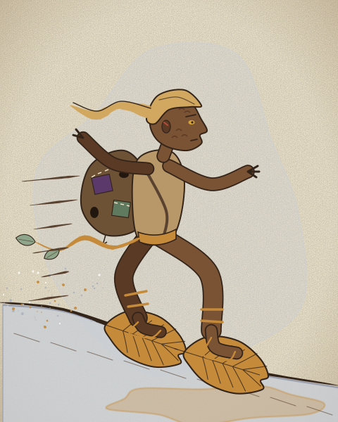
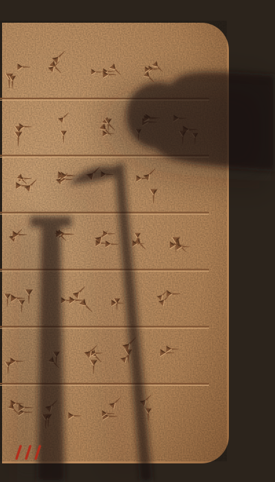
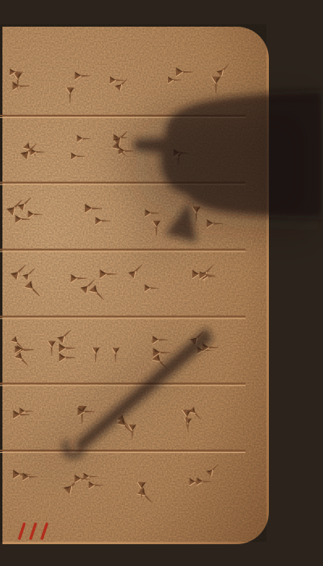
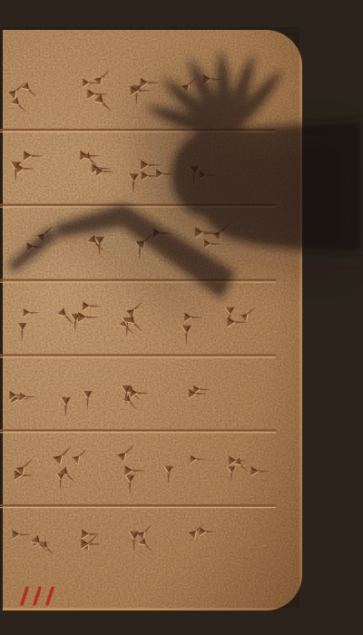
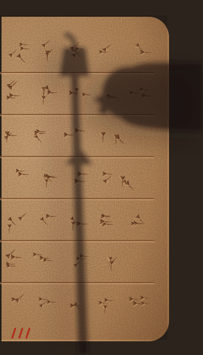

## backdrops (12)

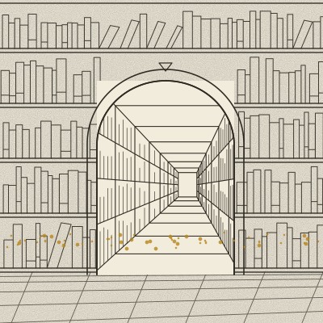
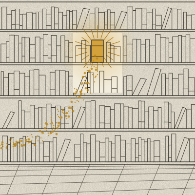
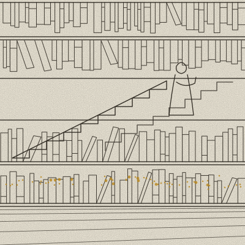
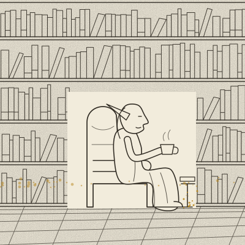
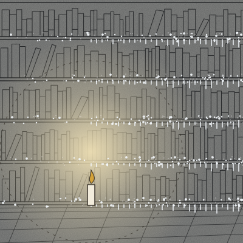
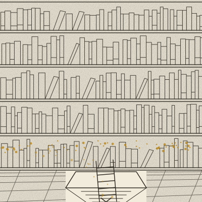
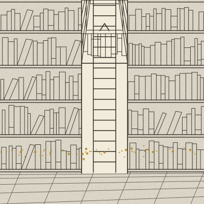
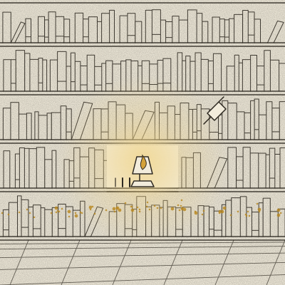
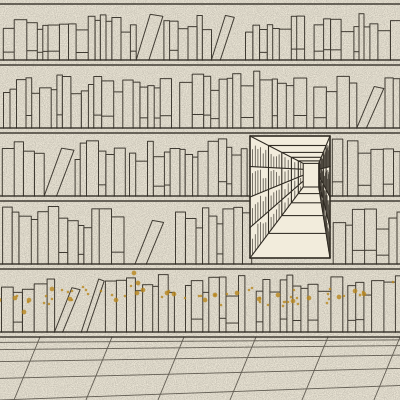
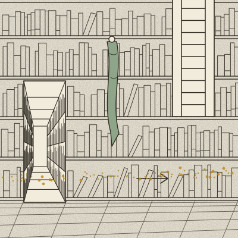
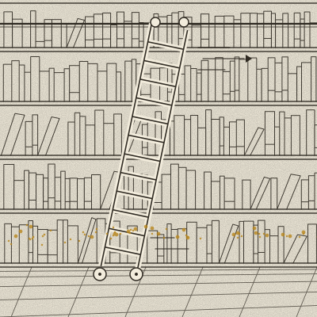
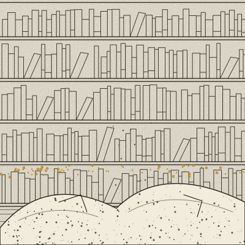

## pieces (46)

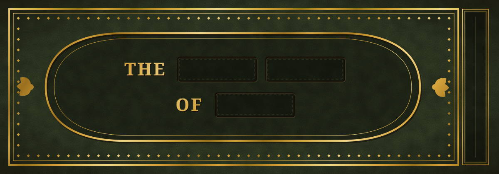
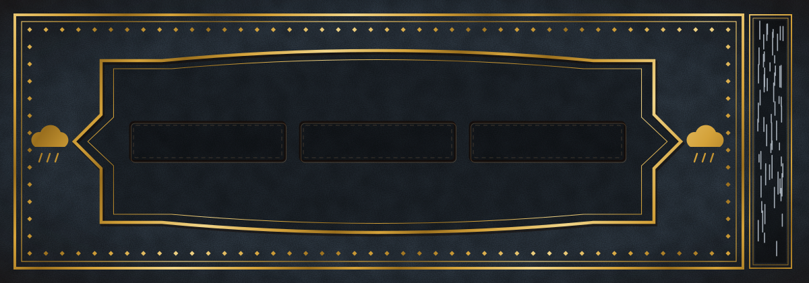
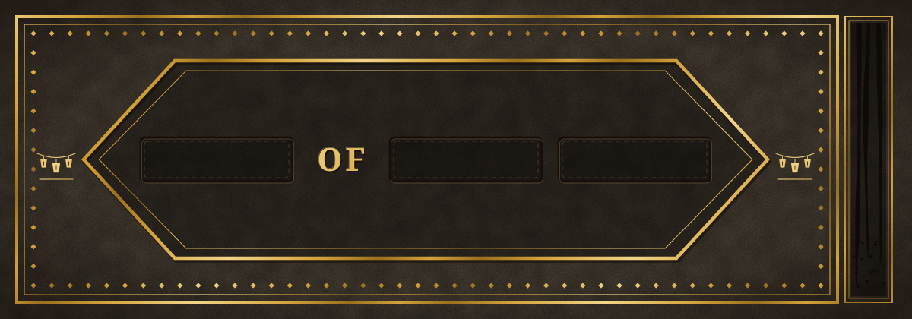
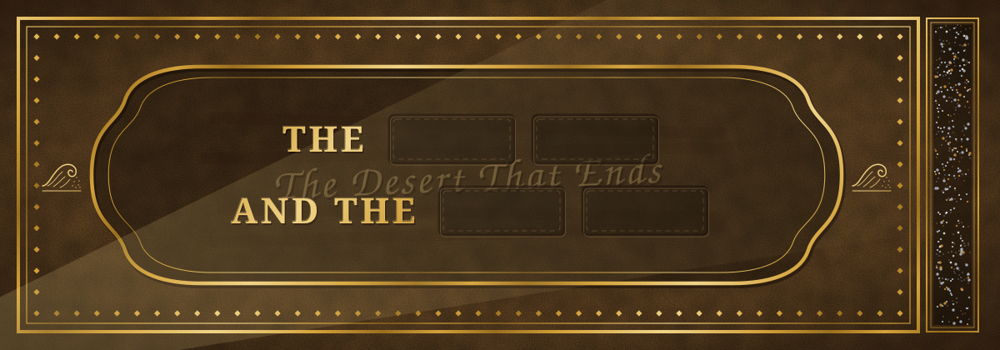
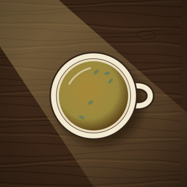
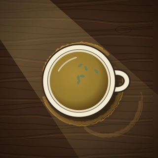
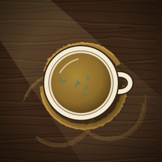
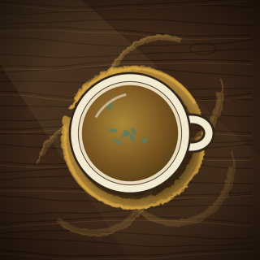
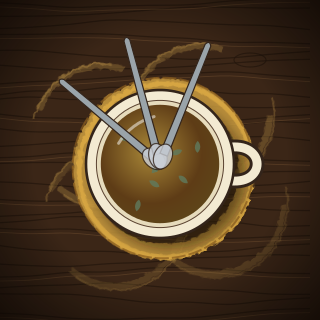
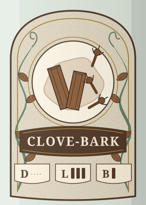
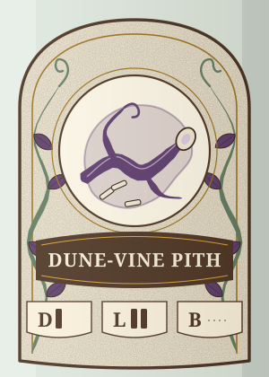
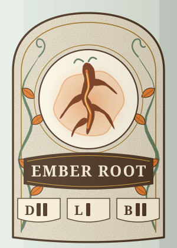
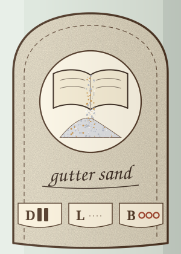
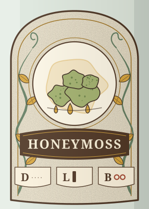
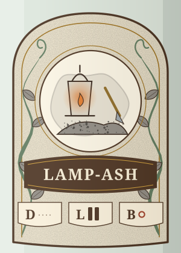
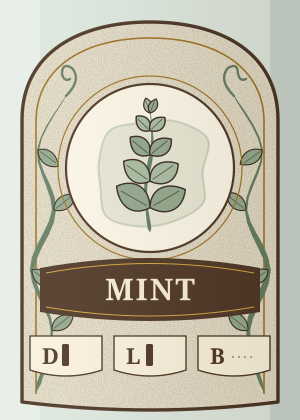
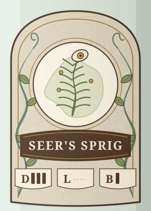
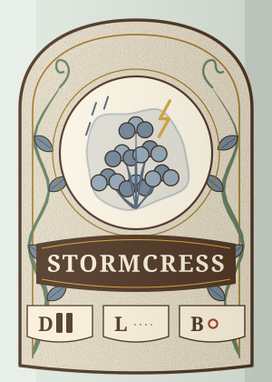
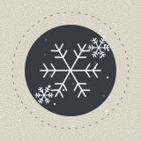
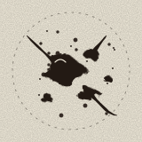

## chapters (9)

## ui (30)

## documents (6)

## maps (11)

## thread (2)

