# The Redacted Testament of Lira Calyx: art drawn by code

92 assets, generated by `python tools/art/build.py lira-calyx` from `art/src/`. Do not edit the
SVGs by hand; change the code and rebuild.

## title (1)

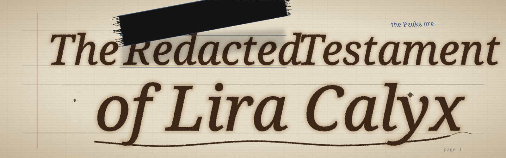

## figures (11)

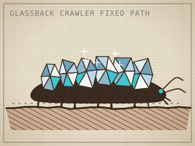
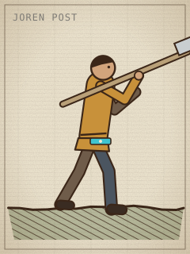
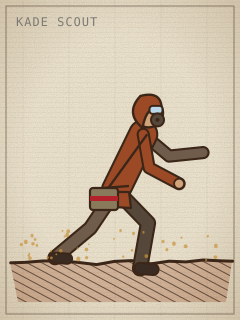
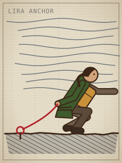
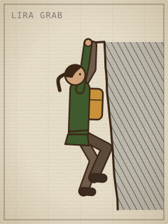
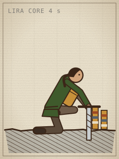
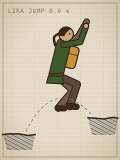
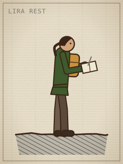
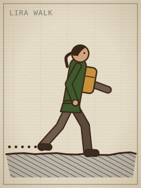
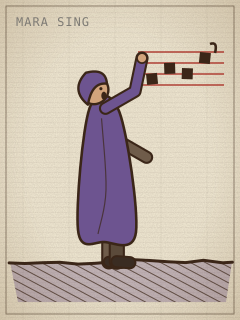
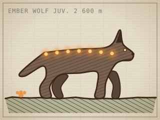

## backdrops (6)

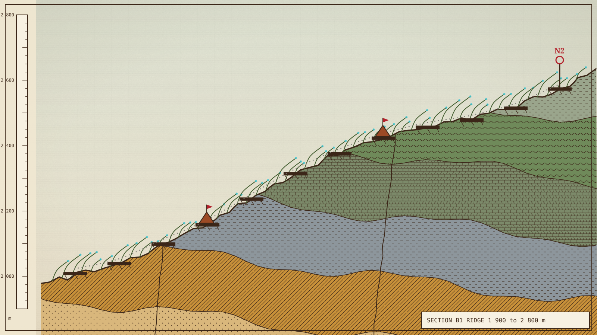
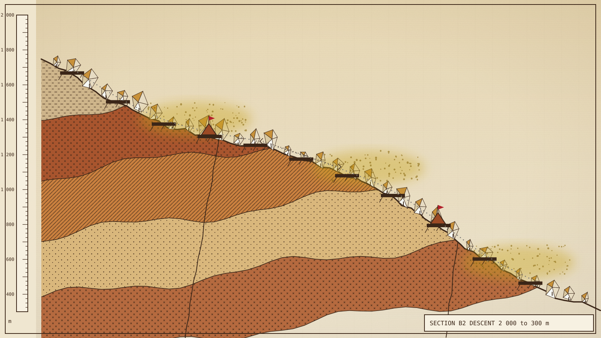
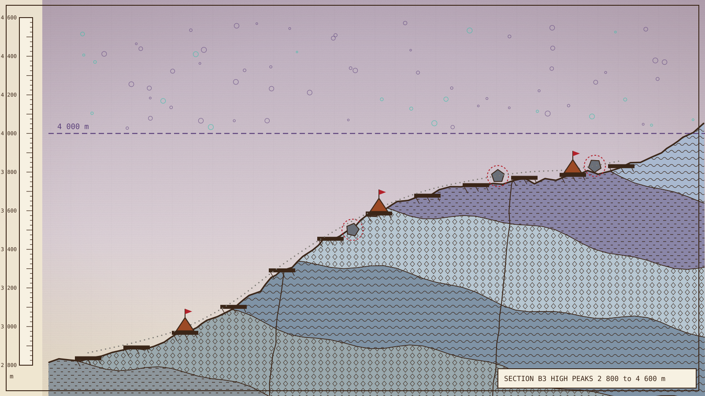
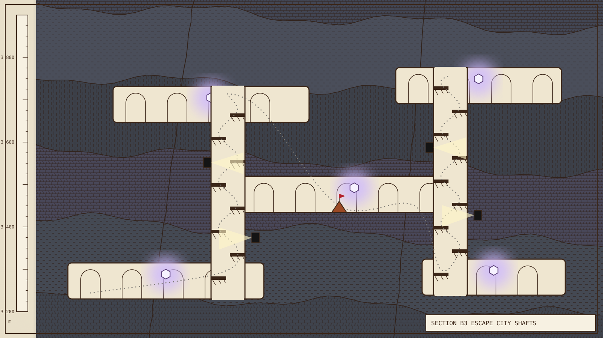
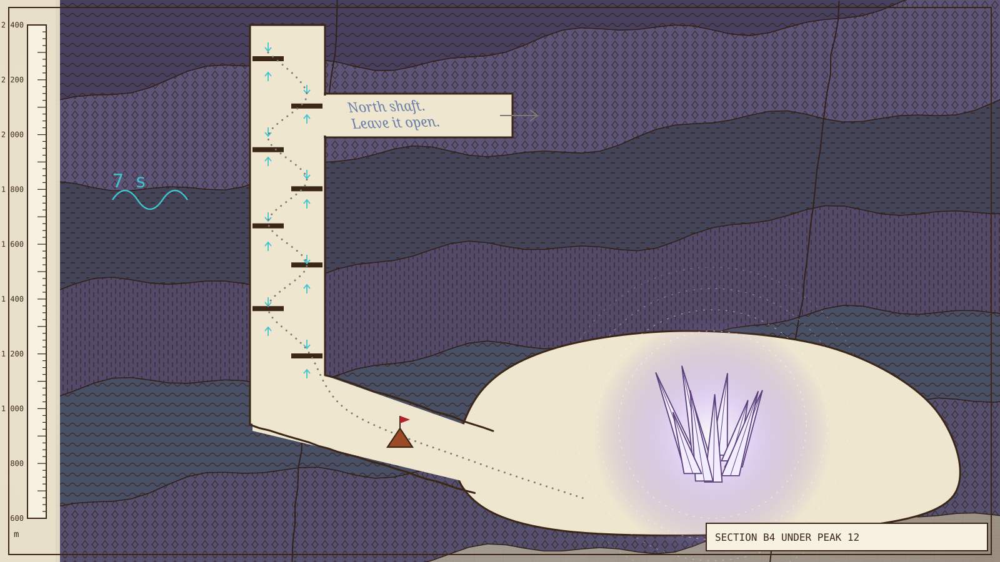
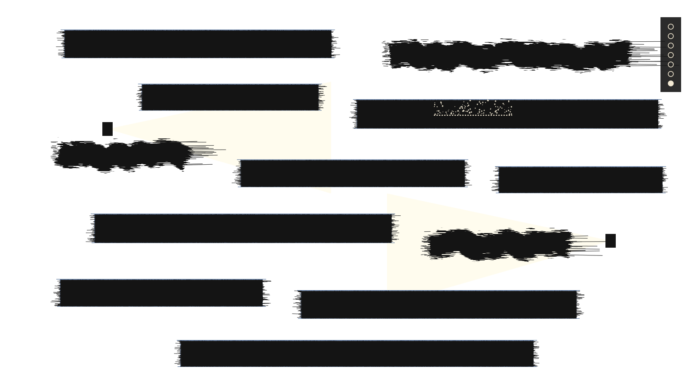

## pieces (29)

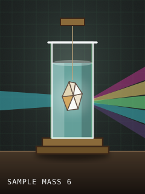
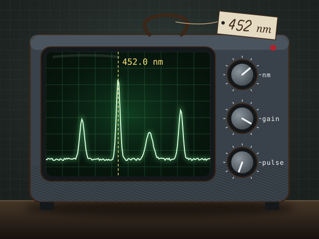
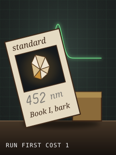
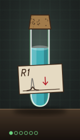
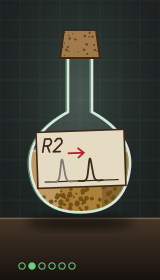
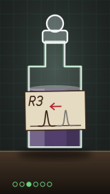
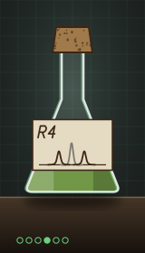
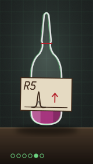
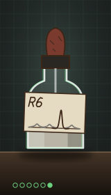
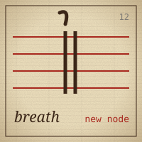
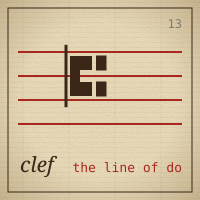
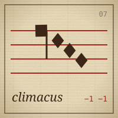
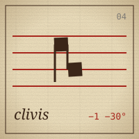
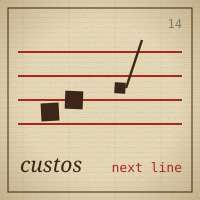
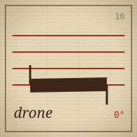
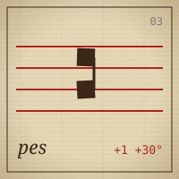
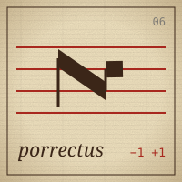
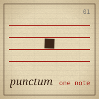
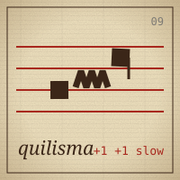
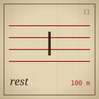
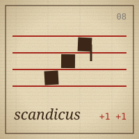
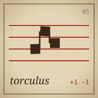
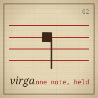
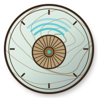
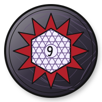
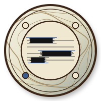
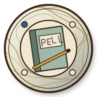
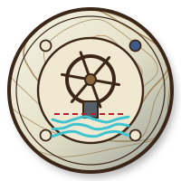
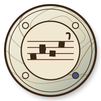

## ui (28)

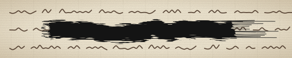
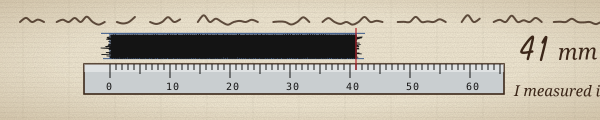
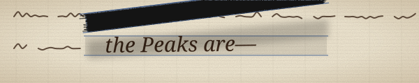

## documents (14)

## maps (1)

## thread (2)

