# Missing Campsites: art drawn by code

154 assets, generated by `python tools/art/build.py missing-campsites` from `art/src/`. Do not edit the
SVGs by hand; change the code and rebuild.

## title (6)

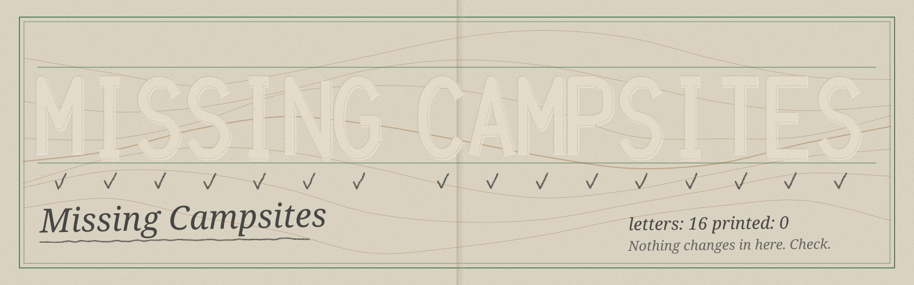
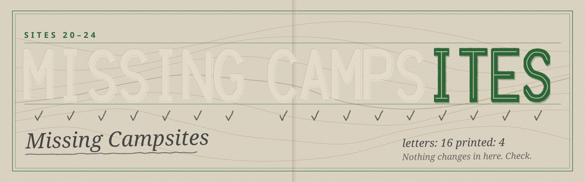
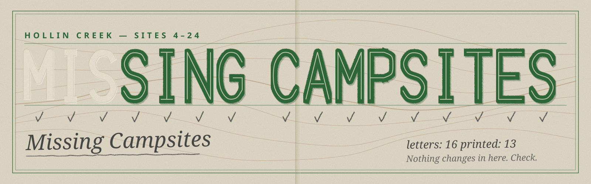
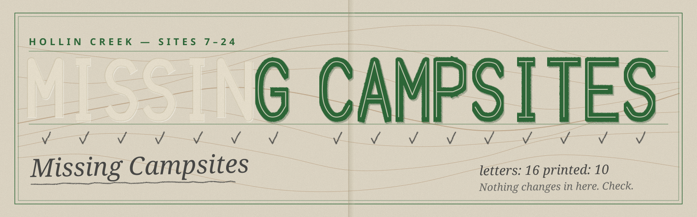
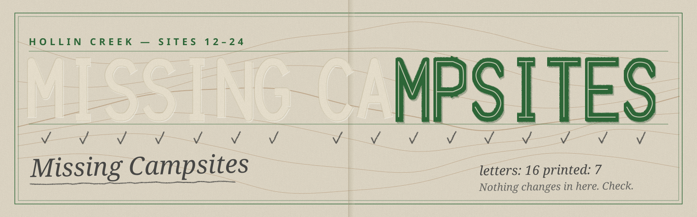
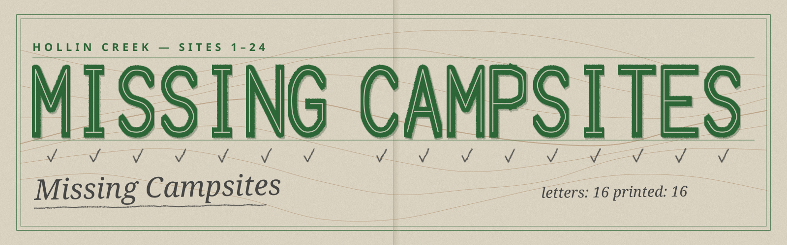

## figures (17)

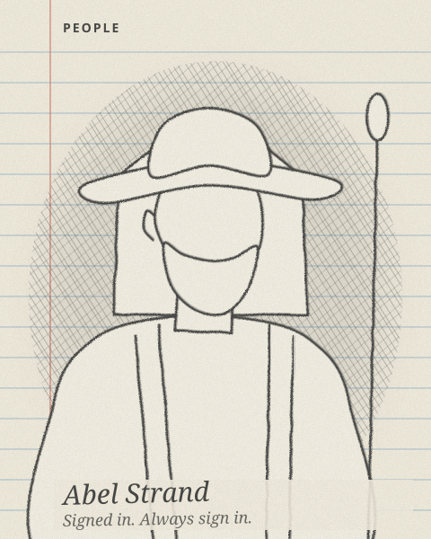
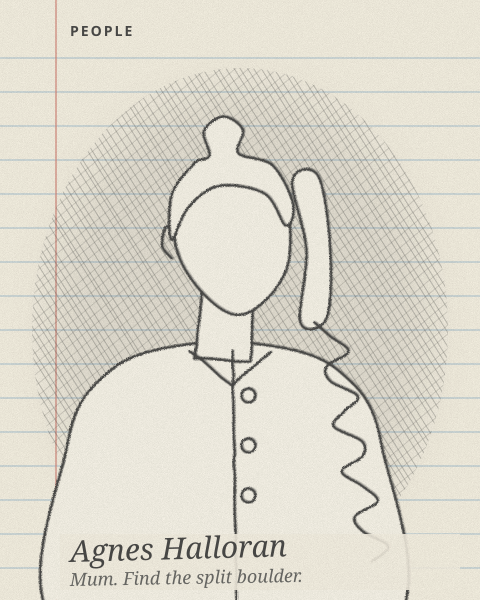
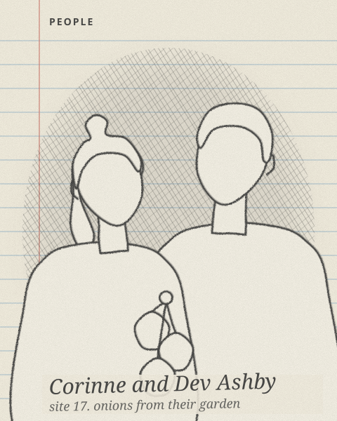
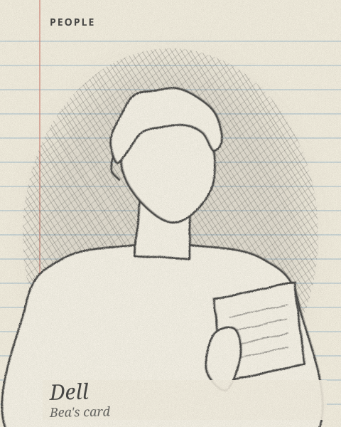
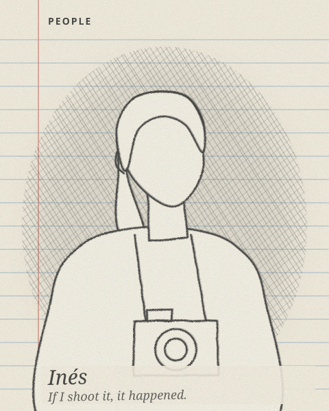
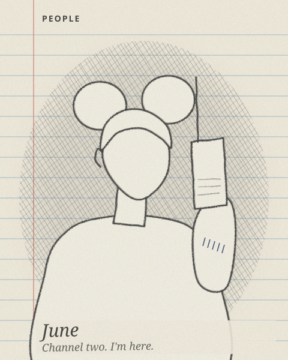
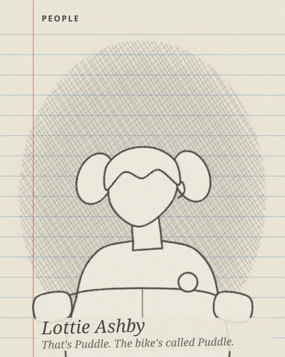
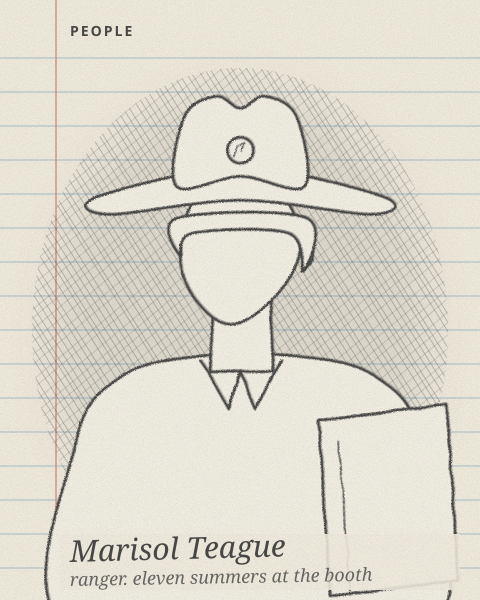
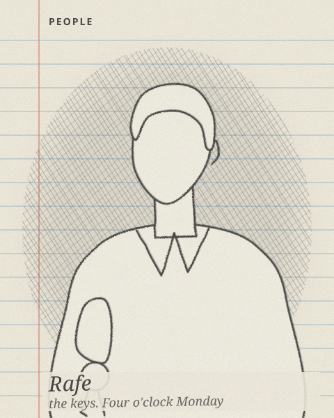
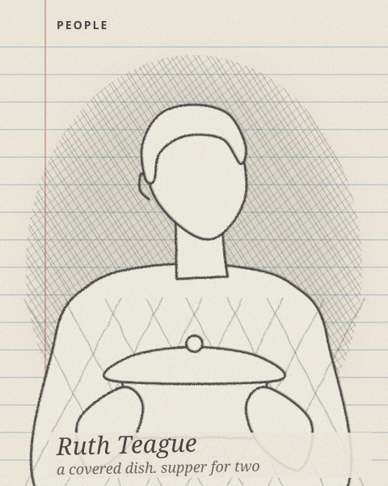
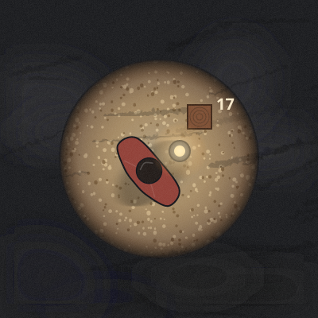
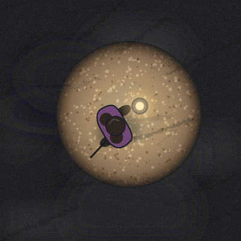
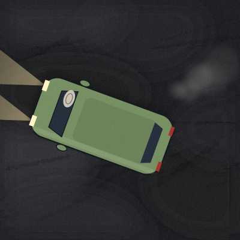
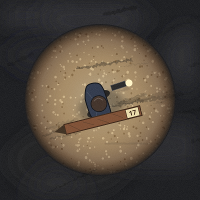
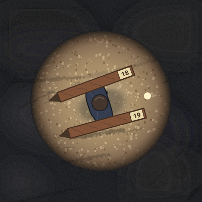
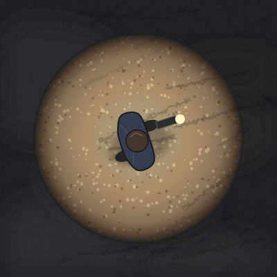
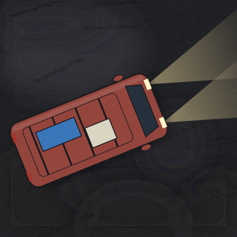

## backdrops (14)

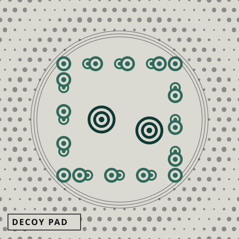
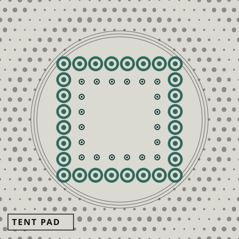
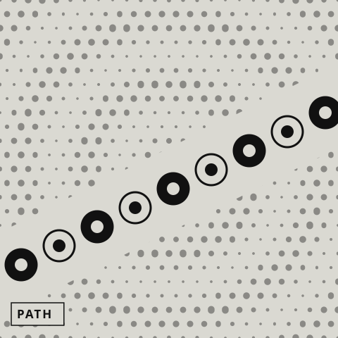
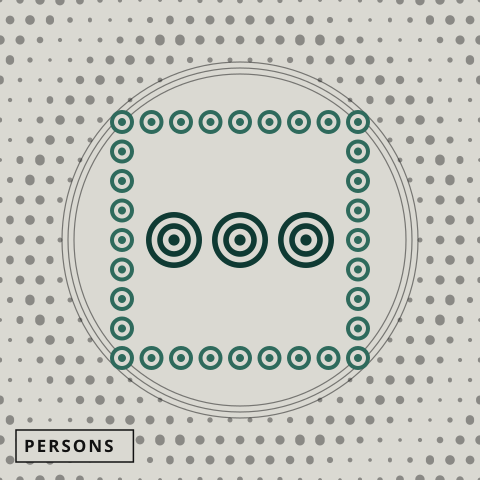
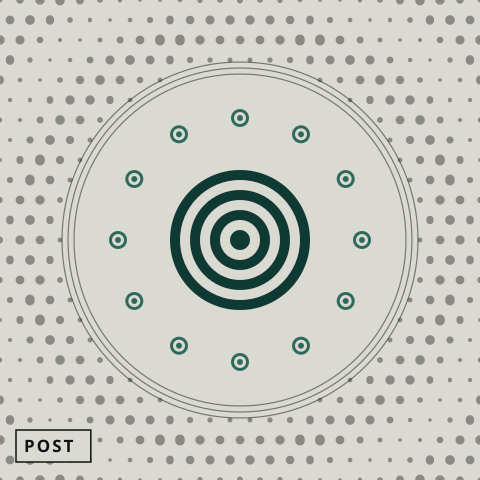
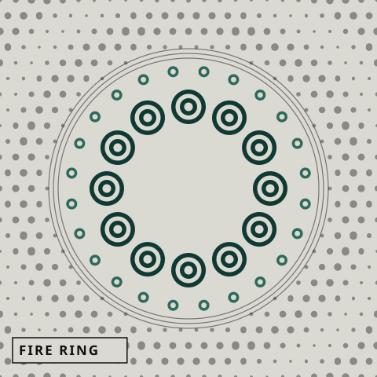
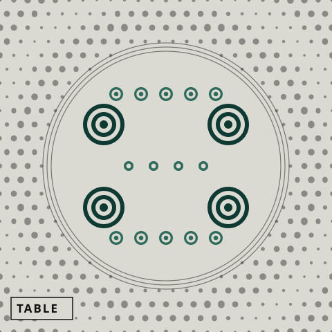
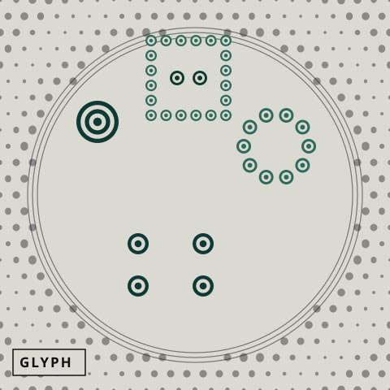
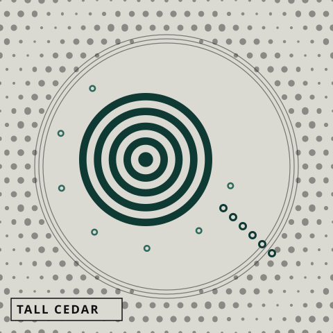
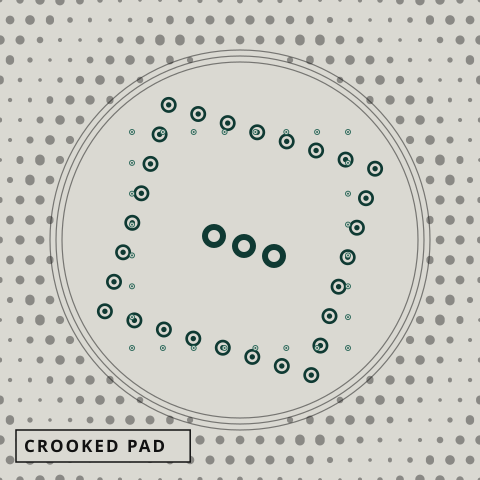
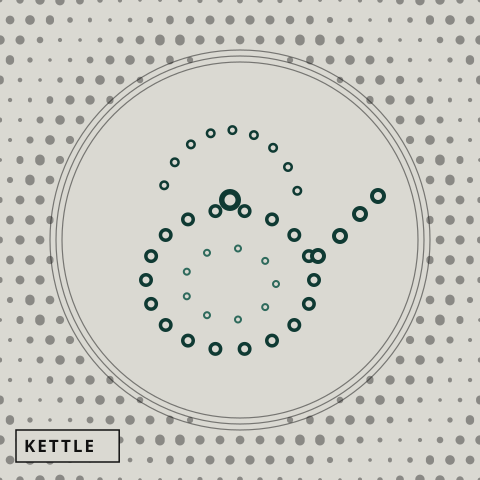
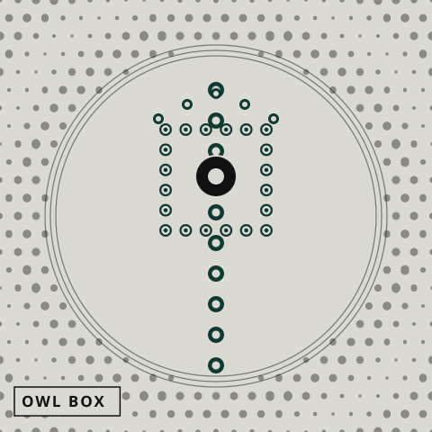
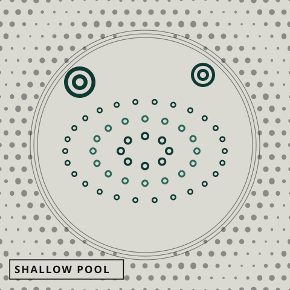
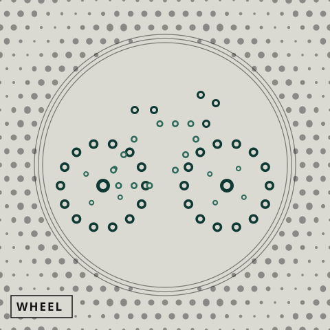

## pieces (69)

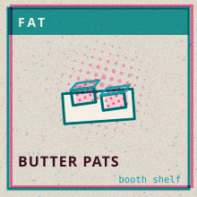
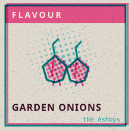
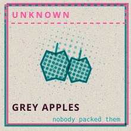
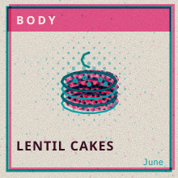
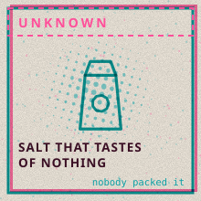
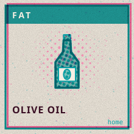
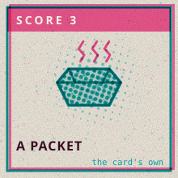
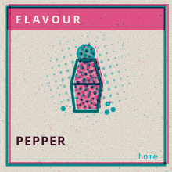
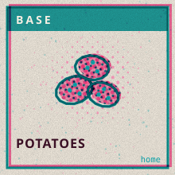
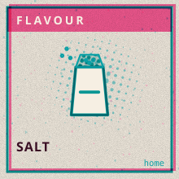
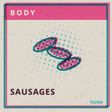
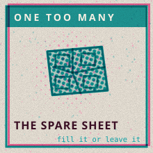
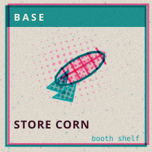

## chapters (9)

## ui (12)

## documents (14)

## maps (11)

## thread (2)

