# People of the Bark: art drawn by code

142 assets, generated by `python tools/art/build.py people-of-the-bark` from `art/src/`. Do not edit the
SVGs by hand; change the code and rebuild.

## title (1)

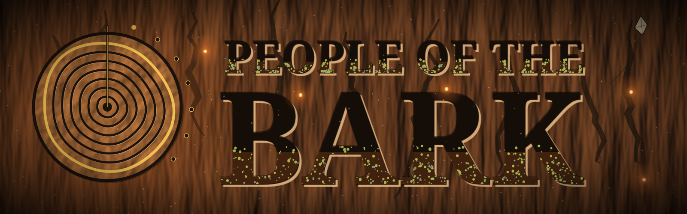

## figures (10)

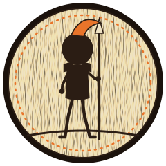
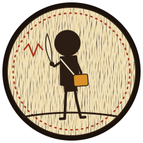
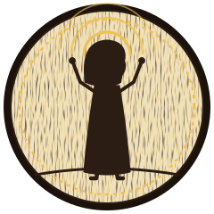
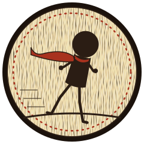
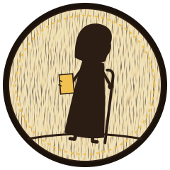
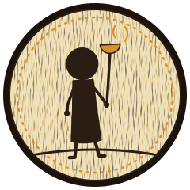
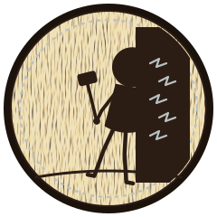
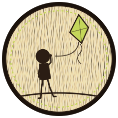
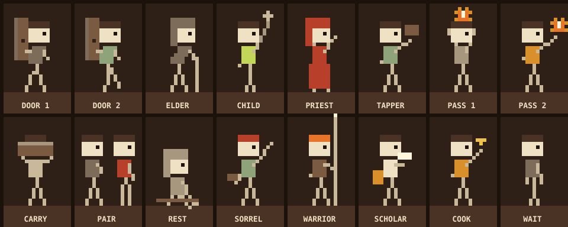
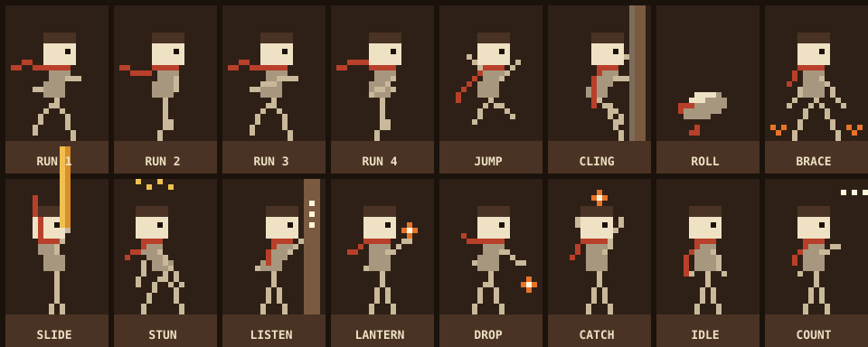

## backdrops (8)

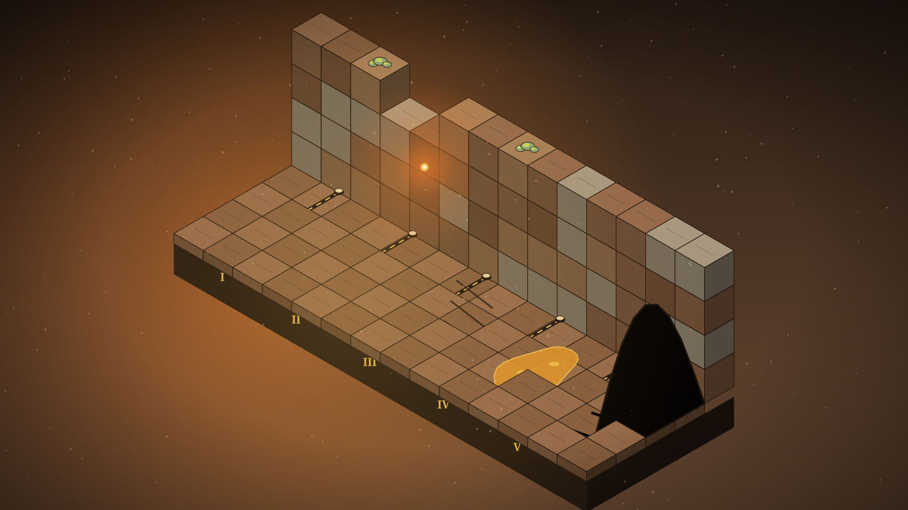
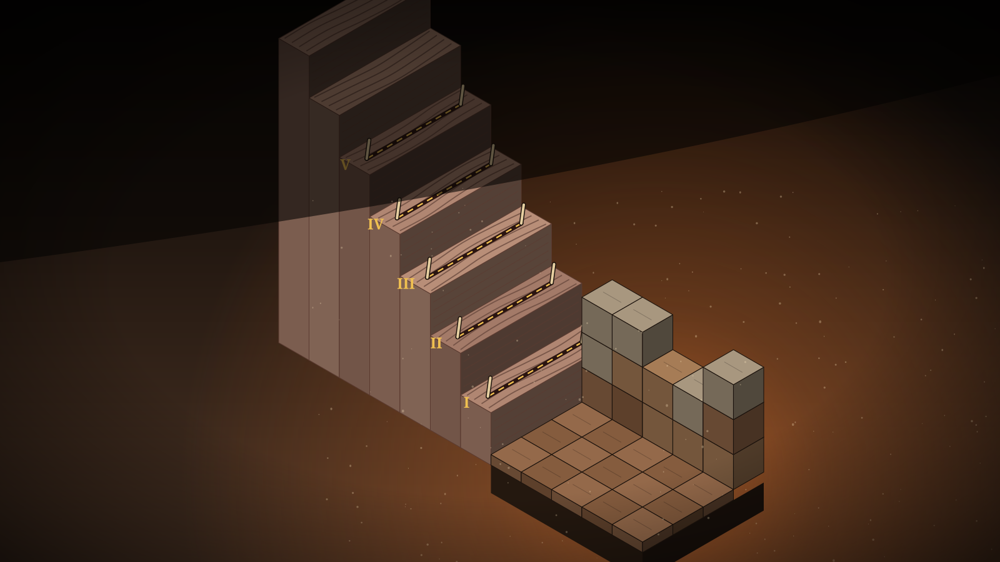
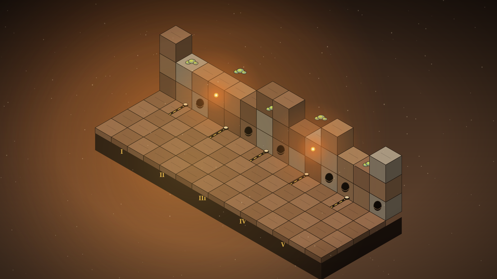
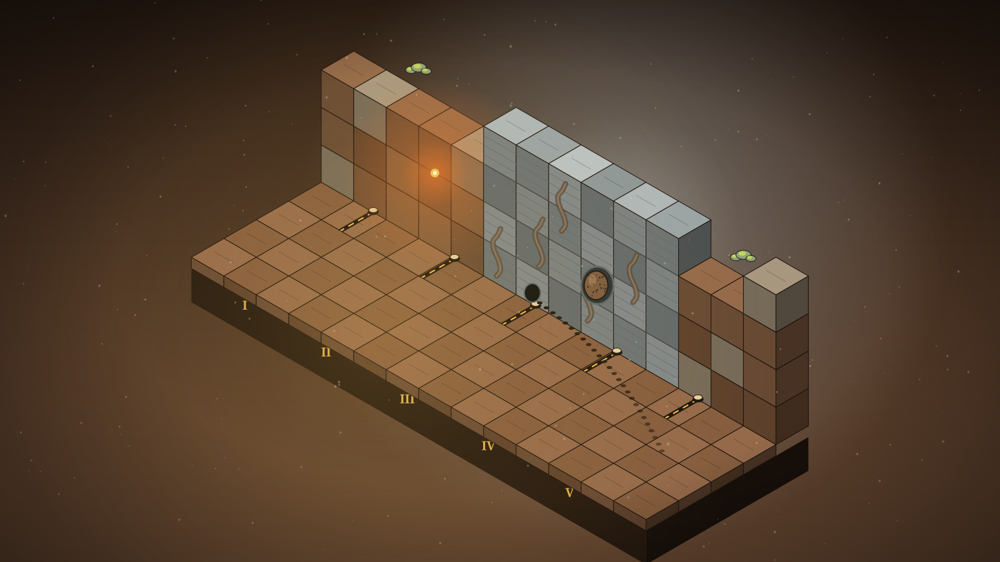
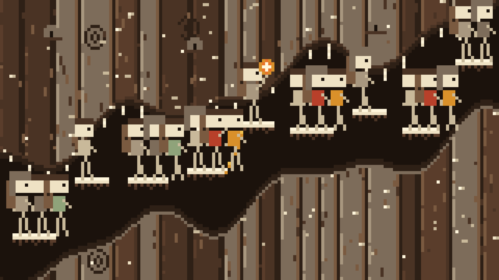
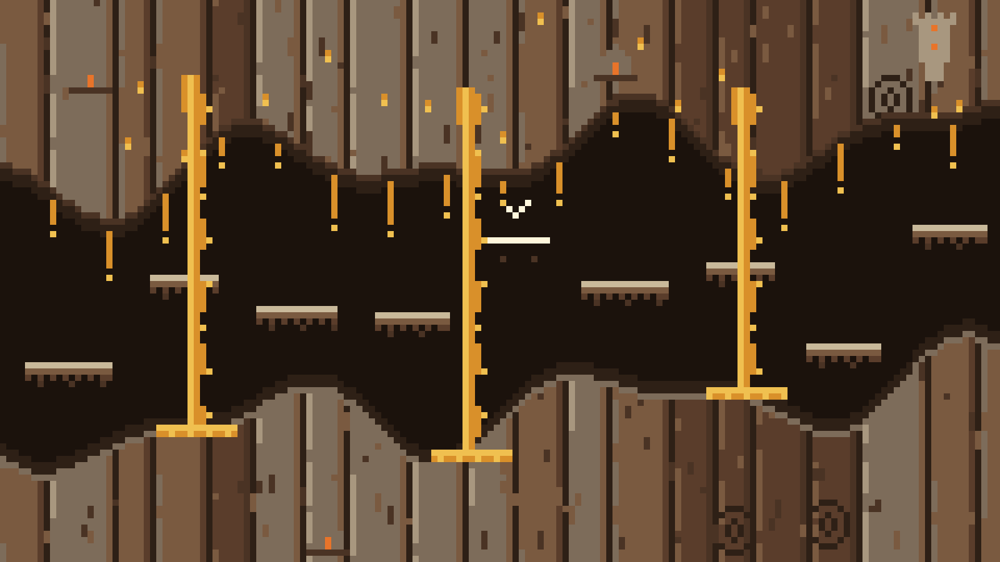
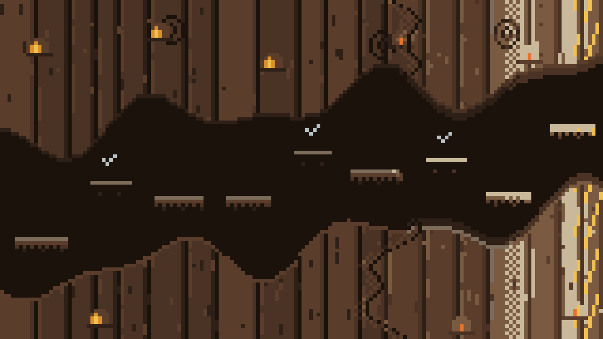
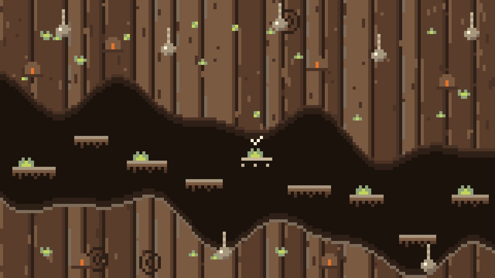

## cards (48)

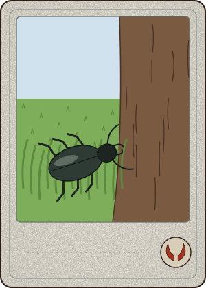
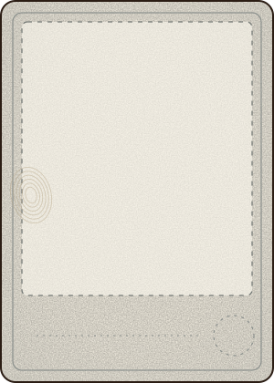
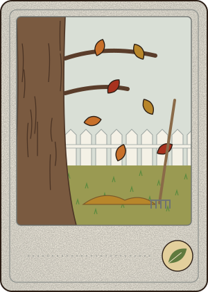
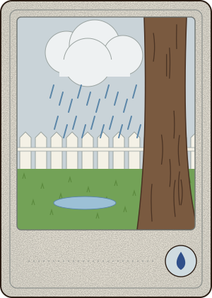
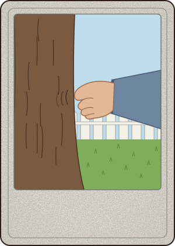
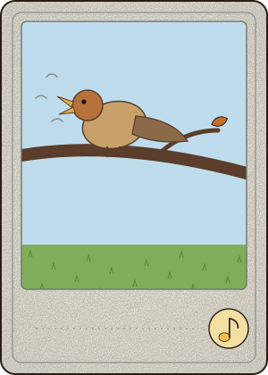
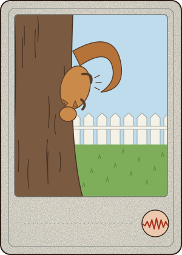
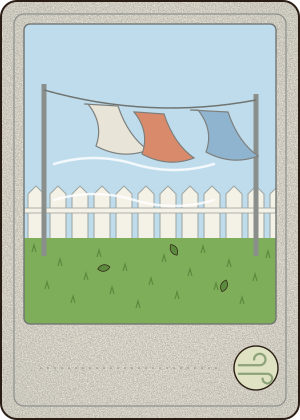
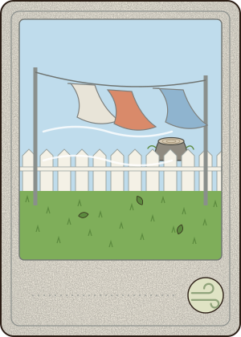
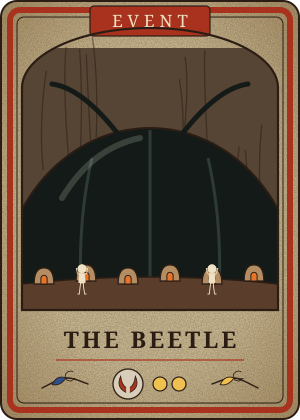
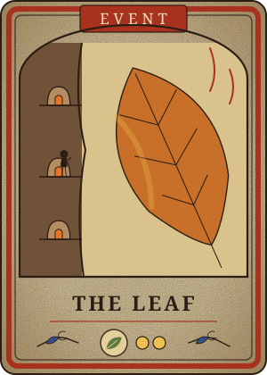
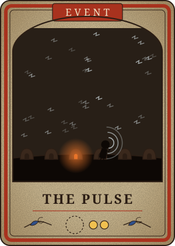
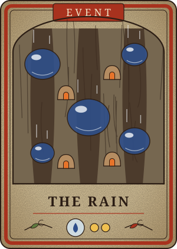
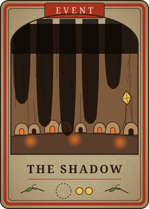
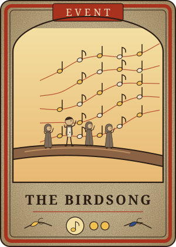
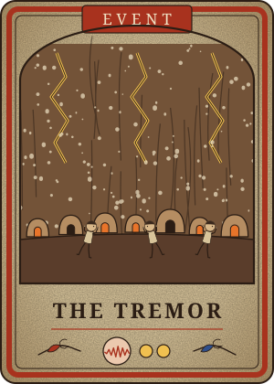
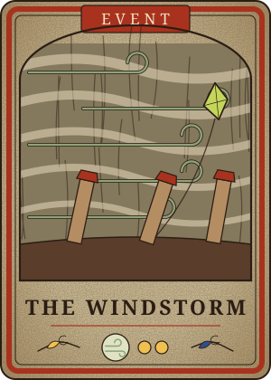
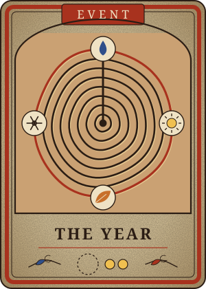
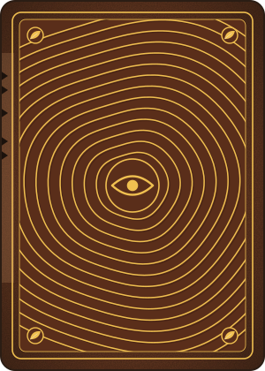
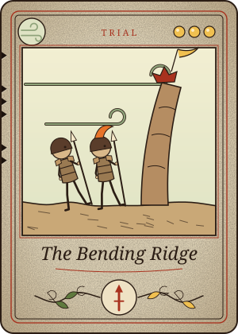
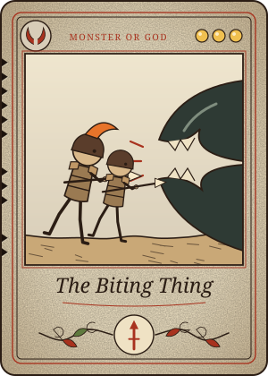
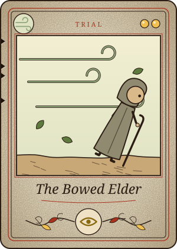
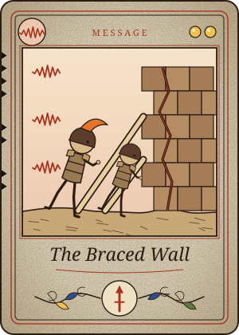
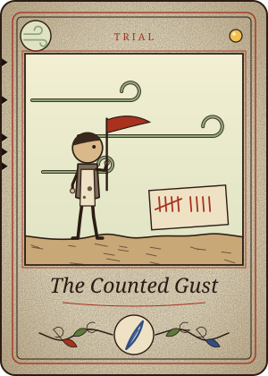
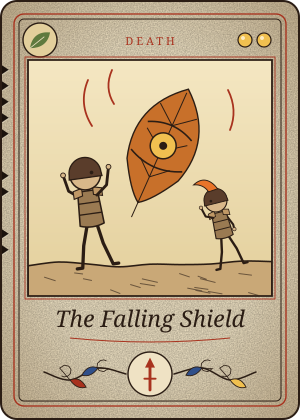
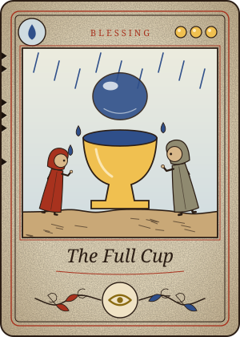
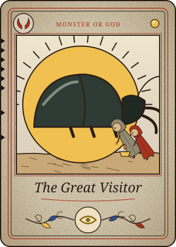
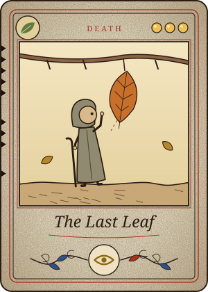
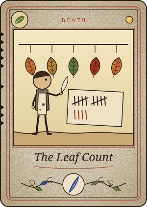
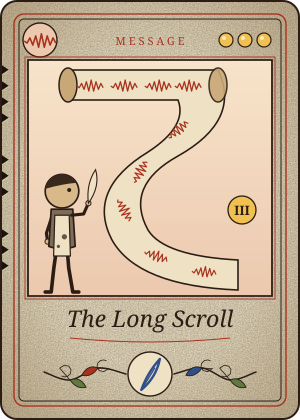
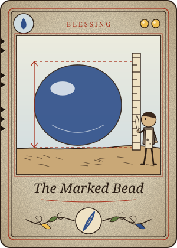

## pieces (24)

## endings (5)

## chapters (7)

## ui (12)

## documents (16)

## maps (9)

## thread (2)

